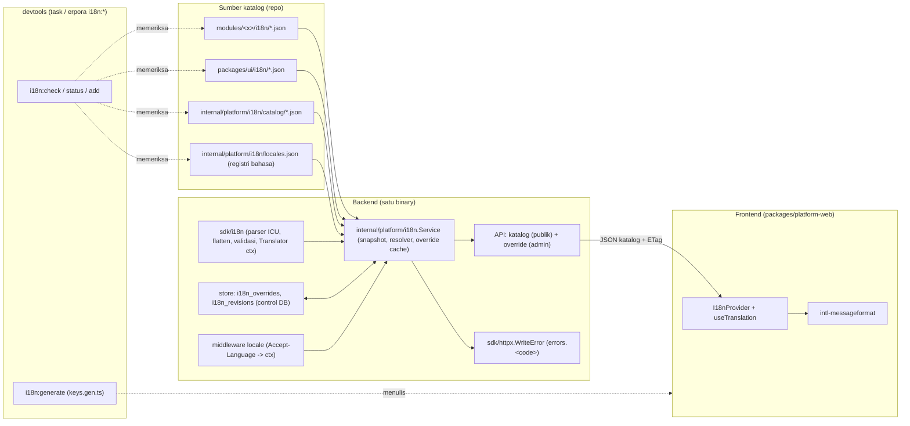
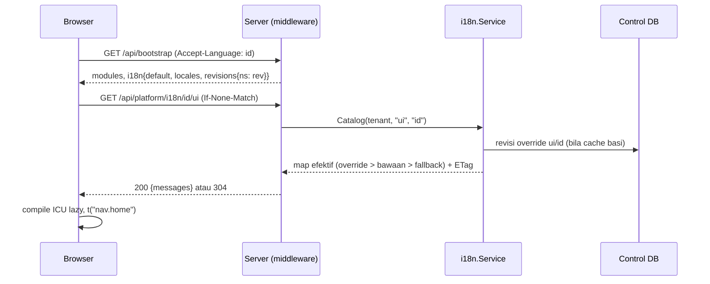

# Design Document: i18n-platform

## Overview

Satu sistem terjemahan untuk backend (Go) dan frontend (React) dengan **satu sumber katalog** yang **terpisah per namespace** (modul, `ui`, `platform`). Pesan memakai **ICU MessageFormat**. Katalog bawaan ditanam di binary (`go:embed`) dan disajikan backend lewat API per namespace dan bahasa; pemilik instalasi dapat **menimpa** teks lewat tabel override. Frontend memuat katalog lewat API (lazy per namespace), memformat dengan runtime ICU, dan mendapat **kunci terketik** dari generator.

Pola utama yang dipakai ulang dari repo (diverifikasi 29 Okt 2026):

| Kebutuhan | Pola yang sudah ada | Dipakai untuk |
| --- | --- | --- |
| Modul membawa aset ter-embed | `module.MigrationSource` / `module.ContractSource` (`sdk/module/module.go`) | antarmuka baru `module.CatalogSource` |
| Berkas generate + `--check` | `modules/<x>/web/api/contract.gen.ts` dari `contracts:generate` | `i18n:generate` menulis `i18n/keys.gen.ts` per paket |
| Snapshot atomik | `runtime.Snapshot` (bootstrap) | snapshot katalog yang ditukar atomik |
| Endpoint publik platform | `/api/bootstrap` (`x-erp-public`, `ETag`) | `GET /api/platform/i18n/{locale}/{namespace}` |
| Endpoint mutasi admin sementara | `admin.API` (`platform.core`, `ERP_ENV`/`ERP_MODULES_ADMIN_API`) | API override |
| Aset ter-embed di paket JS | `web/embed.go`, `contracts/embed.go` | `packages/ui/i18n/embed.go` |
| Generator modul | `internal/devtools/gen` + templat | `make:module` ikut membuat `i18n/` |

**Yang tidak berubah:** amplop API dan kode error (`code` tetap kontrak), aturan D1–D11 (kecuali satu penambahan allowlist D3b, lihat Keputusan D-1), mode single-tenant, dan alur lifecycle modul. Perubahan pada kontrak bersifat **additive** (endpoint baru, bidang bootstrap baru, properti manifest opsional).

**Di luar desain ini:** UI manajemen istilah, preferensi bahasa per pengguna (PRD-001), template email/notifikasi (PRD Notifications), terjemahan data master.

## Architecture



**Alur data (request halaman):**



**Alur galat berlokal:** handler memanggil `httpx.WriteError(..., code, message, ...)`. `WriteError` mencari `errors.<code>` di namespace modul pemilik route (lalu `platform::errors.<code>`) pada locale aktif; bila ada, ia menggantikan `message`, bila tidak, `message` bawaan dipertahankan. Tanda tangan fungsi tidak berubah, jadi semua pemanggil lama tetap valid.

### Tata letak berkas baru

```
sdk/i18n/                          # modul sdk; tanpa impor internal/ (D5/D9)
  catalog.go  flatten.go  icu.go  localizer.go  limits.go  testdata/conformance.json
internal/platform/i18n/
  service.go  resolve.go  negotiate.go  locales.json  locales.go
  catalog/id.json  catalog/en.json  embed.go
  store/                           # GORM (perlu Keputusan D-1)
  admin/                           # handler override
migrations/control/0003_i18n_overrides.sql
packages/ui/i18n/{id,en}.json + embed.go
packages/platform-web/             # runtime frontend (baru; dipakai M3a juga)
  src/i18n/{provider.tsx,loader.ts,format.ts,testing.tsx,index.ts}
modules/<x>/i18n/{id,en}.json      # dan modules/<x>/web/src/i18n/keys.gen.ts
internal/devtools/i18ntools/       # check, status, add, generate
```

## Components and Interfaces

### 1. `sdk/i18n` (Go, tanpa I/O platform)

```go
// Locale adalah kode bahasa terdaftar di registri (mis. "id", "en-GB").
type Locale string

// Args adalah argumen pesan; nilai: string, bilangan (int*/float*), bool.
type Args map[string]any

// Message adalah pesan ICU yang sudah dikompilasi (immutable, aman untuk banyak goroutine).
type Message interface {
	Format(loc Locale, args Args) (string, error) // teks polos; tag rich <b>…</b> dilucuti
	Params() []Param                              // nama + tipe argumen (untuk cek kesesuaian & tipe TS)
}

type Param struct{ Name string; Kind ParamKind } // KindString|KindNumber|KindDate|KindSelect(opts)|KindPlural

// Compile mengurai satu pesan ICU; menolak melebihi batas (Limits) dan sintaks tak valid.
func Compile(src string, lim Limits) (Message, error)

// Tree/Flat: katalog satu namespace+bahasa.
type Flat map[string]string // kunci lengkap bertitik -> sumber pesan

// ParseCatalog membaca satu berkas JSON bersarang dengan pembaca token yang MELAPORKAN kunci ganda,
// lalu meratakannya (Requirement 1.4-1.7). Mengembalikan Flat dan daftar Issue (galat struktural).
func ParseCatalog(r io.Reader, lim Limits) (Flat, []Issue)

// Translator-context: dipasang platform; modul hanya memakai T.
func WithLocale(ctx context.Context, loc Locale) context.Context
func WithScope(ctx context.Context, namespace string) context.Context // diisi platform per route/hook/command
// T menerjemahkan kunci relatif terhadap scope modul pada ctx, atau absolut "ui::a.b" / "platform::a.b".
// Namespace modul lain ditolak (mengembalikan "ns::key" dan mencatat peringatan). Tidak pernah panik.
func T(ctx context.Context, key string, args ...Args) string
```

- **Mesin ICU** disembunyikan di balik antarmuka `Message` dan fungsi `Compile`, supaya bisa diganti tanpa mengubah pemanggil (Keputusan D-2). Aturan plural memakai CLDR dari `golang.org/x/text/feature/plural` (ada di dependensi root `x/text v0.43.0`; `sdk/go.mod` mencantumkan `v0.20.0` sebagai indirect dan perlu dinaikkan).
- **Batas (`Limits`, bawaan):** panjang pesan 2000 karakter, kedalaman bersarang 8, opsi plural/select ≤ 20, argumen ≤ 32, kunci ≤ 5000 per namespace-bahasa, berkas ≤ 1 MB, panjang kunci lengkap ≤ 200.
- **Sintaks yang didukung:** argumen `{n}`, `plural` (kategori CLDR, `=N`, `#`), `select`, tag rich `<b>…</b>` (nama tag `[a-z][a-z0-9]*`), dan kutip ICU (`'{'`). Angka/tanggal diformat di kode, bukan di pesan (Requirement 2.6). `selectordinal` dan `{x, number}` tidak didukung (ditolak parser).
- **Plural/format di Go** memakai `Locale` untuk memilih kategori; tidak ada akses jaringan atau berkas.

### 2. Penyedia katalog di modul (`sdk/module`)

```go
// CatalogSource diimplementasi modul yang membawa katalog terjemahan (satu berkas JSON per bahasa).
type CatalogSource interface {
	// Catalogs mengembalikan filesystem dengan berkas "<locale>.json" di akar (hasil //go:embed i18n/*.json).
	Catalogs() fs.FS
}
```

- Registry memetakan modul → `CatalogSource` seperti `MigrationSource`. Modul tanpa katalog valid (tidak punya namespace).
- **Manifest** (additive, `schema_version` tetap `"1"`): properti opsional

```json
"i18n": { "locales": ["id", "en"], "defaultLocale": "id" }
```

  `module.schema.json` dan `manifest.gen.ts` diperbarui. `module:check` memastikan setiap bahasa di `locales` terdaftar di registri, `defaultLocale` ada di `locales`, dan berkas katalog tiap bahasa ada. Modul dengan `CatalogSource` wajib punya bagian `i18n`.
- **SDK semver:** penambahan antarmuka dan `Registrar` tidak berubah; `SDKVersion` naik minor.

### 3. `internal/platform/i18n.Service`

```go
type Service struct { /* snapshot atomik + cache override per tenant */ }

// Katalog efektif satu namespace+bahasa untuk satu tenant: override > bawaan, dengan rantai fallback.
func (s *Service) Catalog(ctx context.Context, t tenancy.TenantID, ns string, loc i18n.Locale) (View, error)
// Terjemah satu kunci (dipakai i18n.T lewat penghubung di ctx dan WriteError).
func (s *Service) Resolve(ctx context.Context, t tenancy.TenantID, ns, key string, loc i18n.Locale) (src string, from Source)
func (s *Service) Revisions(ctx context.Context, t tenancy.TenantID) map[string]string // namespace aktif -> revisi
func (s *Service) SetOverride(ctx context.Context, t tenancy.TenantID, o Override, actor string) (changed bool, err error)
func (s *Service) DeleteOverride(ctx context.Context, t tenancy.TenantID, ns string, loc i18n.Locale, key, actor string) error
```

- **Pemuatan saat boot** (`internal/app/assemble.go`): kumpulkan katalog `platform`, `ui`, dan tiap modul terkompilasi; parse dengan `sdk/i18n.ParseCatalog`; validasi struktural (sama dengan `i18n:check`) dan **gagalkan startup** bila ada galat (konsisten dengan keputusan "galat struktural menggagalkan build"). Ketidaksesuaian antar bahasa hanya dicatat sebagai warning. Hasilnya `snapshot` immutable.
- **Namespace aktif:** `ui` dan `platform` selalu aktif; namespace modul hanya bila modul `enabled` pada runtime snapshot (`404` untuk selain itu).
- **Rantai fallback** `chain(L)`: `L` → `registry[L].fallback` → … → `default`; berhenti bila bertemu bahasa yang sudah ada (anti-siklus, divalidasi saat boot). Untuk setiap kunci, per bahasa dalam rantai: override dulu, lalu katalog bawaan; hasil pertama menang. Bila tak ada, kembalikan `namespace::kunci`.
- **Override cache:** peta `(tenant, ns, locale) → Flat` dimuat dari DB. Setiap `Catalog`/`Resolve` memeriksa `i18n_revisions` (satu query ringan, atau TTL 5 detik antar-instance) dan memuat ulang bila revisi berubah; pada instance yang sama mutasi memperbarui cache langsung. Konsistensi antar instance bersifat **eventual** (≤ TTL).
- **Pesan terkompilasi** di-cache per `(ns, loc, key, sumber+revisi)`; kompilasi malas.
- **ETag** = `W/"<sha256 hex 16 byte pertama>"` atas isi peta efektif yang diserialisasi kanonik (kunci terurut), sehingga identik bila isi sama dan berbeda bila berubah (bukan sekadar counter).

### 4. Middleware locale (`internal/platform/httpserver`)

Disisipkan setelah `tenantContext`. Langkah: baca `Accept-Language` (maks 1 KB; lebih dari itu diabaikan) → cocokkan terhadap daftar registri memakai `golang.org/x/text/language.Matcher` → `i18n.WithLocale(ctx, loc)`. Nilai tak dikenal jatuh ke `default`. Sebelum PRD-001 tidak ada sumber preferensi pengguna; setelah PRD-001, urutan menjadi `user_preferences.locale` → `Accept-Language` → default (satu titik: `negotiate.go`). `SetModule` yang sudah ada juga memasang `i18n.WithScope(ctx, slug)` sehingga `i18n.T` otomatis terikat ke modul pemilik route. Hook lifecycle dan command memperoleh scope serupa dari platform.

### 5. Integrasi galat (`sdk/httpx.WriteError`)

`WriteError` membaca penerjemah dari `ctx` (disuntik platform lewat antarmuka kecil di `sdk/i18n`, tanpa impor `internal/`). Aturan: `message := lookup("errors."+code)` di scope modul → `platform::errors.<code>` → `message` yang diberikan pemanggil. Hanya `message` yang berubah; `code` dan `details` tidak disentuh. Pesan 5xx tetap tanpa detail internal. Katalog `platform` memuat subpohon `errors` untuk kode katalog api-guidelines §8.

### 6. API (platform.core)

| Endpoint | Akses | Keterangan |
| --- | --- | --- |
| `GET /api/platform/i18n/{locale}/{namespace}` | `x-erp-public` (fase ini) | katalog efektif, `ETag`, `If-None-Match` → 304 |
| `GET /api/platform/i18n/overrides` | `platform.i18n.read` | daftar override tenant, filter `namespace`, `locale`; pagination halaman |
| `PUT /api/platform/i18n/overrides/{namespace}/{locale}/{key}` | `platform.i18n.manage` | simpan (upsert) satu override, body `{ "message": "…" }` |
| `DELETE /api/platform/i18n/overrides/{namespace}/{locale}/{key}` | `platform.i18n.manage` | hapus override (kembali ke bawaan) |

Detail kontrak (ditulis di `contracts/openapi/platform.yaml`, tipe TS dibangkitkan ke `packages/platform-contracts`):

```yaml
/api/platform/i18n/{locale}/{namespace}:
  get:
    operationId: getI18nCatalog
    x-erp-public: true
    parameters:
      - { name: locale,    in: path, required: true, schema: { type: string, maxLength: 16 } }
      - { name: namespace, in: path, required: true, schema: { type: string, maxLength: 50 } }
      - { name: If-None-Match, in: header, schema: { type: string } }
    responses:
      '200': { content: { application/json: { schema: { $ref: '#/components/schemas/I18nCatalogEnvelope' } } } }
      '304': { description: Tidak berubah }
      '404': { description: Bahasa/namespace tidak dikenal atau modul tidak aktif }
# I18nCatalog: { locale, namespace, revision, messages: { "<kunci.lengkap>": "<pesan ICU>" } }
```

- **Bootstrap** ditambah (additive): `i18n: { defaultLocale, locales: [{ code, name }], revisions: { "<ns>": "<rev>" } }`, hanya namespace aktif.
- **Validasi `PUT`** (Requirement 12.3): `locale` terdaftar; `namespace` aktif; `key` ada di katalog bawaan **bahasa default** namespace itu; `message` lolos `Compile` (batas ukuran), tanpa HTML (`<` hanya sebagai tag rich bernama valid, bukan elemen HTML), dan `Params()` sama dengan pesan bawaan. Pelanggaran → `400` kode baru `invalid_i18n_override` dengan `error.details[]` (`code`: `unknown_key`, `invalid_syntax`, `param_mismatch`, `html_not_allowed`, `too_long`). Tidak ada body > 8 KB (`MaxBodyBytes`).
- **Mutasi** hanya aktif bila `ERP_ENV=development` atau `ERP_MODULES_ADMIN_API=true` (flag yang sama dengan API modul; Keputusan D-5); selain itu `404` sebelum permission. Mutasi `Content-Type: application/json` wajib (`415`). `If-Match` opsional dengan semantik RFC 9110 (perbandingan kuat) terhadap ETag kuat baris `"<hash isi pesan>"` (G19); `412 version_mismatch` membawa record terbaru di `details`; tanpa `If-Match` berlaku last-write-wins.
- `PUT` pada nilai yang sama tidak menaikkan revisi dan membalas `200` (idempoten); mengubah nilai menaikkan revisi namespace+bahasa dalam **satu transaksi** yang sama dengan upsert.
- **Cache:** `Cache-Control: private, no-cache` (selalu revalidasi via ETag) pada katalog; tidak ada `Vary` karena bahasa ada di path.

### 7. CLI

| Perintah | Lokasi | Keterangan |
| --- | --- | --- |
| `erpora i18n:check [--strict] [--json]` | devtools (`task erpora -- …`) | pemeriksa Requirement 8 |
| `erpora i18n:status` | devtools | kelengkapan per bahasa per namespace |
| `erpora i18n:add <locale> [module…]` | devtools | kerangka katalog bahasa baru (kunci dari bahasa default, nilai kosong ditandai `TODO`), menambah ke registri bila belum ada |
| `erpora i18n:generate [--check]` | devtools | menulis `keys.gen.ts`; `--check` gagal bila usang |
| `erpora i18n override set\|list\|rm …` | **produksi** (`cmd/erpora`, di samping `modules`) | antarmuka utama override, memakai `Service` langsung; `rm` meminta konfirmasi (`--yes`) |

Perintah devtools memakai penamaan bertitik dua seperti `make:module` dan `contracts:generate`; perintah produksi memakai subperintah seperti `erpora modules` (Keputusan D-7; kata `i18n:override` di Requirement 12.5 diselaraskan). Exit code: 0 sukses; 2 galat validasi; 3 prasyarat/konfigurasi gagal; 4 operasi gagal.

### 8. Pemeriksa dan generator (`internal/devtools/i18ntools`)

- Memuat katalog dari **filesystem** (bukan embed), registri, dan manifest; memakai `sdk/i18n.ParseCatalog` yang sama dengan runtime sehingga tidak ada dua definisi "valid".
- **Galat (gagalkan):** JSON/ICU tidak valid; kunci ganda; tabrakan perataan; karakter segmen terlarang; kunci bernamespace pemilik lain; pesan berisi HTML; registri/fallback tidak valid; modul mendeklarasikan bahasa tak terdaftar.
- **Peringatan:** kunci hilang/berlebih antar bahasa dan parameter tak cocok (mengacu bahasa default); bahasa `partial` tidak melaporkan kunci hilang. `--strict` mengubah peringatan menjadi galat.
- **Generator `keys.gen.ts`** per paket: dari katalog bahasa default tiap namespace, menulis antarmuka kunci → tipe argumen (`string | number` untuk argumen sederhana, `number` untuk `plural`, gabungan literal untuk `select`, `RichTags<"b"|"a">` untuk tag rich), dan **augmentasi modul**:

```ts
// modules/example/web/src/i18n/keys.gen.ts  (GENERATED; jangan diedit)
declare module "@erpora/platform-web" {
  interface I18nCatalogs {
    example: {
      "note.title": {};
      "note.count": { count: number };
      "note.status": { state: "draft" | "approved" | "other" };
    };
  }
}
```

### 9. Runtime frontend (`@erpora/platform-web`, `src/i18n`)

```ts
export interface I18nCatalogs {}                       // diperluas oleh keys.gen.ts tiap paket
export function I18nProvider(props: { children: ReactNode }): JSX.Element
export function useTranslation<N extends keyof I18nCatalogs>(ns: N): {
  t: <K extends keyof I18nCatalogs[N]>(key: K, ...args: ArgsOf<I18nCatalogs[N][K]>) => string
  rich: <K extends keyof I18nCatalogs[N]>(key: K, args: RichArgs<I18nCatalogs[N][K]>) => ReactNode
  locale: string
  setLocale: (loc: string) => void
}
```

- **Pemuatan:** `useSuspenseQuery` dengan key `[tenantId, "i18n", locale, ns]`, `staleTime: Infinity`, dan `refetch` bila `bootstrap.i18n.revisions[ns]` berubah. Karena memakai Suspense, kunci mentah tidak pernah ditampilkan (Requirement 6.3); shell membungkus dengan batas Suspense berisi kerangka. Permintaan membawa `If-None-Match` dari respons sebelumnya (ETag).
- **Header bahasa:** klien API (`packages/platform-contracts`) menerima fungsi `getLocale()` yang menambahkan `Accept-Language` pada setiap request, supaya `error.message` dan katalog sesuai bahasa pilihan.
- **Format:** `intl-messageformat` (FormatJS, tersedia di npm; versi terbaru terverifikasi 29 Okt 2026) dengan cache pesan terkompilasi per `(locale, pesan)`; tag rich dirender sebagai elemen React lewat `rich`. Angka/tanggal diformat di kode dengan `Intl` dan diteruskan sebagai teks. **Syarat (Keputusan D-3):** ukuran gzip tambahan diukur dalam spike dan harus muat di anggaran NFR-04 (entry shell ≤ 200 KB gzip); pustaka dimuat dalam chunk i18n, bukan chunk awal bila perlu. Cadangan: `@formatjs/icu-messageformat-parser` + formatter tipis.
- **Bahasa pilihan:** `localStorage["erpora.locale"]` dengan `try/catch`; nilai divalidasi terhadap `bootstrap.i18n.locales`; `document.documentElement.lang` diperbarui; bila tidak ada, ikut `navigator.languages` yang cocok, lalu `defaultLocale`.
- **Pengujian:** `createTestI18n({ example: { "note.title": "Judul" } })` menyediakan provider tanpa jaringan; `bun test` memakainya.
- **`@erpora/ui`** tidak mengimpor `platform-web`; komponen menerima label lewat props atau konteks tipis `UiLabels` yang diisi `platform-web` dari namespace `ui` (menjaga F1–F3: `ui` generik).

### 10. Penegakan arsitektur dan pembuatan modul

- **archcheck (aturan baru `I1`):** berkas di `modules/<x>/**` tidak boleh mengimpor `internal/platform/i18n` dan tidak boleh memuat literal `"<ns>::…"` bernamespace modul lain (pemeriksaan AST untuk argumen `i18n.T`); modul hanya mengimpor `sdk/i18n`. Penegakan runtime: `T` menolak namespace modul lain.
- **`make:module`:** menambahkan `i18n/id.json` + `en.json` (kunci contoh bersarang), `//go:embed i18n/*.json` + `Catalogs()`, bagian `i18n` di `module.json`, dan `web/src/i18n/keys.gen.ts`; `module:check` dan `test:generator` mencakupnya.
- **Modul referensi:** `example` dan `exampleaddon` mendapat katalog `id`/`en`; satu pesan galat API `example` diterjemahkan lewat `errors.<code>`.
- **Task:** `task i18n:check` dan `task i18n:generate` dibuat (tanpa utilitas Unix); `i18n:check` dipanggil dari `task lint` (galat struktural gagal, peringatan hanya dicetak), dan `i18n:generate --check` dari `task web:check`.

## Data Models

### Katalog (berkas JSON bersarang)

```json
{
  "note": {
    "title": "Catatan",
    "count": "{count, plural, =0 {Belum ada catatan} other {# catatan}}",
    "status.draft": "Draf"
  },
  "fields": { "note": { "title": "Judul" } },
  "errors": { "not_found": "Catatan tidak ditemukan" }
}
```

Perataan: jalur digabung dengan `.` menjadi `note.title`, `note.count`, `note.status.draft`, `fields.note.title`, `errors.not_found`. Dua jalur yang menghasilkan kunci sama → galat. Konvensi: `fields.<resource>.<field>` (label dan nama field validasi), `errors.<code>`, `status.<kode>`, `nav.<area>.<item>`.

### Registri bahasa `locales.json`

```json
{
  "default": "id",
  "locales": [
    { "code": "id", "name": "Bahasa Indonesia" },
    { "code": "en", "name": "English", "fallback": "id" },
    { "code": "en-GB", "name": "English (UK)", "fallback": "en" },
    { "code": "ms", "name": "Bahasa Melayu", "fallback": "id", "partial": true }
  ]
}
```

Aturan: `code` unik (BCP 47 sederhana `^[a-z]{2,3}(-[A-Z]{2})?$`); `fallback` menunjuk kode terdaftar; tanpa siklus; kedalaman rantai ≤ 4; `default` tidak punya `fallback`.

### Skema DB (`migrations/control/0003_i18n_overrides.sql`)

```sql
-- +goose Up
-- Override terjemahan per tenant (PRD-000 Q34). Kolom tenant_id NOT NULL (FR-21).
CREATE TABLE i18n_overrides (
    tenant_id  uuid        NOT NULL,
    namespace  text        NOT NULL CHECK (namespace ~ '^[a-z][a-z0-9]*(-[a-z0-9]+)*$' AND char_length(namespace) <= 50),
    locale     text        NOT NULL CHECK (locale ~ '^[a-z]{2,3}(-[A-Z]{2})?$'),
    key        text        NOT NULL CHECK (key ~ '^[A-Za-z0-9_.-]+$' AND char_length(key) <= 200),
    message    text        NOT NULL CHECK (char_length(message) BETWEEN 1 AND 2000),
    updated_by text        NOT NULL,
    updated_at timestamptz NOT NULL DEFAULT now(),
    PRIMARY KEY (tenant_id, namespace, locale, key)
);

-- Revisi per (tenant, namespace, locale): naik pada setiap perubahan override; basis ETag dan invalidasi cache.
CREATE TABLE i18n_revisions (
    tenant_id  uuid        NOT NULL,
    namespace  text        NOT NULL,
    locale     text        NOT NULL,
    revision   bigint      NOT NULL DEFAULT 0 CHECK (revision >= 0),
    updated_at timestamptz NOT NULL DEFAULT now(),
    PRIMARY KEY (tenant_id, namespace, locale)
);
```

Additive dan idempoten (tabel baru; tidak mengubah tabel yang ada). Skema hanya lewat goose; tidak ada `AutoMigrate`.

### Resource, permission, field group, klasifikasi, scope

| Hal | Nilai |
| --- | --- |
| Resource/aksi | `platform.i18n.read`, `platform.i18n.manage` (capability baru `platform.core`; ditambahkan ke `admin.Capabilities`) |
| Katalog | `x-erp-public`, klasifikasi `public` (hanya teks terjemahan) |
| Override (daftar) | klasifikasi `internal`; tanpa properti `confidential`/`highly_confidential` |
| Scope data | selalu per tenant dari context (`tenancy.FromContext`); tidak ada `tenantId`/`userId` di parameter atau body |
| Resource transaksional | **Bukan** (konfigurasi, bukan dokumen transaksi): checklist `transaction-data-standards §15` tidak berlaku |

## Correctness Properties

Properti yang harus selalu benar (diuji dengan test berbasis properti/fuzz bila fungsinya murni):

1. **P1 Perataan deterministik.** Untuk pohon tanpa tabrakan, `Flatten(t)` memuat tepat satu entri per daun, dan `Lookup(Flatten(t), k)` mengembalikan daun pada jalur `k`. Dua jalur dengan kunci lengkap sama selalu dilaporkan sebagai galat (tidak pernah salah satunya hilang diam-diam).
2. **P2 Rantai fallback berhingga dan deterministik.** Untuk registri valid dan semua `L`, `chain(L)` berhingga, tanpa duplikat, diawali `L`, dan diakhiri `default`.
3. **P3 Pencarian total.** `Resolve` selalu mengembalikan string (tidak pernah panik); bila tidak ada di rantai, hasilnya tepat `namespace::kunci`.
4. **P4 Format total dan terbatas.** Untuk pesan dan argumen apa pun yang lolos `Compile`, `Format` tidak panik, selesai dalam waktu terbatas, dan panjang keluaran ≤ batas turunan (`len(src) * faktor` ditetapkan di `limits.go`); input yang melebihi batas ditolak oleh `Compile`, bukan di `Format`.
5. **P5 Paritas Go↔TypeScript.** Untuk setiap kasus pada `sdk/i18n/testdata/conformance.json`, keluaran Go sama dengan keluaran TypeScript.
6. **P6 Isolasi tenant.** Override tenant A tidak pernah muncul pada `Catalog`/`Resolve` tenant B, dan `ETag` tenant A tidak bergantung pada data tenant B.
7. **P7 ETag mengikuti isi.** `ETag` sama bila peta efektif sama dan berbeda bila ada kunci atau nilai yang berbeda.
8. **P8 Idempotensi override.** `SetOverride` dua kali dengan nilai sama meninggalkan keadaan sama dengan sekali dan tidak menaikkan revisi untuk panggilan kedua; `DeleteOverride` pada kunci yang tidak ada tidak menaikkan revisi.
9. **P9 Negosiasi tertutup.** Untuk string `Accept-Language` apa pun (termasuk rusak atau sangat panjang), hasil negosiasi selalu anggota registri (default bila tidak ada kecocokan).
10. **P10 Validasi override melestarikan kontrak argumen.** Override yang diterima selalu punya `Params()` sama dengan pesan bawaan bahasa default pada kunci itu.
11. **P11 Pemeriksa sehat.** Bila `i18n:check` tidak melaporkan peringatan paritas untuk bahasa lengkap, maka untuk setiap kunci bahasa default kunci itu ada pada bahasa tersebut dengan `Params()` sama.
12. **P12 Namespace tertutup.** `T(ctx, key)` dengan scope modul `m` tidak pernah mengembalikan pesan dari namespace modul lain.

## Error Handling

| Skenario | Perilaku |
| --- | --- |
| Berkas katalog JSON rusak / ICU tidak valid / kunci ganda / tabrakan perataan / karakter terlarang / registri tidak valid | `i18n:check` dan build gagal; saat boot `Service` menolak start dengan pesan yang menyebut berkas dan kunci |
| Kunci hilang/berlebih atau parameter tak cocok antar bahasa | Peringatan (build tetap lolos); `--strict` mengubahnya menjadi galat |
| Kunci tidak ditemukan di rantai fallback | Mengembalikan `namespace::kunci`; peringatan sekali per (bahasa, ns, kunci) di dev/test, hanya metrik di produksi |
| `Accept-Language` rusak atau > 1 KB | Diabaikan; memakai default |
| `GET /api/platform/i18n/...` bahasa/namespace tak dikenal atau modul nonaktif | `404 not_found` (tidak membedakan penyebab) |
| `PUT` override: kunci tak ada, ICU tidak valid, parameter berbeda, HTML, terlalu panjang | `400 invalid_i18n_override` + `details[].code` |
| Mutasi saat API admin mati | `404 not_found` sebelum permission |
| Media type bukan JSON | `415 unsupported_media_type` |
| `If-Match` tidak cocok | `412 version_mismatch` (dengan record terbaru di `details`, api-guidelines §5) |
| DB override tak terjangkau | Katalog bawaan tetap disajikan (override dilewati), peringatan di log dan metrik; mutasi gagal `503 not_ready`; `/readyz` tidak terpengaruh |
| Pesan memerlukan argumen yang tak diberikan | Teks dengan placeholder tak terisi apa adanya; peringatan di dev/test; tidak pernah panik |
| Panic di formatter | Ditangkap di `T`; mengembalikan kunci; dicatat dengan tipe panic saja (tanpa nilai) |

## Keamanan

**STRIDE (permukaan baru: API katalog, API override, parser ICU, pemuatan katalog):**

| Ancaman | Risiko | Mitigasi |
| --- | --- | --- |
| **S**poofing | Memakai endpoint mutasi tanpa hak | Gerbang `ERP_ENV`/flag admin + permission `platform.i18n.manage`; actor tercatat `api:dev` sampai PRD-001 |
| **T**ampering | Override berisi HTML/skrip yang dirender sebagai markup; mengubah argumen sehingga merusak tampilan | Tanpa HTML (hanya tag rich bernama valid yang dirender komponen React, bukan `innerHTML`); `Params()` harus sama; lint `dangerouslySetInnerHTML` (M3g) |
| **R**epudiation | Perubahan istilah tanpa jejak | Log terstruktur `i18n_override_changed` (tenant, ns, locale, key, actor, trace_id) sampai audit writer PRD-001 |
| **I**nformation disclosure | Katalog/override terbaca tanpa login; salah simpan data sensitif di override | Katalog hanya teks terjemahan; endpoint publik hanya fase ini (Keputusan D-4); dokumentasi melarang data pribadi/rahasia di pesan; PRD-001 mengetatkan namespace modul ke pengguna terautentikasi |
| **D**enial of service | Pesan berbahaya (kedalaman, ukuran), katalog raksasa, banjir request | `Limits` (panjang, kedalaman, kunci, ukuran berkas), body ≤ 8 KB, ETag/304, katalog dihitung dari snapshot tanpa I/O per request kecuali satu query revisi |
| **E**levation of privilege | Modul membaca/menimpa namespace modul lain | `T` terikat scope; arch rule `I1`; override hanya untuk namespace aktif milik instalasi lewat endpoint platform |

- **Titik masuk ID/IDOR:** `{locale}`, `{namespace}`, `{key}` adalah pengenal tertutup: `locale` dan `namespace` divalidasi terhadap registri/daftar modul aktif; `key` terhadap pola dan katalog bawaan. Tenant selalu dari context, tidak pernah dari parameter; semua query override memfilter `tenant_id`. Wajib ada test IDOR tingkat store (tenant A vs B) untuk `GET`/`PUT`/`DELETE`, dan test bahwa parameter `tenantId` di body ditolak.
- **Koneksi keluar/SSRF:** tidak ada.
- **File:** tidak ada unggahan; katalog dibaca dari embed, bukan dari path yang dikendalikan pengguna (tidak ada path traversal karena nama berkas berasal dari registri tertutup).
- **Data offline:** katalog di-cache Service Worker (M3g) per URL ber-ETag; tidak ada data sensitif; revisi berubah memicu muat ulang.
- **Konten pesan:** teks terjemahan dirender sebagai teks oleh React (di-escape). Backend mencetak ke email/ekspor memakai `Format` teks polos (tag dilucuti); `sdk/export` tetap menerapkan proteksi formula injection pada hasil.

## Testing Strategy

**Unit (example-based)**
- `sdk/i18n`: `Compile` (sintaks sah/tidak sah, batas), `Format` (plural `id`/`en`, `select`, kutip, argumen hilang, rich), `ParseCatalog` (duplikat, tabrakan, karakter terlarang, ukuran), `T` (scope, absolut, namespace terlarang).
- `Service`: resolusi rantai fallback, override > bawaan, revisi dan ETag, namespace nonaktif → 404, override cache refresh.
- Negosiasi `Accept-Language`, integrasi `WriteError` (galat `errors.<code>` terlokalisasi, `code` tetap).
- `i18ntools`: semua galat dan peringatan, `--strict`, `partial`, `--json`, exit code, `add`, `generate --check`.
- Frontend (`bun test`): `useTranslation`, Suspense, ganti bahasa, `rich`, validasi bahasa pilihan, kegagalan `localStorage`, `createTestI18n`.

**Property-based / fuzz** (P1–P4, P7–P9, P12): Go `testing/quick` dan `go test -fuzz` bawaan untuk parser/formatter/negosiasi; TypeScript `fast-check` bila disetujui sebagai dev dependency baru (Keputusan D-9), selain itu pembangkit acak berbenih.

**Konformansi Go↔TS (P5):** `sdk/i18n/testdata/conformance.json` (sumber di modul `sdk`); dibaca test Go dan `bun test` di `platform-web` lewat path relatif repo.

**Integrasi (butuh PostgreSQL, via tunnel VPS sesuai aturan proyek)**
- Migrasi `0003` naik dan idempoten; `i18n_overrides`/`i18n_revisions` terisolasi per tenant (P6, IDOR store).
- Alur penuh: `PUT` override → revisi naik → `GET` katalog berubah (ETag baru, 304 untuk ETag lama) → `DELETE` → kembali ke bawaan.
- Mutasi mati di `ERP_ENV=production`; `415`, `412`; bootstrap memuat `i18n` hanya untuk namespace aktif; disable modul → katalognya `404`.
- Modul referensi `example`: `Accept-Language: en` menghasilkan `error.message` Inggris, `code` tidak berubah.

**Arsitektur/kontrak:** archcheck `I1`; `contracts:check` (route, permission, klasifikasi cocok dengan kontrak); `module:check` untuk bagian `i18n`; `test:generator` memastikan modul hasil `make:module` lolos `i18n:check`.

## Keputusan desain (D-1 sampai D-9 disetujui pemilik produk, 29 Okt 2026; dicatat di PRD-000 Q35)

Butir berikut menyimpang dari atau menambah aturan yang ada; seluruhnya **disetujui sesuai usulan** dan dicatat di PRD-000 Q35:

| # | Keputusan | Usulan | Pro | Kontra |
| - | --------- | ------ | --- | ------ |
| D-1 | Menambah `internal/platform/i18n/store` ke allowlist GORM aturan D3b (PRD-000 §4.2, `internal/archcheck`) | Setuju | Konsisten dengan `modules/store`; akses GORM tetap terkurung di satu paket | Mengubah aturan arsitektur yang ditegakkan otomatis |
| D-2 | Mesin ICU Go: antarmuka `Compile`/`Message` di `sdk/i18n` dengan implementasi **ditentukan lewat spike** (T0): (a) `kaptinlin/messageformat-go/mf1` (MIT, aktif, rilis `mf1/v0.8.1` 23 Jun 2026, 6 bintang, pra-1.0), atau (b) parser subset sendiri + `golang.org/x/text/feature/plural`. **Bukan** `kaptinlin/go-i18n` (membawa katalog/fallback/dependensi sendiri yang bertabrakan dengan desain ini) | **Hasil spike I0 (29 Okt 2026): dipilih (b)** parser subset sendiri + `golang.org/x/text/feature/plural` di balik antarmuka `Compile`/`Message`. mf1 ditolak: plural desimal salah pada v0.8.1, tag rich tidak didukung, batas tidak ditegakkan, sintaks salah diterima diam-diam, API berubah antar patch. Oracle paritas = `intl-messageformat` (FormatJS) | (a) cepat, ICU nyata; (b) tanpa dependensi kecil/pra-1.0, kendali penuh | (a) risiko pemeliharaan; (b) kita memelihara parser |
| D-3 | Mesin ICU frontend: `intl-messageformat` (FormatJS), dengan syarat ukuran muat di anggaran NFR-04 (diukur di spike) | Setuju bersyarat | Standar, matang, plural CLDR via `Intl.PluralRules` | Menambah ukuran bundle; cadangan: parser + formatter tipis |
| D-4 | Katalog publik (tanpa login) di fase ini; PRD-001 mengetatkan namespace modul ke pengguna terautentikasi | Setuju | Halaman login butuh `ui`/`platform`; belum ada autentikasi | Override tampil tanpa login sampai PRD-001 |
| D-5 | API override memakai flag yang sama dengan API modul (`ERP_MODULES_ADMIN_API`) | Setuju | Tanpa konfigurasi baru; pola sama | Nama flag menyebut "MODULES" padahal mencakup i18n; ganti nama nanti saat PRD-001 |
| D-6 | `sdk/httpx.WriteError` melokalkan `message` otomatis lewat `errors.<code>` | Setuju | Semua galat terlokalisasi tanpa mengubah pemanggil | Perilaku tersirat; terdokumentasi dan teruji |
| D-7 | Penamaan CLI: devtools `i18n:check|status|add|generate`, produksi `erpora i18n override set|list|rm` (Requirement 12.5 diselaraskan) | Setuju | Mengikuti konvensi devtools dan `erpora modules` | Dua gaya penamaan, sudah menjadi konvensi repo |
| D-8 | Properti manifest `i18n` opsional dan additive (`schema_version` tetap `"1"`) | Setuju | Modul lama tetap valid | Manifest tanpa `i18n` berarti modul tak bernamespace |
| D-9 | Dependensi uji baru: `fast-check` (TypeScript); Go memakai `testing/quick` dan fuzzing bawaan | Setuju | PBT TS setara Go | Dev dependency baru |

## Risiko

- **Pustaka ICU untuk Go** kecil dan pra-1.0 (D-2); mitigasi: antarmuka tipis, fixture konformansi, dan rencana cadangan parser sendiri.
- **Ukuran bundle frontend** (D-3) terhadap NFR-04.
- **Konsistensi override antar-instance** bersifat eventual (≤ TTL); dapat diterima karena mode saat ini satu instance, dicatat untuk PRD scaling.
- **Katalog publik** (D-4) menampilkan istilah override tanpa login; dibatasi aturan "tanpa data sensitif" dan diketatkan di PRD-001.
- **Ketergantungan M3a**: runtime frontend dan paket `@erpora/platform-web` harus ada sebelum M3a mulai; M3a memakai paket yang sama untuk layanan platform lain.
