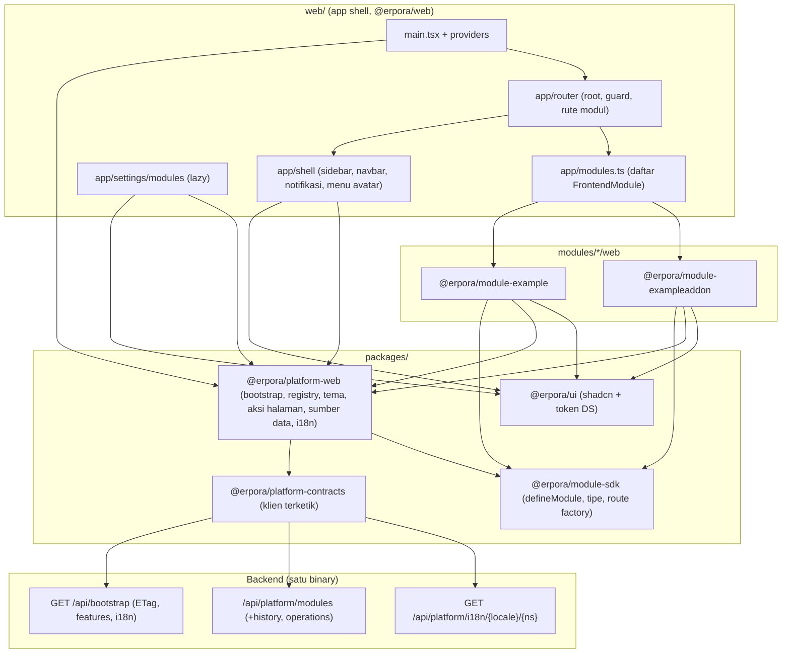
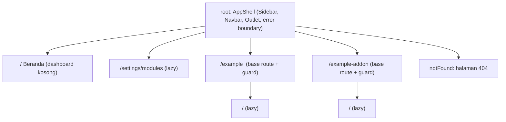

# Design Document: M3a Fondasi Frontend dan Shell

## Overview

M3a membangun fondasi frontend yang dipakai semua blok M3 berikutnya dan semua modul bisnis: toolchain React + Tailwind di Bun, paket `@erpora/ui` (shadcn yang disalin dan dimiliki repo, token ERP Design System), `defineModule()` dan registry modul frontend, lapisan data (bootstrap ber-`ETag`, TanStack Query, TanStack DB), TanStack Router dengan route guard, shell (sidebar, navbar, aksi halaman, notifikasi, menu avatar, theme switcher), dan halaman `/settings/modules`. Teks UI memakai runtime spec `i18n-platform` (namespace `platform` dan `ui`); M3a tidak mendefinisikan format atau runtime i18n sendiri.

**Kondisi repo yang diverifikasi (29 Okt 2026) dan memengaruhi desain:**

| Fakta | Dampak |
| --- | --- |
| `web/` hanya berisi `main.ts` (fetch `/api/bootstrap`), `index.html`, `styles.css`, `build.ts` (`Bun.build` dari `src/index.html`, tanpa `splitting`, tanpa plugin), `dev.ts`, `csp-check.ts`, `deps.ts`; `packages/ui` belum ada; `packages/module-sdk` hanya mengekspor `ModuleManifest`; `packages/platform-contracts` punya klien terketik (`createClient`) yang belum membaca header respons | Semua pekerjaan baru; klien API perlu perluasan aditif (`etag`, status 304) |
| `modules/example` dan `modules/exampleaddon` **belum punya `web/`** (hanya Go) | M3a membuat `modules/<x>/web` untuk keduanya (route lazy, navigasi) dan menjalankan `contracts:generate` agar `api/contract.gen.ts` terbentuk |
| `make:module --frontend` menghasilkan `src/index.ts` berisi `moduleInfo` dan menyisipkan `moduleInfo as <x>Info` ke `web/src/app/modules.ts` | Templat dan golden test generator berubah (bentuk `frontendModule`); `task test:generator` wajib dijalankan |
| CSP produksi: `default-src 'self'; script-src 'self'; style-src 'self' 'unsafe-inline'; img-src 'self' data:; connect-src 'self'` (`internal/platform/httpserver/middleware.go`) | `font-src` jatuh ke `'self'`: font CDN dan `data:` diblokir; skrip inline dilarang |
| `Bun.build` pada entry HTML **menyisipkan font di CSS sebagai `data:` URI** (terukur 29 Okt 2026, juga dengan `loader: { ".woff2": "file" }`), menggabungkan semua `<script>` di HTML menjadi satu modul, dan menolak URL absolut (`/x.js`) | Perlu langkah pasca-build untuk font dan skrip tema (lihat K-1, K-18) |
| `bun-plugin-tailwind@0.1.2` berhasil membangun `tailwindcss@4.3.3` (spike); `light-dark()` diturunkan Bun menjadi hack `--buncss-light/--buncss-dark` | Tema memakai blok `:root`/`.dark` biasa (K-13) |
| Ukuran gzip terukur (Bun.build, minify, level 9): `react-dom` 65,7 KB; + TanStack Router 28,3 KB; + Query 9,7 KB; + 9 primitif Radix 23,7 KB; + 17 ikon lucide 3,2 KB; + sonner 9,9 KB; + `intl-messageformat` 10 KB; gabungan "base" (tanpa kode aplikasi) **159 KB**. **TanStack DB + `query-db-collection` menambah ±100 KB** (entry 111 KB tanpa react-dom) | Anggaran NFR-04 (200 KB) tidak muat bila DB ada di entry: DB wajib lazy (K-21); strategi anggaran K-12 |
| API `GET /api/platform/modules`, `…/{key}`, `…/{key}/history`, `…/operations/{id}`, `POST …/{key}/{operation}` sudah ada; **tidak ada endpoint `plan`**; respons `Module` memuat `dependencies[]` dan `dependents[]`; mutasi wajib `Content-Type: application/json` walau body kosong (`415`); `If-Match` dievaluasi di dalam lock; API mutasi tidak mengumumkan apakah ia aktif | Dialog dampak dihitung di klien (K-6); klien harus mengirim body `{}`; UI butuh bendera "API mutasi aktif" (K-19) |
| Bootstrap (`internal/platform/bootstrap`) mengembalikan `appVersion`, `tenantId`, `modules[]` (tanpa `platform.core`), `permissions[]` (kosong), `revision`; `ETag` = `revision` | Router dibangun setelah bootstrap; `permissions` kosong berarti "belum ada informasi" |
| `task web:check` hanya menjalankan typecheck, lint, dan `deps`; belum `bun test` maupun `build` | R15.1 menuntut keduanya ditambahkan (K-23) |
| `.dependency-cruiser.cjs` punya aturan F1 sampai F3; tidak ada aturan untuk `packages/ui` | Aturan F4 baru (K-22, Perlu konfirmasi PK-3) |

**Prasyarat (spec `i18n-platform`):** runtime frontend (`@erpora/platform-web` dengan `I18nProvider`, `useTranslation`, `keys.gen.ts`, katalog dari API) selesai sampai tahap I6 sebelum M3a dimulai. M3a memperluas paket `@erpora/platform-web` yang sama dan menyelaraskan `I18nProvider` agar membaca `tenantId` dan `bootstrap.i18n` dari konteks bootstrap bersama (task 9.4).

**Yang tidak berubah:** amplop API dan kode error, mode single-tenant, lifecycle modul (ADR-007), aturan D1 sampai D11 dan F1 sampai F3, CSP backend. Perubahan backend hanya satu bidang aditif di bootstrap (`features`, K-19).

**Di luar M3a:** Desk (M3b); list view, FilterBuilder, pencarian lanjutan dan global (M3c); FormPage/FormDialog (M3d); tree/kanban (M3e); dashboard, chart, laporan (M3f); PWA/Service Worker, `SafeHtml`, ZAP, Playwright (M3g); backend notifikasi dan identitas (PRD Notifications, PRD-001).

## Architecture



Arah dependensi (ditegakkan dependency-cruiser): `web/src` merakit semua; modul hanya mengimpor `ui`, `platform-web`, `module-sdk`, `platform-contracts`; `module-sdk` tidak mengimpor `platform-web`; **`ui` tidak mengimpor paket repo mana pun** (F4); `platform-web` tidak mengimpor `ui` (komponen dijembatani di shell, mis. `UiLabelsBridge`).

**Alur boot dan pembaruan tanpa reload (R7, R8):**

```mermaid
sequenceDiagram
  participant B as Browser
  participant T as theme-init (skrip eksternal)
  participant A as main.tsx
  participant Q as QueryClient
  participant S as Server
  B->>T: muat sinkron (sebelum paint): kelas .dark/.light
  B->>A: muat entry JS + CSS (font ber-hash dari /assets)
  A->>Q: BootstrapProvider (key ["bootstrap"])
  Q->>S: GET /api/bootstrap (If-None-Match bila ada)
  S-->>Q: 200 {data, ETag=revision} atau 304
  Note over A: gagal -> layar galat bisa dicoba ulang (kamus bawaan id/en)
  A->>A: I18nProvider (tenantId, i18n.revisions), registry.resolve(frontendModules, bootstrap)
  A->>A: buat router sekali (rute modul yang ada di bootstrap)
  B->>S: focus window / setelah operasi modul
  S-->>Q: 304 (state sama) atau 200 revision baru
  Q-->>A: data baru -> navigasi & guard bereaksi; router.invalidate()
```

**Pohon route (TanStack Router, code-based):**



### Tata letak berkas baru (ringkas)

```
bunfig.toml                       # [test] preload dom.ts lalu setup.ts (urutan penting)
web/
  bunfig.toml                     # [serve.static] plugins = ["bun-plugin-tailwind"]; [test] preload yang sama
  build.ts  dev.ts  csp-check.ts  # build.ts ditulis ulang; csp-check.ts + cssViolations
  tools/    budget.ts fonts.ts head.ts (+ *.test.ts)       # fungsi murni build (testable)
  test/     dom.ts setup.ts
  src/
    index.html  main.tsx  styles.css  theme-init.ts
    app/
      modules.ts                                           # penanda erp:generated:web-*
      providers/ (providers.tsx, ui-labels-bridge.tsx, boot-screens.tsx)
      router/    (router.tsx, root-route.tsx, module-routes.tsx, guard.tsx)
      shell/     (app-shell.tsx, app-sidebar.tsx, nav-menu.tsx, notifications.tsx, user-menu.tsx,
                  navbar.tsx, breadcrumbs.tsx, page-actions-view.tsx, route-announcer.tsx)
      pages/     (dashboard.tsx, not-found.tsx, module-inactive.tsx)
      settings/modules/ (page.tsx, modules-table.tsx, action-dialog.tsx, history-dialog.tsx,
                         impact.ts, errors.ts, api.ts, polling.ts)
packages/
  ui/              package.json components.json tsconfig.json
    src/ index.ts  styles/theme.css  lib/utils.ts  hooks/use-mobile.ts  icons.ts  labels.tsx
         components/ui/*.tsx (hasil shadcn, diadaptasi)  components/*.tsx (komposit DS)
    i18n/{id,en}.json embed.go                              # dari spec i18n-platform
  platform-web/src/
    index.ts  i18n/ (spec i18n-platform)
    prefs/ bootstrap/ tenancy/ registry/ api/ theme/ page/ sources/ db/ format/ permissions/
  module-sdk/src/ index.ts  define-module.ts  types.ts  routing.ts  offline.ts  manifest.gen.ts
modules/example/web/  modules/exampleaddon/web/             # BARU
```

## Components and Interfaces

### 1. Toolchain dan pipeline build (R1)

**`web/package.json`:** dependensi runtime `react`, `react-dom`, `@tanstack/react-router`, `@tanstack/react-query`, `@erpora/ui`, `@erpora/platform-web`, `@erpora/module-sdk`, `@erpora/platform-contracts`, `@erpora/module-example`, `@erpora/module-exampleaddon` (`workspace:*`); devDependency `tailwindcss`, `bun-plugin-tailwind`, `@types/react`, `@types/react-dom`, dan alat uji (K-9 menyebut versi pasti). `typescript` dan `@biomejs/biome` **tidak dinaikkan** (tetap 6.0.3 dan 2.6.2).

**`web/tsconfig.json`:** tambah `"jsx": "react-jsx"`, `include` memuat `src/**/*.tsx`, `tools`, `test`; `strict` dan `noUncheckedIndexedAccess` tetap.

**Tailwind (R1.2):** `web/src/styles.css`:

```css
@import "tailwindcss" source(none);
@import "@erpora/ui/theme.css";           /* token, @theme inline, lapisan dasar */
@source "./";
@source "../../packages/ui/src";
@source "../../packages/platform-web/src";
@source "../../modules/*/web/src";
```

`@erpora/ui/theme.css` diekspor lewat `exports` package.json (`"./theme.css": "./src/styles/theme.css"`). Impor CSS lewat `@import` (bukan `import "…css"` di TS) agar aturan F2 (deep import ke `packages/*`) tidak terpicu. `bun-plugin-tailwind` dipasang di `Bun.build` (`web/build.ts`) dan di dev server lewat `web/bunfig.toml`:

```toml
[serve.static]
plugins = ["bun-plugin-tailwind"]
[test]
preload = ["./test/dom.ts", "./test/setup.ts"]
```

**`web/build.ts` (ditulis ulang):**

```ts
const result = await Bun.build({
  entrypoints: ["src/index.html"], outdir: "dist", minify: true, splitting: true, publicPath: "/",
  plugins: [tailwind], metafile: true,
  define: { "process.env.NODE_ENV": JSON.stringify("production") },
  naming: { entry: "[name].[ext]", chunk: "assets/[name]-[hash].[ext]", asset: "assets/[name]-[hash].[ext]" },
});
// pasca-build (fungsi murni di web/tools/*, masing-masing punya test):
const themeInit = await Bun.build({ entrypoints: ["src/theme-init.ts"], outdir: "dist", minify: true,
  naming: "assets/theme-init-[hash].js" });
await extractInlinedFonts("dist");          // data:font/woff2 di CSS -> dist/assets/figtree-<hash>.woff2 + url(/assets/…)
await injectHead("dist/index.html", [...]);  // <script src="/assets/theme-init-…js"> pertama di <head>, <link rel=preload as=font>
cspViolations(html); cssViolations(css);     // gagal bila ada pelanggaran (R1.3)
reportBudget(result.metafile);               // R1.4: gagal bila JS awal gzip > 200 KB
```

- **`extractInlinedFonts`:** menemukan `url(data:font/woff2;base64,…)` pada CSS keluaran, menulis berkasnya sebagai `assets/figtree-<sha8>.woff2` (diganti URL absolut `/assets/…`). Alasan: CSP `font-src` jatuh ke `'self'` sehingga `data:` diblokir (K-1).
- **`injectHead`:** menyisipkan `<script src="/assets/theme-init-<hash>.js"></script>` (sinkron, tanpa `type="module"`) tepat setelah `<head>` agar tema terpasang sebelum paint pertama tanpa `<script>` inline (R4.4, K-18), plus preload font.
- **Anggaran (K-12):** `initialJsGzip(metafile)` menelusuri `outputs[entry].imports` dengan `kind: "import-statement"` secara rekursif (mengabaikan `dynamic-import`), menjumlahkan `gzipSync(level 9)` tiap berkas, lalu membandingkan dengan `BUDGET = 200 * 1024` byte. Laporan membuat tabel: JS awal, tiap chunk lazy, CSS, font, dan 15 kontributor `inputs` terbesar pada chunk awal.
- **`csp-check.ts`:** tetap menjalankan `cspViolations(html)`; ditambah `cssViolations(css)` yang menolak `url(data:font…)` dan `url(http…)` pada CSS keluaran.
- **`dev.ts`:** tidak berubah selain plugin dari `bunfig.toml`; di dev tidak ada CSP sehingga font `data:` aman.
- **Biome:** aturan `lint/security/noDangerouslySetInnerHtml` dan `noDangerouslySetInnerHtmlWithChildren` diset `error` untuk seluruh `**/*.tsx` (R3.6; pengecualian untuk `SafeHtml` ditambahkan di M3g). Aturan a11y rekomendasi tetap aktif (`useButtonType`, `useKeyWithClickEvents`, `noBlankTarget`).
- **Gate:** `task web:check` menjadi: `bun install --frozen-lockfile`, `typecheck`, `lint`, `deps`, `bun test --pass-with-no-tests` (dari root), `bun run --filter @erpora/web build`. Job `web-checks` di `.github/workflows/ci.yml` mendapat dua langkah yang sama (K-23). `bun test` dijalankan **dari root** untuk gate (`bunfig.toml` root berisi `preload`); setiap paket yang punya test (`packages/ui`, `packages/platform-web`, `packages/module-sdk`, `modules/*/web`) juga menyertakan `bunfig.toml` kecil dengan `preload` relatif ke `web/test/dom.ts` dan `web/test/setup.ts`, sehingga `bun test` di dalam paket (mis. skrip `test` yang sudah ada di `platform-web`) bekerja dengan setup yang sama.

### 2. `@erpora/ui` (R2, R3)

**Paket:** `packages/ui/package.json` (`name: "@erpora/ui"`, `private`, `type: module`, `main`/`types: "src/index.ts"`, `sideEffects: ["**/*.css"]`, `peerDependencies: react, react-dom`). `exports` mengikuti pola monorepo shadcn agar alias `@erpora/ui/*` (self-reference) bekerja untuk CLI, TypeScript (`moduleResolution: bundler`), dan Bun:

```json
"exports": {
  ".": "./src/index.ts",
  "./theme.css": "./src/styles/theme.css",
  "./components/*": "./src/components/*.tsx",
  "./lib/*": "./src/lib/*.ts",
  "./hooks/*": "./src/hooks/*.ts"
}
```

`components.json` (CLI `shadcn` terpin sebagai devDependency, dijalankan lewat `bun run shadcn add <komponen>`; tidak memakai `bunx`/`npx` tak terpin, NFR-02): `style: "new-york"`, `rsc: false`, `tsx: true`, `tailwind: { css: "src/styles/theme.css", baseColor: "zinc", cssVariables: true }`, `iconLibrary: "lucide"`, `aliases: { components: "@erpora/ui/components", ui: "@erpora/ui/components/ui", utils: "@erpora/ui/lib/utils", lib: "@erpora/ui/lib", hooks: "@erpora/ui/hooks" }`. Komponen hasil `add` **dimiliki repo**: setelah disalin, diadaptasi (token, label, ukuran) dan dicatat di tabel K-24; versi dependensi yang ditulis CLI dipin ulang ke versi pasti. Konsumen hanya mengimpor dari `@erpora/ui` (barrel `src/index.ts`), sehingga aturan F2 ("hanya lewat entry paket") tetap berlaku.

**Token dan tipografi (R2.1–R2.5, `src/styles/theme.css`):**

```css
@import "tw-animate-css";
@custom-variant dark (&:is(.dark *));
:root { /* terang: token semantik DS (background … sidebar-*, status-*, success/info/warning/destructive) */ }
.dark { /* gelap */ }
@media (prefers-color-scheme: dark) { :root:not(.light):not(.dark) { /* salinan blok .dark, sama persis */ } }
@theme inline {
  --color-background: var(--background);  /* … satu baris per token semantik */
  --font-sans: "Figtree", ui-sans-serif, system-ui, sans-serif;
  --radius-sm: 4px; --radius-md: 6px; --radius-lg: 8px; --radius-xl: 12px;
  --spacing-control-sm: 1.75rem; --spacing-control-md: 2.125rem; --spacing-control-lg: 2.5rem;
}
@layer base {
  * { @apply border-border; }
  body { @apply bg-background text-foreground font-sans text-sm antialiased; }
  *:focus-visible { outline: 2px solid var(--ring); outline-offset: 3px; border-radius: var(--radius-xs, 2px); }
  @media (prefers-reduced-motion: reduce) { *, ::before, ::after { animation-duration: .01ms !important;
    animation-iteration-count: 1 !important; transition-duration: .01ms !important; scroll-behavior: auto !important; } }
}
```

- Token yang dibawa (hanya yang dipakai komponen M3a): `background foreground card card-foreground popover popover-foreground primary primary-foreground secondary secondary-foreground muted muted-foreground accent accent-foreground destructive destructive-foreground border input ring`, keluarga `sidebar-*` (8 token), `success info warning` (+ `-foreground`), `invert`, `status-{primary,success,error,warning,secondary}-{bg,fg}`, `overlay`, `notification-badge-bg`, `notification-dot`, `logout-fg`. Token DS lain (chart, tag, chip, toast, legacy, …) dibawa di blok yang membutuhkannya. Nilai palet memakai deret Tailwind v4 bawaan (`zinc`, `red`, `emerald`, dst.) sebagai target alias; komponen **tidak boleh** menulis `zinc-100` dan sejenisnya (diuji, task 4.2).
- Penyesuaian kontras dari DS (R2.5, K-14) dan ukuran shell (K-15) tercatat di bagian keputusan.
- **Font (K-1):** `@font-face` Figtree variabel (`font-weight: 300 900`, `font-display: swap`, subset latin) dari `@fontsource-variable/figtree` (`files/figtree-latin-wght-normal.woff2`, 20 KB) dirujuk dengan jalur relatif agar Bun mengemasnya; `extractInlinedFonts` memindahkannya ke berkas ber-hash saat build produksi.
- **Ukuran teks dan kontrol (R2.3):** UI default `text-sm` (14/20); Button md 34 px, sm 28 px, lg 40 px; Input sm 32 px (token tersedia untuk M3d).

**Label bawaan komponen (`src/labels.tsx`):** komponen `ui` yang punya teks bawaan (tutup dialog, "Toggle Sidebar", label breadcrumb, dsb.) membaca label lewat konteks tipis tanpa mengimpor runtime i18n:

```ts
export type UiLabelFn = (key: UiKey, args?: Record<string, string | number>) => string;
export function UiLabelsProvider(props: { t: UiLabelFn; children: ReactNode }): JSX.Element;
export function useUiLabel(): UiLabelFn;   // tanpa provider: mengembalikan kunci apa adanya
```

`UiKey` adalah tipe kunci namespace `ui` dari `keys.gen.ts` milik paket (spec i18n-platform). Shell mengisi provider dari `useTranslation("ui")` lewat `UiLabelsBridge`.

**Ikon (K-7, R9.8):** `src/icons.ts` mengekspor `iconRegistry` (peta `nama-kebab` ke komponen `lucide-react`, impor bernama sehingga tree-shaken, ±40 ikon: `home bell package settings users file-text folder chevron-right … `), tipe `IconName`, dan `resolveIcon(name?: string): ComponentType | undefined`. Nama tak dikenal: komponen menu menampilkan lingkaran `muted` 16 px berinisial label (perilaku DS) dan, di development, `console.warn` sekali per nama.

**Komponen M3a dan adaptasi:** lihat tabel K-24. Komposit tambahan (bukan hasil `shadcn add`): `BadgeStatus` (berbasis `tone`), `LoadingIcon`, `ErrorPage`, `EmptyState`, `Kbd`, `Avatar` + `initialsOf(name)`.

```ts
export type StatusTone = "primary" | "success" | "warning" | "error" | "secondary";
export function BadgeStatus(props: { tone: StatusTone; children: ReactNode }): JSX.Element;
export function ErrorPage(props: { title: string; description?: string; actions?: ReactNode; status?: 403 | 404 | 500 | 503 }): JSX.Element;
export function EmptyState(props: { icon?: IconName; title: string; description?: string; action?: ReactNode }): JSX.Element;
export function LoadingIcon(props: { className?: string; "aria-label"?: string }): JSX.Element; // 8 titik, animasi CSS (menghormati reduced-motion)
export function initialsOf(name: string): string; // dua kata pertama, huruf besar; "" -> "?"
```

### 3. `@erpora/module-sdk` (R6, R5.1)

```ts
// types.ts
export interface MessageRef { readonly ns: string; readonly key: string }        // dibuat oleh msg() di platform-web
export type NavigationEntry =
  | { readonly type: "item"; readonly id: string; readonly label: MessageRef; readonly to: string; readonly icon?: string }
  | { readonly type: "group"; readonly id: string; readonly label: MessageRef; readonly icon?: string;
      readonly children: readonly Extract<NavigationEntry, { type: "item" }>[] };
// `to` relatif terhadap basePath modul ("/" -> "/example", "/notes" -> "/example/notes")

export interface FrontendModule<S extends string = string> {
  readonly key: string;          // = manifest.key, mis. "acme.example"
  readonly slug: S;              // = manifest.slug; basePath "/" + slug; namespace i18n = slug
  readonly version: string;      // = manifest.version
  readonly title?: MessageRef;   // opsional: crumb dasar modul
  readonly navigation: readonly NavigationEntry[];
  readonly registerRoutes: (base: ModuleBaseRoute) => readonly AnyModuleChildRoute[];
  readonly offline: OfflinePolicy;
}
export function defineModule<const S extends string>(m: FrontendModule<S>): FrontendModule<S>;
```

- `defineModule` memvalidasi (melempar `ModuleDefinitionError`): `key` berpola `^[a-z0-9]+(\.[a-z0-9-]+)+$`, `slug` `^[a-z][a-z0-9-]*$` (≤ 50), `version` semver, `id` navigasi unik dalam modul, `to` diawali `/`, `offline` valid; mengembalikan objek `Object.freeze` (dangkal untuk `navigation`).
- `OfflinePolicy` **persis** `docs/architecture/offline-strategy.md` §3: `mode`, `assets.strategy`, `data.{collections,maxAgeSeconds,maxRecords?}`, `sync.{enabled,conflict}`; `defaultOfflinePolicy = { mode: "online-only", assets: { strategy: "on-demand" }, data: { collections: [], maxAgeSeconds: 0 }, sync: { enabled: false, conflict: "server-wins" } }`.
- **Route bertipe spesifik (R5.1):** modul tidak menerima `AnyRoute`. `src/routing.ts` mengekspor satu-satunya tempat tipe route didefinisikan:

```ts
export interface AppRouterContext { queryClient: QueryClient }
export const createAppRootRoute: () => AppRootRoute;              // createRootRouteWithContext<AppRouterContext>()
export function createModuleBaseRoute(root: AppRootRoute, slug: string, options: ModuleBaseRouteOptions): ModuleBaseRoute;
export type ModuleBaseRoute = ReturnType<typeof createModuleBaseRoute>;
export type AnyModuleChildRoute = /* route yang getParentRoute()-nya ModuleBaseRoute */;
export { createRoute, createLazyRoute, lazyRouteComponent, Link, Outlet, useNavigate } from "@tanstack/react-router";
```

  `ModuleBaseRouteOptions` (`component`, `beforeLoad`, `errorComponent`, `staticData`) diisi shell (guard). Modul membuat anak: `createRoute({ getParentRoute: () => base, path: "/notes", staticData: { crumb: crumb("example", "page.notes") } })` lalu `.lazy(() => import("./pages/notes").then(m => m.Route))`. Tipe `Register` router **tidak** dideklarasikan global (K-28): keamanan tipe parameter/loader dipegang objek route lokal modul (`route.useParams()`), bukan pohon global (pohon modul dirakit saat runtime dari registry).
- `staticData` diperluas lewat augmentasi `StaticDataRouteOption`: `{ crumb?: Crumb | readonly Crumb[]; }` dengan `type Crumb = { readonly ref: MessageRef } | { readonly text: string }` (teks data seperti nama record; bukan teks UI).
- **Bergantung** pada `@tanstack/react-router` dan `@tanstack/react-query` (tipe) sebagai `peerDependencies`; **tidak** bergantung pada `platform-web` atau `ui`.

### 4. `@erpora/platform-contracts` (perluasan aditif)

- `ApiResult` sukses mendapat `etag?: string` (dari header `ETag`).
- Status `304` dipetakan ke `{ ok: false, status: 304, error: { code: "not_modified", message: "" } }` (sebelumnya `http_error` dengan `statusText`); pemanggil memakai `status === 304`.
- Header permintaan `If-None-Match`/`If-Match` lewat `init.headers` yang sudah ada. `getLocale()` (header `Accept-Language`) ditambahkan oleh spec i18n-platform (12.6).
- **Mutasi selalu mengirim `body: {}`** (klien hanya menyetel `Content-Type: application/json` bila ada body; tanpa itu mutasi platform `415`).
- Tipe `data` bootstrap dan modul berasal dari `platform.gen.ts` hasil `contracts:generate` (sumber tunggal, R7.5). Klien tidak pernah mengirim `tenantId`/`userId` (diuji, P11).

### 5. `@erpora/platform-web` (lapisan layanan frontend)

Bagian i18n berasal dari spec `i18n-platform`. Tambahan M3a:

**5.1 `prefs/`:** `readPref(key): string | null` dan `writePref(key, value): void` membungkus `localStorage` dengan `try/catch` (diblokir = diam-diam gagal). Kunci: `erpora.theme`, `erpora.sidebar`, `erpora.locale` (i18n). **Hanya preferensi UI** (R14.2); tidak ada rahasia atau data pengguna.

**5.2 `bootstrap/`:**

```ts
export type Bootstrap = PlatformComponents["schemas"]["BootstrapEnvelope"]["data"];
export const BOOTSTRAP_KEY = ["bootstrap"] as const;          // satu-satunya key tanpa awalan tenant (sumber tenantId)
export function createBootstrapFetcher(client: TypedClient<PlatformPaths>): () => Promise<Bootstrap>;
  // menyimpan {etag, data} terakhir; kirim If-None-Match; 304 -> kembalikan data terakhir (referensi sama, tanpa render ulang)
export function bootstrapQueryOptions(fetcher): { queryKey; queryFn; staleTime: 5_000; refetchOnWindowFocus: true; gcTime: Infinity; retry: 2 }
export function BootstrapProvider(props: { client; loading: ReactNode; error: (retry: () => void, err: unknown) => ReactNode; children }): JSX.Element;
export function useBootstrap(): Bootstrap;   // hanya di dalam provider (sudah siap)
export function useTenantId(): string;
export function useFeature(name: "modulesAdminApi"): boolean;     // tidak ada bidang -> false
export function usePermission(permission: string): boolean;       // permissions kosong = belum ada informasi -> true (optimistis, UX saja; PRD-001 menggantinya)
```

**5.3 `tenancy/`:** `scopedKey(tenantId: string, ...rest: readonly unknown[]): readonly unknown[]` (selalu `[tenantId, ...rest]`; R7.1) dan `useScopedKey(...rest)`. `QueryClient` tunggal dibuat di `main.tsx`: `staleTime 30_000`, `retry` ≤ 2 hanya untuk galat jaringan/5xx, `mutations.retry 0`, **tanpa persister** (cache hanya di memori; data tidak ditulis ke storage).

**5.4 `registry/`:**

```ts
export function validateModules(mods: readonly FrontendModule[]): void;            // melempar DuplicateModuleKeyError (dan slug ganda)
export interface RegistryWarning { kind: "not_in_bootstrap" | "version_mismatch" | "offline_mismatch"; key: string; detail: string }
export interface ResolvedModule { readonly module: FrontendModule; readonly entry: Bootstrap["modules"][number] }
export function resolveModules(mods, bootstrap): { resolved: readonly ResolvedModule[]; warnings: readonly RegistryWarning[] };  // dijalankan sekali untuk router
export function selectNavigation(resolved, bootstrap): readonly NavNode[];         // hanya status "enabled"; urutan = urutan modul
export function moduleStatus(bootstrap, key): ModuleStatus | undefined;
export function useModuleRegistry(): { resolved; navigation; statusOf(key): ModuleStatus | undefined; isEnabled(key): boolean };
export type NavNode =
  | { type: "item"; id: string; label: MessageRef; to: string; icon?: string; moduleKey: string }
  | { type: "group"; id: string; label: MessageRef; icon?: string; moduleKey: string; children: readonly Extract<NavNode, { type: "item" }>[] };
```

`to` pada `NavNode` sudah absolut (`"/" + slug + to`). Peringatan dicatat sekali per `(kind, key)` lewat `console.warn` (logger dapat disuntik untuk test). `offline_mismatch`: `module.offline.mode !== "online-only"` harus sama dengan `entry.offline`.

**5.5 `api/`:** `createPlatformClient(opts)` membungkus `createClient<PlatformPaths>` dengan `getLocale`; `describeApiError(err: ApiError): { key: PlatformKey; params?: Record<string, string>; retryable: boolean }` memetakan `error.details[].code` lalu `error.code` ke kunci `platform:error.*` (total, tidak pernah melempar; tidak pernah menyalin `details` mentah ke UI).

**5.6 `theme/`:**

```ts
export type ThemePreference = "light" | "dark" | "system";
export const THEME_STORAGE_KEY = "erpora.theme";
export function parseThemePreference(raw: unknown): ThemePreference;           // total: nilai asing -> "system"
export function resolveTheme(pref: ThemePreference, systemDark: boolean): "light" | "dark";
export function applyTheme(root: HTMLElement, resolved: "light" | "dark"): void; // tepat satu kelas: .light atau .dark; style.colorScheme
export function ThemeProvider(props: { children: ReactNode }): JSX.Element;      // matchMedia listener + event "storage" (sinkron antar tab)
export function useTheme(): { preference: ThemePreference; resolved: "light" | "dark"; setPreference(p: ThemePreference): void };
```

`web/src/theme-init.ts` (±15 baris, mandiri, tanpa impor) membaca `erpora.theme` dan memasang kelas sebelum paint; test konsistensi memastikan kunci dan perilakunya sama dengan `theme/`.

**5.7 `page/` (aksi halaman dan tata letak, K-8):**

```ts
export interface PageAction {
  readonly id: string; readonly label: string;               // label sudah diterjemahkan pemanggil
  readonly icon?: string;                                      // nama di iconRegistry
  readonly variant?: "primary" | "outline" | "ghost" | "destructive";
  readonly onSelect: () => void; readonly disabled?: boolean; readonly loading?: boolean;
  readonly pinned?: boolean;                                   // tetap tampil sebagai tombol ikon di layar kecil
}
export function usePageActions(actions: readonly PageAction[]): void;     // terdaftar selama halaman ter-mount (useLayoutEffect)
export function PageActions(props: { actions: readonly PageAction[] }): null;
export function usePageLayout(opts: { scroll?: boolean }): void;           // scroll=false: area konten tidak menggulir (list-detail)
export function PageChromeProvider(props: { children: ReactNode }): JSX.Element;     // dipasang shell
export function usePageChrome(): { actions: readonly PageAction[]; scroll: boolean };  // dibaca Navbar dan area konten
```

Store memakai `useSyncExternalStore`; `onSelect` disimpan di ref sehingga closure terbaru dipakai tanpa memicu render ulang Navbar pada setiap render halaman; pembersihan otomatis saat unmount (P13). Escape hatch simpul kustom: `{ id, node: ReactNode }` hanya tampil di ≥ `md` (di layar kecil tidak dilipat).

**5.8 `sources/`:**

```ts
export interface AppNotification { id: string; title: string; message: string; createdAt: string /* ISO 8601 */; read: boolean; href?: string }
export interface NotificationSource {
  unreadCount(signal?: AbortSignal): Promise<number>;
  list(opts: { limit: number; signal?: AbortSignal }): Promise<readonly AppNotification[]>;
  markRead(id: string): Promise<void>;
  markAllRead(): Promise<void>;
  subscribe?(onChange: () => void): () => void;
}
export const emptyNotificationSource: NotificationSource;            // 0 / [] / no-op
export function NotificationSourceProvider(props: { source: NotificationSource; children: ReactNode }): JSX.Element;
export function useNotifications(opts: { enabled: boolean }): { items; unreadCount; status: "loading" | "ready" | "error"; refetch(); markRead(id); markAllRead() };

export interface CurrentUser { id: string; displayName: string; email: string | null; avatarUrl: string | null }
export interface CurrentUserSource {
  readonly capabilities: { readonly manageAccount: boolean; readonly signOut: boolean };
  get(signal?: AbortSignal): Promise<CurrentUser | null>;            // null = anonim
  manageAccountPath?(): string | null;                                // path internal
  signOut?(): Promise<void>;
}
export const anonymousUserSource: CurrentUserSource;                  // get() -> null; capabilities semua false
export function CurrentUserSourceProvider(props: { source: CurrentUserSource; children: ReactNode }): JSX.Element;
export function useCurrentUser(): { user: CurrentUser | null; status: "loading" | "ready" | "error" };
export function safeInternalHref(href: unknown): string | null;       // hanya path "/..." tanpa "//", tanpa skema
```

Query key: `[tenantId, "notifications", "unread" | "list"]` dan `[tenantId, "current-user"]`. `NotificationSource.unreadCount` dipoll `refetchInterval: 60_000` hanya bila sumber bukan `emptyNotificationSource`. Data pengguna (nama, email) diperlakukan **Rahasia (PII)**: hanya di cache memori Query, tidak di storage, tidak di log, tidak di URL.

**5.9 `db/` (K-21):** `loadDb(): Promise<DbApi>` (`import()` dinamis; `DbApi` = `{ createCollection, queryCollectionOptions, useLiveQuery }` dari `@tanstack/react-db` dan `@tanstack/query-db-collection`), `useDb(): DbApi` (Suspense, `use(promise)` ter-cache). Kode DB berada di chunk terpisah yang hanya dimuat halaman yang memakainya (`/example`). Tanpa persistence IndexedDB (menyusul di PRD offline).

**5.10 `format/`:** `formatRelativeTime(iso: string, locale: string, now = Date.now()): string` (`Intl.RelativeTimeFormat`, `numeric: "auto"`) dan `formatDateTime(iso, locale)` (`Intl.DateTimeFormat`); masukan ISO 8601 UTC dari API.

**5.11 `msg()`/`crumb()` terketik:**

```ts
export function msg<N extends keyof I18nCatalogs, K extends keyof I18nCatalogs[N] & string>(ns: N, key: K): MessageRef;
export function crumb<N extends keyof I18nCatalogs, K extends keyof I18nCatalogs[N] & string>(ns: N, key: K): Crumb;
```

Modul memakai `msg("example", "nav.notes")` sehingga kunci salah ketik gagal `tsc` (R14.4, spec i18n). `MessageRef` dirender oleh `<Message ref={…} />` (komponen yang memanggil `useTranslation(ref.ns)`; suspense per namespace).

### 6. Shell aplikasi (`web/src/app`) (R5, R8, R9, R10, R11, R12, R4)

**6.1 Providers (`providers.tsx`):** urutan: `QueryClientProvider` → `BootstrapProvider` (loading = kerangka; error = `BootErrorScreen`) → `I18nProvider` → `ThemeProvider` → `UiLabelsBridge` → `TooltipProvider` → `NotificationSourceProvider`/`CurrentUserSourceProvider` → `PageChromeProvider` → `AppRouter` (router dibuat sekali setelah bootstrap) → `Toaster`. `BootErrorScreen` memakai **kamus bawaan** tiga kalimat (id/en, pilih lewat `navigator.languages`) karena runtime i18n bergantung pada bootstrap (K-34, PK-4).

**6.2 Router (`router/`):**

```ts
export function buildRouter(args: { modules: readonly ResolvedModule[]; queryClient: QueryClient }): AppRouter;
```

- Root = `createAppRootRoute()` dengan `component: AppShell`, `notFoundComponent: NotFoundPage`, `defaultErrorComponent: RouteErrorPage`, `defaultPreload: "intent"`.
- Anak: `/` (Beranda, `staticData.crumb = crumb("platform","nav.home")`), `/settings/modules` (lazy; crumb `["platform:nav.settings", "platform:nav.settings.modules"]`), dan satu `createModuleBaseRoute` per modul **yang ada di bootstrap** (`resolveModules`); modul frontend yang tak ada di bootstrap tidak mendaftarkan route (R6.3, hasilnya halaman 404).
- **Guard dua lapis (K-11, R8):** `beforeLoad` pada base route membaca `queryClient.getQueryData(BOOTSTRAP_KEY)` dan melempar `ModuleInactiveError(key, status)` bila status bukan `enabled` (chunk modul tidak dimuat); `errorComponent` base route menampilkan `ModuleInactivePage` untuk galat itu. Komponen base route memakai `useModuleRegistry().isEnabled(key)` secara reaktif, sehingga men-disable modul saat halamannya terbuka langsung menggantikan konten tanpa reload. `AppRouter` memanggil `router.invalidate()` setiap `bootstrap.revision` berubah sehingga enable kembali memulihkan halaman.
- Judul dokumen: `document.title = "<crumb terakhir> - ERPora"` dari `useMatches()`; pengumuman rute: `RouteAnnouncer` (wilayah `aria-live="polite"` tersembunyi secara visual) mengumumkan judul setelah navigasi, dan fokus dipindah ke `<main tabindex="-1">` pada navigasi berikutnya (bukan pemuatan awal).

**6.3 `AppShell`:** `SidebarProvider` (`@erpora/ui`) → `AppSidebar` + `SidebarInset` berisi `Navbar` dan `<main id="content">` (kontainer gulir; `usePageChrome().scroll === false` mematikan gulirnya) dengan `Suspense` (kerangka) dan `CatchBoundary` sehingga galat satu halaman tidak merobohkan sidebar/navbar (R14.5). Ada tautan "Lewati ke konten" pertama di DOM.

**6.4 `AppSidebar` (R9, R11, R12):** dari atas ke bawah:

1. `SidebarHeader`: tile logo (huruf "E", `sidebar-primary`) + nama aplikasi (`platform:app.name`).
2. Item **Notifikasi** (ikon `bell`): `SidebarMenuBadge` merah (`notification-badge-bg`) berisi jumlah belum dibaca (`99+` bila lebih; disembunyikan bila 0); saat sidebar terlipat tampil titik 8 px di pojok ikon (`group-data-[collapsible=icon]`). Klik membuka `NotificationsPanel` (Popover `side="right"`, `align="start"`, `w-96`).
3. Label grup "Menu", lalu `NavMenu`: **Beranda**, node dari `selectNavigation`, dan grup bawaan platform **Pengaturan** (anak: **Modul**). Item langsung = `SidebarMenuButton asChild` + `Link`; grup = `Collapsible` (terbuka bila ada anak aktif); terlipat: grup membuka `Popover` berisi anak, item menampilkan `Tooltip` nama. Aktif bila `pathname === to` atau diawali `to + "/"`. Tanpa node modul: `EmptyState` kecil "Belum ada menu modul" di bawah label (R9.6).
4. `SidebarFooter`: `UserMenu` (Avatar + nama + email; terlipat: hanya Avatar). Isi menu: Kelola Akun (`manageAccountPath`; nonaktif + tooltip bila `capabilities.manageAccount` false), submenu **Bahasa** (radio; opsi dari `bootstrap.i18n.locales`, memanggil `setLocale`), submenu **Tema** (radio: Terang, Gelap, pemisah, Sistem), pemisah, **Keluar** (`variant="destructive"`; nonaktif + tooltip bila `signOut` false).

Tiga keadaan sidebar (R9.3) dari komponen `Sidebar` shadcn yang diadaptasi: diperluas 14,25 rem, terlipat ke ikon 3,25 rem, dan `Sheet` kiri 18 rem di layar < 768 px. Ctrl/Cmd+B dan tombol collapse di navbar membaliknya; keadaan disimpan di `localStorage["erpora.sidebar"]` (`"expanded"` atau `"collapsed"`; nilai lain = bawaan diperluas).

**6.5 `NotificationsPanel` (R11):** header "Notifikasi" + tombol ikon "Tandai semua telah dibaca" (nonaktif bila 0); daftar (baris: titik biru belum dibaca, judul, pesan maks 2 baris, `formatRelativeTime`); keadaan memuat (`LoadingIcon`), kosong (`EmptyState` "Belum ada notifikasi"), galat (`Alert` + tombol "Coba lagi"). Tinggi 460 px, gulir bawaan peramban. Klik baris: `markRead(id)` lalu, bila `safeInternalHref(href)` bukan null, `navigate`. Konten notifikasi dirender sebagai **teks** React.

**6.6 `Navbar` (R10):** tinggi 48 px, `sticky top-0`, garis bawah `border`: tombol collapse (`SidebarTrigger` dengan `Tooltip` + `Kbd` "Ctrl B"), pemisah vertikal, `Breadcrumbs`, lalu `PageActionsView` rata kanan. `Breadcrumbs` memakai `collapseCrumbs(crumbs, { compact })`: `n ≤ 3` tampil semua; `n > 3` atau `compact` (layar < md) tampil `[pertama?, …, terakhir]` dengan elipsis sebagai `DropdownMenu` berisi tingkat yang dilipat; item terakhir selalu `BreadcrumbPage` (teks, `aria-current="page"`). `PageActionsView`: ≥ `md` semua aksi sebagai `Button` (varian dari deskriptor); < `md` aksi `pinned` (atau yang pertama bila tak ada) sebagai tombol ikon dan sisanya di menu ⋯ (`DropdownMenu`).

**6.6a Halaman bawaan:** `DashboardPage` (`EmptyState` "Dashboard belum tersedia", menunggu M3f), `NotFoundPage` (`ErrorPage` 404), `ModuleInactivePage` (`ErrorPage`; teks bergantung status: `installed/disabled` "belum diaktifkan", `available/uninstalled` "belum dipasang", `upgrade_pending/failed` "sementara tidak tersedia"; tautan ke `/settings/modules`), `RouteErrorPage` (`ErrorPage` 500 + tombol "Coba lagi", menampilkan `requestId`/`traceId` bila galat API).

### 7. Halaman `/settings/modules` (R13)

```ts
// api.ts (memakai klien terketik; semua key lewat scopedKey)
useModules(): { modules: readonly ModuleView[]; etag: string | undefined; status; refetch }   // pageSize=200, ikuti hasMore
useModuleHistory(key: string, page: number)
useOperation(id: string, opts: { enabled: boolean })                                          // refetchInterval: 1s -> 5s selama "running"
runModuleOperation(client, args: { key: string; op: ModuleOp; withDeps?: boolean; enable?: boolean; ifMatch?: string }):
  Promise<{ kind: "done"; module: ModuleView; operations: readonly OperationView[] } | { kind: "accepted"; operationIds: readonly string[] }>
```

- **Tabel (R13.1):** kolom Nama (+ `key` monospasi), Versi (binary / ter-install; penanda "upgrade tersedia" bila berbeda), Status (`BadgeStatus`; peta nada di bawah), Dependensi (opsional ditandai), Dependen, dan Aksi.
- **Peta status ke nada:** `enabled` success; `disabled`, `available`, `uninstalled` secondary; `installed` primary; `upgrade_pending` warning; `failed`, `missing`, `incompatible` error. Label dari `platform:modules.status.<status>`.
- **Mode hanya-baca (R13.2):** bila `useFeature("modulesAdminApi")` false, kolom Aksi disembunyikan dan `Alert` menjelaskan bahwa manajemen dilakukan lewat CLI `erpora modules` (produksi sebelum PRD-001). Respons `403` pada daftar menampilkan `ErrorPage` 403 di dalam halaman.
- **Operasi yang ditawarkan** (cermin tabel transisi ADR-007; backend tetap otoritas): `available/uninstalled` install; `installed/disabled` enable, uninstall; `enabled` disable; `upgrade_pending` upgrade; `failed` retry; `required` menyembunyikan disable/uninstall; `missing` tanpa aksi; `incompatible` hanya disable/uninstall. Ditambah aksi "Riwayat".
- **Dampak (R13.3, R13.8, K-6):** fungsi murni

```ts
export type Blocker = { code: "module_required" | "dependency_not_ready" | "dependents_active" | "module_incompatible"
  | "invalid_transition" | "downgrade_not_supported"; modules: readonly string[] };
export type Effect =
  | { kind: "menu_hidden"; labels: readonly MessageRef[] }
  | { kind: "routes_inactive"; paths: readonly string[] }             // basePath + path navigasi modul frontend
  | { kind: "api_closed"; prefix: string; code: "module_disabled" | "module_not_found" }
  | { kind: "data_kept" } | { kind: "migrations_run" } | { kind: "version_change"; from: string | null; to: string }
  | { kind: "needs_dependencies"; modules: readonly string[] };
export interface Impact { blockers: readonly Blocker[]; effects: readonly Effect[]; installOptions?: { withDeps: boolean; enable: boolean } }
export function computeImpact(i: { op: ModuleOp; target: ModuleView; modules: readonly ModuleView[]; frontend: readonly FrontendModule[] }): Impact;
```

  Dialog (`AlertDialog`): menampilkan `effects` (daftar), `blockers` (tombol konfirmasi nonaktif + penjelasan), dan untuk `install` dua `Checkbox` ("Sertakan dependensi", "Aktifkan setelah install"). Mutasi mengirim `If-Match` = ETag daftar yang dipakai menghitung dampak; `412` memuat ulang daftar dan memberi tahu bahwa status berubah.
- **Eksekusi dan polling (R13.5, R13.6, P12):** `200` menampilkan hasil per operasi (status, langkah, `failure` dengan pesan dari katalog `platform:modules.failure.<code>`); `202` memulai `useOperation` untuk semua `operationIds` hingga `succeeded/failed` (interval 1 s, mundur ke 5 s, berhenti saat unmount atau setelah 10 menit). Setelah sukses: `invalidateQueries([BOOTSTRAP_KEY])` dan daftar modul sehingga sidebar dan guard terbarui tanpa reload (R13.5).
- **Pemetaan galat (R13.7):** `modules/errors.ts` memetakan `error.details[].code` (`invalid_transition`, `operation_in_progress`, `module_required`, `dependency_not_ready`, `dependents_active`, `module_incompatible`, `downgrade_not_supported`, `module_not_found`), status `409/412/415/422`, dan kode kegagalan operasi (`migration_failed`, `interrupted`, `health_check_failed`, `hook_failed`, dst.) ke kunci `platform:modules.error.*`/`modules.failure.*`; kode tak dikenal jatuh ke `platform:error.unknown` + `requestId`.
- **Riwayat (R13.4):** `Dialog` lebar: daftar event (`event`, `actor`, waktu relatif, pagination 25) per modul; baris ber-`operationId` memuat `GET operations/{id}` saat dibuka (`Collapsible`) dan menampilkan langkah (nama, status, durasi, galat ringkas). `details` event dirender sebagai teks (`<pre>`), bukan HTML.

### 8. Modul referensi dan generator (R5.3, R15.4)

- **`modules/example/web` dan `modules/exampleaddon/web`** (paket `@erpora/module-example`, `@erpora/module-exampleaddon`): `package.json` (dependensi `@erpora/module-sdk`, `@erpora/platform-web`, `@erpora/platform-contracts`, `@erpora/ui`; addon juga bergantung `@erpora/module-example`), `tsconfig.json` (+`jsx`), `api/contract.gen.ts` (dihasilkan `contracts:generate`), `src/index.ts` (`moduleInfo`, `api`, `frontendModule`), `src/module.ts` (`defineModule`), `src/routes.tsx`, halaman lazy, `src/i18n/keys.gen.ts` (spec i18n-platform).
- `example`: satu item navigasi ("Catatan"), halaman daftar notes dari `GET /api/example/notes` lewat collection TanStack DB `example` (`createCollection(queryCollectionOptions({ queryKey: scopedKey(tenantId, "example", "notes"), … }))` dimuat lewat `useDb()`), dan `PageActions` "Segarkan". `exampleaddon`: satu item navigasi, halaman ringkasan dari `GET /api/example-addon/summary`.
- **Generator:** templat `internal/devtools/templates/module/web` menambah `src/module.ts.tmpl`, `src/routes.tsx.tmpl`, `src/pages/home-page.tsx.tmpl`, memperluas `package.json.tmpl`/`tsconfig.json.tmpl`, dan `index.ts.tmpl` mengekspor `moduleInfo`, `api`, dan `frontendModule`. `modifyRepoFiles` menyisipkan `import { frontendModule as <camel>Module } from "<npm>";` dan `<camel>Module,` ke `web/src/app/modules.ts` (penanda `erp:generated:web-imports`/`web-modules` tidak berubah). Golden test diperbarui; `task test:generator` dijalankan (VPS).

### 9. Kontrak backend yang berubah (aditif; K-19, PK-2)

`GET /api/bootstrap` (`contracts/openapi/platform.yaml`, `BootstrapEnvelope.data`): properti baru **opsional**

```yaml
features:
  type: object
  properties:
    modulesAdminApi: { type: boolean, description: 'API mutasi /api/platform/modules aktif (ERP_ENV=development atau ERP_MODULES_ADMIN_API=true).' }
```

Go: `bootstrap.Manifest.Features Features{ModulesAdminAPI bool}` (`json:"features"`), diisi di `bootstrapFrom` dengan `cfg.ModulesAdminAPIEnabled()` **setelah** `bootstrap.Build(...)` (tanpa mengubah tanda tangan `Build`, menghindari konflik dengan bidang `i18n` dari spec i18n-platform). Contoh respons di kontrak diperbarui; `contracts:generate` membangkitkan ulang `platform.gen.ts`. Klien memperlakukan bidang yang tidak ada sebagai `false`. Tidak ada endpoint baru, tidak ada migrasi.

## Data Models

| Model | Bentuk | Penyimpanan | Klasifikasi |
| --- | --- | --- | --- |
| Bootstrap | `{ appVersion, tenantId, modules[{key,slug,version,status,basePath,offline}], permissions[], features?, i18n?, revision }` | Cache Query (memori) | Publik |
| `FrontendModule`, `NavigationEntry`, `OfflinePolicy` | lihat §3 | Kode (build-time) | Publik |
| Preferensi UI | `erpora.theme` (`light/dark/system`), `erpora.sidebar` (`expanded/collapsed`), `erpora.locale` | `localStorage` (`try/catch`) | Publik |
| `AppNotification` | §5.8 | Cache Query (memori) | **Rahasia** bila berisi data bisnis/PII: memori saja, tidak dicatat |
| `CurrentUser` | §5.8 (nama, email) | Cache Query (memori) | **Rahasia (PII)**: memori saja, tidak di storage/log/URL |
| `ModuleView`, `OperationView`, `EventView` | dari `platform.gen.ts` | Cache Query (memori) | Internal |
| Koleksi `example` | `{ id, title, version, createdAt, updatedAt }` | TanStack DB (memori; tanpa IndexedDB) | Internal (`title` = `internal` di kontrak) |

**Query key (R7.1):** `["bootstrap"]` (satu-satunya tanpa awalan tenant) dan `[tenantId, "i18n", locale, ns]`, `[tenantId, "modules", "list"]`, `[tenantId, "modules", "history", key, page]`, `[tenantId, "modules", "operation", id]`, `[tenantId, "notifications", "unread"|"list"]`, `[tenantId, "current-user"]`, `[tenantId, "example", "notes"]`.

**Katalog i18n yang ditambahkan M3a** (kunci terketik; `id` default dan `en`; `i18n:check` menjaga paritas): namespace `platform`: `app.name`, `nav.*` (`home`, `menu`, `settings`, `settings.modules`, `empty`), `shell.*` (`skip_to_content`, `sidebar.*`), `notifications.*` (judul, kosong, galat, tandai semua, jumlah), `user.*` (`anonymous`, `manage_account`, `sign_out`, `unavailable_hint`), `theme.*`, `language.*`, `module_inactive.*`, `modules.*` (kolom, `status.<9 status>`, `op.<6 operasi>`, `impact.*`, `error.*`, `failure.*`, `history.*`, `readonly.*`), `error.*` (kode api-guidelines §8 + `unknown`); namespace `ui`: `dialog.close`, `sheet.close`, `sidebar.toggle`, `sidebar.title`, `sidebar.description`, `breadcrumb.label`, `breadcrumb.more`, `toast.close`, `loading`. Konvensi teks: Title Case untuk judul dan tombol (DS), tanpa emoji.

## Correctness Properties

1. **P1 Filter navigasi.** `selectNavigation(resolved, bootstrap)` memuat tepat node modul yang (a) ada di bootstrap dan (b) berstatus `enabled`, dengan urutan sama dengan urutan modul pada `frontendModules`; modul lain tidak pernah muncul.
2. **P2 Penolakan key ganda.** Untuk daftar modul apa pun (urutan acak) yang memuat dua `key` sama, `validateModules` selalu melempar `DuplicateModuleKeyError`; daftar tanpa duplikat tidak pernah melempar.
3. **P3 Item aktif unik.** Untuk path apa pun, paling banyak satu item daun aktif per pohon navigasi; grup terbuka bila dan hanya bila ia memuat anak aktif.
4. **P4 Lipat breadcrumb.** `collapseCrumbs` mempertahankan item terakhir sebagai halaman (bukan tautan), tidak pernah menghasilkan lebih dari 3 tingkat terlihat + elipsis, dan gabungan (terlihat + terlipat) selalu sama dengan masukan (tidak ada tingkat hilang).
5. **P5 Bootstrap 304.** Untuk respons `304`, `createBootstrapFetcher` mengembalikan **referensi objek yang sama** dengan data sebelumnya (tidak memicu render ulang); `200` baru mengganti data dan `ETag`.
6. **P6 Tema total.** `parseThemePreference(x)` untuk `x` apa pun (termasuk non-string) mengembalikan salah satu dari tiga nilai; akses `localStorage` yang melempar tidak pernah merusak aplikasi (fallback `system`); `applyTheme` selalu menyisakan tepat satu kelas `.light` atau `.dark`.
7. **P7 Dampak tidak melanggar transisi.** `computeImpact` hanya menawarkan operasi yang diizinkan tabel transisi ADR-007 untuk status modul, dan setiap `Blocker` memakai kode yang sama dengan kode lifecycle backend; bila `blockers` kosong, tidak ada kode yang akan ditolak backend atas dasar aturan dependensi yang dapat dihitung klien.
8. **P8 Key berawalan tenant.** Untuk `tenantId` dan bagian key apa pun, `scopedKey(tenantId, …parts)[0] === tenantId`; tidak ada query selain bootstrap yang didaftarkan tanpa awalan tenant (diuji dengan pemindai pemanggilan `useQuery`/`queryKey` di `web/src` dan `packages/*/src`).
9. **P9 Href aman.** `safeInternalHref(x)` untuk `x` apa pun mengembalikan `null` atau string yang diawali satu `/`, bukan `//`, tanpa skema, tanpa karakter kontrol.
10. **P10 Pemetaan galat total.** `describeApiError(e)` untuk `ApiError` apa pun tidak melempar dan mengembalikan kunci yang ada di katalog `platform`; hasilnya tidak memuat `details` mentah maupun teks yang diawali stack/SQL.
11. **P11 Kebersihan request.** Tidak ada request yang dikirim aplikasi (diuji dengan `fetch` perekam pada seluruh alur halaman modul) yang memuat kunci `tenantId` atau `userId` pada body atau query; semua mutasi memuat `Content-Type: application/json` dan body objek.
12. **P12 Polling berhenti.** Untuk urutan status operasi apa pun, polling berhenti setelah seluruh `operationIds` mencapai `succeeded/failed`, saat unmount, atau setelah 10 menit; interval selalu dalam [1 s, 5 s].
13. **P13 Pembersihan aksi halaman.** Setelah halaman yang memanggil `usePageActions`/`usePageLayout` di-unmount, `usePageChrome()` kembali ke `{ actions: [], scroll: true }`.
14. **P14 Anggaran.** `initialJsGzip` pada hasil build ≤ 200 KB; bila terlampaui `bun run build` keluar dengan kode ≠ 0.
15. **P15 Paritas tema.** Blok `.dark` dan blok `@media (prefers-color-scheme: dark)` di `theme.css` memuat himpunan token dan nilai yang identik.
16. **P16 Tanpa `data:` font dan tanpa skrip inline.** `dist/index.html` lolos `cspViolations` dan `dist/**/*.css` lolos `cssViolations`.
17. **P17 Guard tidak memuat chunk.** Untuk modul berstatus bukan `enabled` saat navigasi, chunk halaman modul tidak diminta (tidak ada `import()` anak yang dijalankan); `ModuleInactivePage` tampil.

## Error Handling

| Skenario | Perilaku |
| --- | --- |
| Bootstrap gagal (jaringan, 5xx, JSON rusak) | `BootErrorScreen` (kamus bawaan id/en) dengan tombol "Coba lagi" yang memanggil `refetch`; bukan layar kosong (R7.3) |
| Bootstrap `304` | State tidak diganti (P5) |
| Katalog i18n gagal dimuat | Kerangka tetap tampil; `RouteErrorPage` bila terjadi di dalam halaman; kunci mentah tidak pernah ditampilkan (spec i18n-platform) |
| Modul frontend tidak ada di bootstrap | Diabaikan; `console.warn` sekali; route tidak didaftarkan (R6.3) |
| Versi frontend ≠ backend; `offline` tak cocok | `console.warn` sekali per `(kind, key)` (R6.4) |
| `key` modul frontend ganda | Aplikasi gagal start dengan `DuplicateModuleKeyError` menyebut kedua modul (R6.2) |
| Route modul berstatus bukan `enabled` | `ModuleInactivePage` (UX saja; backend tetap menolak, R8) |
| Rute tidak dikenal | `NotFoundPage` (404) |
| Galat render di halaman | `RouteErrorPage` di dalam area konten; sidebar dan navbar tetap (R14.5) |
| Galat di bagian shell (panel notifikasi, menu avatar) | `CatchBoundary` lokal menampilkan fallback ringkas; bagian lain tetap |
| Daftar modul `403` | `ErrorPage` 403 di dalam halaman; aksi tidak ditawarkan |
| Mutasi `404` (API mutasi mati) | Pesan "manajemen modul tidak aktif di lingkungan ini" dan halaman beralih ke mode hanya-baca |
| Mutasi `409` (`invalid_state`/`request_in_progress`) | Pesan dari katalog; daftar dimuat ulang |
| Mutasi `412` (`version_mismatch`) | "Status modul berubah"; daftar dimuat ulang, dampak dihitung ulang, pengguna mengonfirmasi lagi |
| Mutasi `415` | Tidak terjadi bila klien benar (body `{}`); bila terjadi, pesan galat umum + `requestId` |
| Mutasi `422` (`business_rule_violated`, `validation_failed`) | Satu butir pesan per `details[]` dengan kode terpetakan; tombol dikembalikan |
| Operasi `failed` (`migration_failed`, `interrupted`, dst.) | Kegagalan ditampilkan di dialog hasil dan toast galat; aksi `retry` ditawarkan pada modul `failed` |
| Polling operasi gagal jaringan | Coba ulang dengan mundur; setelah 10 menit berhenti dengan pesan "pantau lewat riwayat" |
| Notifikasi: sumber gagal | Panel menampilkan `Alert` galat + "Coba lagi"; lencana disembunyikan |
| `localStorage` diblokir | Preferensi tidak tersimpan; aplikasi memakai bawaan (tema `system`, sidebar diperluas) |
| `href` notifikasi tidak aman | Baris dirender sebagai teks tanpa navigasi |
| Ikon menu tak dikenal | Lingkaran berinisial; peringatan di development |
| Build melebihi anggaran / ada `data:` font / skrip inline | `bun run build` gagal dengan pesan menyebut penyebab dan ukuran |

## Keamanan

**STRIDE (permukaan baru: shell, penyimpanan lokal, halaman manajemen modul, build):**

| Ancaman | Risiko | Mitigasi |
| --- | --- | --- |
| **S**poofing | Antarmuka mengaku mewakili pengguna tertentu | Data pengguna hanya dari `CurrentUserSource`; sebelum PRD-001 anonim; tidak ada token di klien (PRD-001 FR-102) |
| **T**ampering | XSS lewat teks notifikasi, pesan terjemahan, `details` riwayat, atau `href`; manipulasi `localStorage` | Semua konten dirender sebagai teks React; `dangerouslySetInnerHTML` dilarang lint (`error`, R3.6) sampai `SafeHtml` (M3g); `safeInternalHref` (P9); nilai `localStorage` divalidasi (`parseThemePreference`, validasi `erpora.sidebar`, bahasa terhadap `bootstrap.i18n.locales`) |
| **R**epudiation | Aksi manajemen modul tanpa jejak | Backend mencatat actor `api:dev` dan event audit lifecycle; UI tidak mengklaim identitas; `requestId`/`traceId` ditampilkan pada galat untuk korelasi |
| **I**nformation disclosure | PII (nama, email) atau data notifikasi bocor lewat storage, log, atau URL; font/asset dari pihak ketiga membocorkan alamat IP | `CurrentUser`/notifikasi hanya cache memori (tanpa persister); tidak ada `console.log` data respons; tidak ada data di URL/query; font di-host sendiri (`font-src 'self'`); preferensi UI saja di `localStorage` (R14.2) |
| **D**enial of service | Polling tak terbatas, refetch berlebihan, daftar besar | Polling 1 s → 5 s dan berhenti (P12); bootstrap `staleTime 5 s` + `304`; `pageSize` ≤ 200; notifikasi dibatasi `limit` |
| **E**levation of privilege | Menampilkan aksi yang tidak berhak, melewati guard | Frontend hanya UX: guard, bendera `features.modulesAdminApi`, dan `usePermission` tidak menjadi otoritas; backend menolak (`404` sebelum permission untuk mutasi mati; `403` permission; `module_disabled`); `permissions` kosong berarti "belum ada informasi" (optimistis) |

- **Titik masuk ID/IDOR:** UI tidak menerima ID dari input bebas. `{key}` modul dan `operationId` berasal dari respons API (daftar modul, `operationIds`, `Event.operationId`) dan dipakai apa adanya (di-`encodeURIComponent` oleh klien). Operasi/modul milik tenant lain atau tidak ada membalas `404` (tidak membedakan) dan ditampilkan sebagai "tidak ditemukan". Tenant selalu dari bootstrap/context backend; **tidak ada `tenantId`/`userId` pada body maupun query** (P11, test perekam). Karena M3a tidak menambah endpoint, test IDOR backend tidak bertambah; test klien memastikan hygiene di atas.
- **CSRF/jenis konten:** mutasi mengirim `Content-Type: application/json` dengan body `{}` (backend mewajibkannya agar request lintas-origin memerlukan preflight CORS).
- **Koneksi keluar/SSRF:** tidak ada koneksi keluar dari frontend selain same-origin `connect-src 'self'` (API). Tidak ada font/skrip/CSS pihak ketiga (dijaga `cssViolations` dan `cspViolations`). `avatarUrl` harus same-origin (CSP `img-src 'self' data:`); gambar gagal dimuat jatuh ke inisial.
- **File:** tidak ada unggah. Aset statis (font ber-hash) disajikan dari `/assets` immutable oleh SPA handler yang sudah ada.
- **Data offline:** M3a tidak menyimpan data bisnis di perangkat: TanStack Query tanpa persister, TanStack DB tanpa IndexedDB, tanpa Service Worker (M3g). Satu-satunya data lokal adalah tiga preferensi UI.
- **Navigasi eksternal:** M3a tidak membuat tautan eksternal; aturan `rel="noopener noreferrer"` pada `target="_blank"` ditegakkan lint (`noBlankTarget`).
- **Rantai pasok:** semua dependensi baru dipin versi pasti di `bun.lock` (NFR-02), diperiksa `bun audit` di CI, dan masuk SBOM frontend; `shadcn` hanya devDependency terpin (tidak ada `bunx` tak terpin).
- **Resource/aksi permission:** M3a tidak menambah permission. Halaman memakai `platform.modules.read` (daftar, riwayat, operasi) dan `platform.modules.manage` (mutasi) yang sudah ada; `usePermission` hanya petunjuk UX.
- **Field group dan klasifikasi:** tidak ada field group baru; klasifikasi data sisi klien ada di tabel Data Models (PII dan data notifikasi = Rahasia, hanya memori).
- **Scope data:** semua data dari API sudah dibatasi tenant/otorisasi backend; klien tidak menyaring sebagai kontrol keamanan.
- **Migrasi:** tidak ada.
- **Resource transaksional:** bukan (konfigurasi UI); checklist `transaction-data-standards.md` §15 tidak berlaku.

## Testing Strategy

**Unit (`bun test`, murni, tanpa DOM):** `defineModule` (valid/invalid), `validateModules`, `resolveModules`/`selectNavigation`/`moduleStatus`, `collapseCrumbs`, `computeImpact` (seluruh baris tabel transisi ADR-007), pemetaan galat, `describeApiError`, `safeInternalHref`, `parseThemePreference`/`resolveTheme`/`applyTheme`, `scopedKey`, `formatRelativeTime`, `createBootstrapFetcher` (200/304/galat), polling (jam palsu), `initialJsGzip`/`extractInlinedFonts`/`injectHead`/`cssViolations`/`cspViolations`, paritas blok tema, kontras token (pasangan pada daftar §K-14 ≥ 4,5:1, komponen non-teks ≥ 3:1), larangan nilai palet langsung di `components/**`.

**Komponen (`@testing-library/react` + `user-event` + `jest-dom` + `happy-dom`):** setiap komponen `@erpora/ui`: perilaku utama dan a11y dasar (peran ARIA, label, navigasi keyboard: Tab, Esc, panah, Enter/Spasi). Khusus: `Sidebar` (tiga keadaan, Ctrl/Cmd+B, persistensi dan nilai rusak, tooltip saat terlipat), `Breadcrumb` (elipsis menu), `DropdownMenu` radio/sub, `AlertDialog` (fokus terperangkap, Esc tidak menutup), `Toast`. Shell: `AppSidebar` (urutan, lencana 0/5/99+, titik saat terlipat, `EmptyState`), `NotificationsPanel` (memuat/kosong/galat, tandai terbaca), `UserMenu` (aksi nonaktif + tooltip, pilihan bahasa/tema), `Navbar` + `PageActionsView` (inline vs ⋯), `AppRouter` dengan `fetch` palsu: guard (modul nonaktif → "Modul tidak aktif"; diubah ke `enabled` → pulih tanpa reload; chunk tidak dimuat, P17), modul tak ada di bootstrap → 404, pergantian bootstrap `revision`, error boundary. Halaman modul: `fetch` perekam memverifikasi P11, urutan polling, pemetaan `409/412/415/422`.

**Property-based (`fast-check`, devDependency D-9 spec i18n):** P1, P2, P3, P4, P6, P8, P9, P10; pembangkit berbenih untuk P7 dan P12.

**Build:** `bun run build` pada repo nyata memverifikasi P14, P16, adanya chunk terpisah untuk `/example` (R5.4), dan font ber-hash; hasil dilaporkan di keluaran build.

**Backend (Go):** `internal/platform/bootstrap` (bidang `features` ada, `modulesAdminApi` mengikuti konfigurasi), `internal/app` (`bootstrapFrom` dengan `ModulesAdminAPIEnabled`), `task contracts:check` (kontrak dan tipe hasil generate sinkron), test integrasi SPA yang ada tetap lolos (`go:embed` dari `web/dist` baru).

**Generator:** golden test `make:module --frontend` (templat baru) dan `task test:generator` (lama; Docker + Bun di VPS) membuktikan modul hasil generate lolos semua gate.

**Verifikasi manual R15.5 (sampai Playwright di M3g):** `task dev:setup`, `erpora serve` (dev) + web build; buka `/settings/modules`, disable `example` → menu hilang tanpa reload, `/example` menampilkan "Modul tidak aktif"; enable kembali → pulih; ulangi di lingkungan dengan API mutasi mati untuk mode hanya-baca; cek `localStorage` hanya berisi tiga kunci preferensi.

## Keputusan yang diambil (didelegasikan pemilik produk, 29 Okt 2026)

Pemilik produk menyatakan: "jika ada hal yang butuh keputusanku, lakukan dulu sesuai rekomendasi, namun tetap beritahu setiap keputusan dengan alasan." Seluruh butir di bawah diputuskan atas dasar itu, kecuali yang tercantum di **Perlu konfirmasi** (menyimpang dari spek). Konfirmasi per komponen (R3.3) dijalankan lewat paket keputusan ini: implementer berhenti dan bertanya hanya bila memerlukan komponen, varian, atau penyimpangan yang tidak ada di tabel.

### A. Pertanyaan terbuka di `requirements.md`, pustaka, dan pendekatan

| # | Keputusan | Alasan | Alternatif yang ditolak |
| - | --------- | ------ | ----------------------- |
| K-1 | **Font (R2.6, Q1):** Figtree variabel (`@fontsource-variable/figtree`, subset latin, 20 KB), di-host sendiri; ekstraksi pasca-build dari `data:` URI ke `/assets/figtree-<hash>.woff2` | CSP `default-src 'self'` memblokir CDN dan `data:`; terukur: Bun menyisipkan font ke CSS sebagai `data:` (juga dengan `loader file`); satu berkas variabel mencakup 400/500/600; offline M3g tidak bergantung CDN | CDN Bunny/Google (melanggar CSP, tidak offline); tiga berkas statis 400/500/600 (±34 KB vs 20 KB); melonggarkan CSP `font-src data:` (mengubah header keamanan backend) |
| K-2 | **Stack uji (R3.7, Q2):** `bun test` + `@testing-library/react` + `user-event` + `jest-dom` + `happy-dom` (`@happy-dom/global-registrator`), dua berkas preload (`dom.ts` lalu `setup.ts`) | Terverifikasi spike 29 Okt 2026: Radix DropdownMenu dan Dialog lolos (klik, Esc, peran ARIA); FR-14 menetapkan `bun test`; tanpa runner kedua. Urutan preload penting: impor statis di-hoist sehingga registrasi DOM harus lebih dulu | Vitest/jsdom (runner kedua, menyimpang dari FR-14); Playwright component testing (berat, ruang lingkup M3g) |
| K-3 | **Notifikasi (R11.5, Q3):** antarmuka `NotificationSource` + `emptyNotificationSource`; panel dan lencana diuji dengan sumber tiruan | Backend notifikasi belum ada; kontrak API ditentukan di PRD Notifications (modul `platform.notifications`); UI siap dipasang tanpa mengubah komponen | Endpoint notifikasi minimal di M3a (menambah kontrak backend di luar spek dan mengikat desain PRD Notifications) |
| K-4 | **Pengguna (R12.4, Q4):** `CurrentUserSource` + `anonymousUserSource`; Kelola Akun dan Keluar nonaktif dengan tooltip | Identitas/sesi baru ada di PRD-001; data pengguna PII (Rahasia) hanya di memori | Memalsukan pengguna contoh (menyesatkan); endpoint `me` sementara (di luar spek) |
| K-5 | **i18n (R12.5, Q5, sudah diputuskan):** memakai runtime `i18n-platform`; integrasi: `I18nProvider` membaca konteks bootstrap bersama; `UiLabelsBridge` di shell mengisi `UiLabels` dari namespace `ui` (menjaga `ui` dan `platform-web` tidak saling bergantung) | Satu query bootstrap; F4 (ui adalah daun); sejalan dengan "tanpa mengimpor platform-web" pada spec i18n | `platform-web` mengimpor `ui` (membalik arah dependensi) |
| K-6 | **Dampak aksi modul (R13.8, Q6):** `computeImpact` murni di klien dari `dependencies`/`dependents`/`status`/`required` + `navigation` modul frontend (menu dan route yang terdampak); `If-Match` dari ETag daftar; backend tetap otoritas (galat 422/409/412 dipetakan). Antarmuka dampak terisolasi sehingga dapat diganti hasil `plan` server | Tidak ada endpoint `plan` (diverifikasi di `contracts/openapi/platform.yaml` dan `internal/platform/modules/admin`); data yang dibutuhkan sudah ada di `Module`; tanpa perubahan kontrak backend | Endpoint `GET …/plan` aditif (kontrak + Go + test baru di luar cakupan frontend; butuh keputusan PRD) → **PK-1** |
| K-7 | **Ikon (R9.8, Q7):** `lucide-react` lewat registry terkurasi di `@erpora/ui` (nama kebab → komponen), `IconName`; nama tak dikenal → lingkaran berinisial | Pencarian ikon menurut nama dinamis menarik ±1.500 ikon atau satu chunk per ikon; terukur: 17 ikon impor bernama = +3,2 KB gzip | `DynamicIcon`/`lucide-react/dynamic` (ribuan chunk, tak terukur terhadap NFR-04); mengunggah SVG per modul (menambah permukaan XSS dan kontrak) |
| K-8 | **Aksi halaman (R10.5, Q8):** store deskriptor `usePageActions`/`PageActions` yang dirender Navbar; di layar kecil aksi `pinned` jadi ikon dan sisanya masuk menu ⋯; simpul kustom hanya ≥ `md` | Persyaratan "dilipat ke menu ⋯" mustahil dengan portal murni karena konten bebas tidak dapat diubah menjadi butir menu; store bersifat sinkron (`useLayoutEffect`), mudah diuji, tetap tanpa modul mengimpor struktur shell; pembersihan otomatis (P13) | Portal ke slot (padanan `Teleport` Frappe; tak bisa melipat ke ⋯, urutan bergantung waktu mount); props lewat layout (pola Inertia DS; tidak cocok untuk layout persisten SPA) |
| K-9 | **Pustaka dan versi pasti (diverifikasi `npm view` 29 Okt 2026; tiap paket dipilih rilis stabil tertinggi berumur ≥ 14 hari, sesuai kebijakan spike i18n):** lihat tabel versi di bawah | NFR-02 (versi terkunci), kebijakan minimal 2 minggu mengurangi risiko rilis bermasalah; ulangi `npm view <pkg> time` saat memasang dan pakai versi stabil terbaru yang masih berumur ≥ 14 hari | Rentang `^` (tidak deterministik); rilis terbaru < 14 hari |
| K-10 | **Memasang shadcn:** `shadcn` (CLI terpin) sebagai devDependency `packages/ui`; `components.json` di `packages/ui`; alias `@erpora/ui/*` via `exports` (self-reference), bukan `@/` | Pola resmi monorepo shadcn; `@/` bertabrakan antar paket dan tsconfig `web` tidak memahami alias paket lain; `bunx` tak terpin dilarang (NFR-02) | Alias `@/` (rusak saat diimpor dari `web`); menyalin komponen manual (kehilangan penerapan token/dependensi otomatis) |
| K-11 | **Registry dan guard (R6, R8):** router dibangun **sekali setelah bootstrap** dari modul yang ada di bootstrap; guard dua lapis (`beforeLoad` melempar `ModuleInactiveError` + komponen base route reaktif) dan `router.invalidate()` saat `revision` berubah | Memenuhi R6.3 (modul tak ada di bootstrap tidak punya route), R8.1 (tanpa memuat chunk), dan R8.2 (hilang/pulih tanpa reload) | Router statis penuh + guard komponen saja (chunk modul nonaktif tetap dimuat); mem-build ulang router tiap status berubah (kehilangan state navigasi) |
| K-12 | **Anggaran bundle (NFR-04):** `splitting: true`; `NODE_ENV=production` eksplisit; metafile untuk JS awal; build gagal > 200 KB gzip; TanStack DB lazy; `/settings/modules` lazy; panel notifikasi tanpa dependensi berat; laporan kontributor terbesar. Terukur: base 159 KB + kode aplikasi ≈ 30–40 KB → ±190 KB (sempit) | Angka nyata menunjukkan ruang sempit; mitigasi berurutan bila terlampaui: (1) pisahkan `intl-messageformat` lazy (hemat ±10 KB, keputusan G4 i18n), (2) lazy `AlertDialog`/`Dialog`/`Table`, (3) kurangi primitif Radix; tidak menaikkan anggaran tanpa persetujuan | Menaikkan anggaran; memasukkan DB di entry (+±100 KB → ±259 KB, melanggar NFR-04) |
| K-13 | **Tema:** blok `:root`/`.dark` biasa + salinan di `@media (prefers-color-scheme: dark)` untuk "sistem" sebelum JS; bukan `light-dark()` | Terukur: Bun menurunkan `light-dark()` menjadi hack `--buncss-light/--buncss-dark` yang rapuh terhadap kelas `.dark`; paritas blok diuji (P15) | `light-dark()` (rapuh); hanya kelas `.dark` (kilatan tema sistem sebelum JS) |
| K-14 | **Penyesuaian kontras token DS (R2.5):** `muted-foreground` terang `oklch(0.54 0.016 285.938)` (4,39 → 4,61:1 di `muted`); gelap `oklch(0.66 0.016 285.938)` (4,12/3,67 → 6,37:1 di `background`, 5,68:1 di `muted`, 4,77:1 di `secondary`, 5,74:1 di `sidebar`); `ring` terang `oklch(0.62 0.016 285.938)` (2,63 → 3,65:1) dan gelap `oklch(0.54 0.016 285.938)` (2,57 → 3,92:1) agar fokus ≥ 3:1; `status-warning-fg` gelap `zinc-50` (4,47 → 4,72:1). Teks Alert memakai `foreground`; hue hanya pada border dan ikon (teks `success/info/warning` DS gagal 4,5:1, mis. emerald-500 di putih 2,46:1) | DS mendokumentasikan kegagalan ini sebagai warisan sumber; R2.5 menuntut 4,5:1 dan pencatatan. Angka dihitung dari definisi oklch Tailwind v4 dan cocok dengan angka DS | Mempertahankan nilai DS yang gagal; mengganti seluruh skala zinc |
| K-15 | **Dimensi shell mengikuti mockup yang disetujui:** sidebar 14,25 rem (228 px), terlipat 3,25 rem (52 px), navbar 3 rem (48 px), item 30 px | Mockup `shell-layout.html` disetujui pemilik produk (29 Okt 2026); DS memakai 16 rem/3 rem/64 px | Dimensi bawaan shadcn/DS |
| K-16 | **Item sidebar terpilih:** latar `sidebar-accent`, teks `sidebar-accent-foreground`, bobot medium; `sidebar-primary` hanya untuk tile logo | Sesuai kartu DS Sidebar (item aktif `sidebar-accent`) dan mockup; `sidebar-primary` DS menjadi biru di tema gelap dan membuat item terpilih terlalu mencolok (R2.7) | `sidebar-primary` untuk item terpilih |
| K-17 | **Keadaan sidebar di `localStorage["erpora.sidebar"]`**, bukan cookie shadcn | Cookie ikut terkirim ke setiap request API; konsisten dengan kunci preferensi lain dan R14.2; dapat di-`try/catch` | Cookie `sidebar_state` bawaan shadcn |
| K-18 | **Tema sebelum paint tanpa skrip inline:** `theme-init` dibangun terpisah dan disisipkan pasca-build sebagai `<script src>` sinkron pertama di `<head>`; pilihan "sistem" didukung CSS murni | Terukur: Bun menggabungkan semua `<script>` HTML menjadi satu modul yang ditunda dan menolak URL absolut, sehingga tanpa injeksi akan ada kilatan tema untuk pilihan eksplisit yang berbeda dari OS; CSP `script-src 'self'` mengizinkan skrip eksternal | Skrip inline (dilarang CSP); cookie tema + penyajian server (mengubah backend SPA) |
| K-19 | **Bendera API mutasi:** bidang aditif opsional `features.modulesAdminApi` di bootstrap, diisi `cfg.ModulesAdminAPIEnabled()` | R13.2 mewajibkan UI mengetahui apakah API mutasi aktif, sedangkan API tidak mengumumkannya; perubahan aditif (api-guidelines §14.1), nol migrasi → **PK-2** | Menebak lewat probe `POST` (efek samping, `404` vs `405` tidak andal); selalu menampilkan aksi (UI menipu di produksi) |
| K-20 | **Klien API:** `etag` pada hasil sukses; `304` → `{ ok: false, status: 304, code: "not_modified" }`; mutasi selalu `body: {}` | R7.2 butuh `ETag`/`If-None-Match` dan `304` tanpa mengganti state; mutasi platform `415` tanpa `Content-Type: application/json`; perubahan aditif pada paket yang sudah ada | Mengandalkan cache HTTP peramban (304 tak terlihat skrip; `If-Match` butuh ETag eksplisit) |
| K-21 | **TanStack DB lazy:** `loadDb()`/`useDb()` memuat DB lewat `import()` hanya saat `/example` dibuka; koleksi `example` ada di modul `example` | Terukur +±100 KB gzip; entry tidak boleh memuatnya (K-12); R7.4 ("inisialisasi provider dan satu collection contoh") tetap terpenuhi sebagai bukti integrasi | DB di entry (melanggar NFR-04); menunda integrasi DB ke blok lain (melanggar FR-08) |
| K-22 | **Aturan arsitektur F4:** `packages/ui` tidak boleh mengimpor paket repo mana pun (`platform-web`, `module-sdk`, `platform-contracts`, `module-*`) | Menjaga `@erpora/ui` generik (R3.4, CLAUDE.md) dan menutup tikungan "label lewat konteks tipis"; diuji dengan fixture pelanggaran → **PK-3** | Mengandalkan review manual |
| K-23 | **Gate:** `task web:check` dan job `web-checks` CI menjalankan `bun test --pass-with-no-tests` (dari root) dan `bun run --filter @erpora/web build` selain typecheck/lint/deps | R15.1; PRD Q23/M3 menjadwalkan gate `bun test` di M3 (sekarang lebih awal, tanpa konflik) | Menunda ke M3g |
| K-24 | **Daftar final komponen `@erpora/ui`:** lihat tabel C di bawah (Switch, Tabs, Card, Command, ScrollArea, Input dikeluarkan; Checkbox, Label, Alert, Kbd, EmptyState, LoadingIcon, ErrorPage, BadgeStatus ditambahkan) | Hanya yang dipakai shell dan halaman fondasi (FR-08); sisanya dipasang di blok yang membutuhkannya | Memasang seluruh primitif DS sekarang (tanpa acuan pemakaian, bundle) |
| K-25 | **Breadcrumb:** dari `staticData.crumb` route; `collapseCrumbs` deterministik (`n ≤ 3` semua; `n > 3` atau layar kecil → pertama, elipsis, terakhir); tanpa tingkat "Beranda" tambahan (mockup) | Dapat diuji (P4); sumber tunggal URL/judul/crumb (R5.5) | Pelipatan berdasar pengukuran lebar (Frappe `Breadcrumbs`; non-deterministik, sulit diuji) |
| K-26 | **`FrontendModule` dan teks navigasi:** `navigation[].label` dan `title` bertipe `MessageRef` yang dibuat `msg(ns, key)` terketik; `to` relatif terhadap `basePath`; `title` opsional (crumb dasar modul) | Kunci salah ketik gagal `tsc` (R14.4); modul tidak mengulang slug; `module-sdk` tetap tidak bergantung pada `platform-web` (tanpa siklus) → **PK-6** untuk `title` | `label: string` bebas (teks tak melewati i18n) |
| K-27 | **Navigasi bawaan platform** (Beranda, Pengaturan › Modul) dirakit shell, bukan modul | Halaman platform bukan modul `FrontendModule`; selalu tersedia | Menjadikan platform modul frontend semu |
| K-28 | **Tanpa deklarasi `Register` router global**; keamanan tipe lokal via objek route modul | Pohon modul dirakit saat runtime dari registry; deklarasi global tidak dapat memuat modul dinamis | Pohon statis global (menyalahi registry dinamis) |
| K-29 | **`make:page` ditunda** ke M3d (form/daftar pertama) | Q31 ★1 menjadwalkannya "ke M3" tanpa blok; templat halaman bergantung konvensi list/form yang ditetapkan M3c/M3d → **PK-5** | Membuat `make:page` untuk halaman kosong sekarang |
| K-30 | **`usePermission` optimistis:** `permissions` kosong → `true` | Sebelum PRD-001 `permissions[]` selalu kosong dan backend (stub allow/deny) tetap otoritas; halaman menangani `403` | Selalu `false` (menyembunyikan semua aksi) |
| K-31 | **Toast = `sonner`** bergaya token (posisi tengah atas, 5 detik, tombol tutup, aksi "Coba lagi" pada galat) | DS memakai `goey-toast` yang dibangun di atas Sonner + `framer-motion` (menambah ukuran bundle yang tidak terukur terhadap NFR-04) | `goey-toast` + `framer-motion` |
| K-32 | **Polling operasi:** 1 s → mundur 5 s, batas 10 menit | P12; tidak membebani backend | Interval tetap tanpa batas |
| K-33 | **Aksesibilitas tambahan:** tautan "Lewati ke konten", `RouteAnnouncer` (`aria-live`), fokus ke `<main>` pada navigasi | R14.1 (keyboard dan ARIA); TanStack Router tidak mengumumkan perubahan halaman | Tanpa pengumuman rute |
| K-34 | **Layar boot (bootstrap gagal) memakai kamus bawaan tiga kalimat id/en**, bukan kunci i18n | Runtime i18n butuh bootstrap (tenantId, daftar bahasa); tanpa pengecualian ini kegagalan bootstrap tidak dapat menampilkan teks → **PK-4** | HTML statis tanpa teks; menunggu katalog (tak pernah tersedia saat backend mati) |

**Hasil spike 1.3 (shadcn 4.21.5, 29 Okt 2026; kode spike dibuang):** konfigurasi K-10 (`components.json` dengan alias `@erpora/ui/*`, `exports` self-reference) **berfungsi** di ketiga alat: `shadcn add button --dry-run` lalu `add button` menulis `src/components/ui/button.tsx` (sesuai alias `ui`); `tsc --noEmit` dari `web` dan dari `packages/ui` membaca impor `@erpora/ui/components/ui/button` dan `@erpora/ui/lib/utils` (self-reference lewat `exports`) tanpa galat; `Bun.build` dari `web` membundelnya (61 KB minified termasuk runtime JSX). Tidak perlu alternatif impor relatif. **Dua temuan yang mengubah alur kerja `shadcn add`:**

1. Registry `new-york-v4` yang dilayani CLI 4.21.5 menulis `import { cn } from "cn"` dan menambahkan dependensi `cn@^0.5.0` (paket npm resmi shadcn, rilis 16 Okt 2026, belum berumur 14 hari) alih-alih `@/lib/utils`; perilaku sama pada konfigurasi `@/` standar. Aturan repo: **setelah setiap `bun run shadcn add`**, ganti `from "cn"` menjadi `from "@erpora/ui/lib/utils"` (`cn` milik repo = `twMerge(clsx(...))`) dan hapus `cn` dari `dependencies` sebelum `bun install` (README `packages/ui` mencatat langkah ini).
2. CLI menulis dependensi dengan `^` (mis. `radix-ui`); setiap versi yang ditulis CLI dipin ulang ke versi pasti tabel B (sudah dijadwalkan di task 5.2/6.2).


### B. Versi pustaka terpin (K-9)

| Paket | Versi (stabil, ≥ 14 hari) | Catatan verifikasi |
| --- | --- | --- |
| `react`, `react-dom` | 19.3.1 | dirilis 14 Okt 2026 |
| `@types/react`, `@types/react-dom` | 19.3.0 | 9 Sep 2026 |
| `tailwindcss` | 4.3.3 | 16 Jul 2026 |
| `bun-plugin-tailwind` | 0.1.2 | terbaru; build dengan Tailwind 4.3.3 terverifikasi (spike) |
| `@tanstack/react-router` | 1.170.44 | terbaru 1.170.46 (22 Okt) belum berumur 14 hari |
| `@tanstack/react-query` | 5.104.2 | terbaru 5.105.0 (26 Okt) belum berumur 14 hari |
| `@tanstack/react-db` | 0.5.9 | pra-1.0; membawa `@tanstack/db` 0.14.0 |
| `@tanstack/query-db-collection` | 1.4.4 | peer `@tanstack/query-core` mengikuti Query |
| `radix-ui` | 1.8.1 | paket terpadu (impor bernama; tree-shaken) |
| `lucide-react` | 1.57.0 | terbaru 1.63.0 (28 Okt) belum berumur 14 hari |
| `sonner` | 2.0.8 | |
| `class-variance-authority`, `clsx`, `tailwind-merge`, `tw-animate-css` | 0.7.1, 2.1.1, 3.7.0, 1.4.0 | dependensi standar komponen shadcn |
| `@fontsource-variable/figtree` | 5.3.0 | sumber `figtree-latin-wght-normal.woff2` |
| `shadcn` (devDependency) | 4.21.5 | terbaru 4.23.0 (27 Okt) belum berumur 14 hari |
| `@happy-dom/global-registrator`, `happy-dom` | 21.0.1 | terbaru 21.0.4 (20 Okt) |
| `@testing-library/react`, `/dom`, `/user-event`, `/jest-dom` | 16.3.3, 10.4.2, 14.6.8, 7.0.1 | |
| `fast-check` | 4.10.2 | dari spec i18n (D-9) |
| `intl-messageformat` | 12.1.3 | dari spec i18n (G4) |
| `typescript`, `@biomejs/biome`, `@types/bun` | 6.0.3, 2.6.2, 1.4.3 | **tidak diubah** (sudah terpin di repo) |

**Verifikasi ulang (task 1.2, 29 Okt 2026; jam sistem 28 Okt 19:50 UTC sehingga batas 14 hari = rilis sebelum 14 Okt 19:50 UTC):** `npm view <paket> time` untuk seluruh paket di atas; **tidak ada perubahan** pada tabel. Rilis yang lebih baru tetapi belum berumur 14 hari tidak dipakai: `@tanstack/react-query` 5.104.3 (15 Okt), `@tanstack/react-db` 0.5.10-0.5.12, `@tanstack/query-db-collection` 1.4.5-1.4.8, `happy-dom` 21.0.2-21.0.4, `@tanstack/react-router` 1.170.45-46, `lucide-react` 1.58-1.63, `shadcn` 4.22-4.23, `intl-messageformat` 12.1.4.

### C. Komponen `@erpora/ui` (K-24): kartu DS, rujukan Frappe UI, pilihan, dan penyesuaian

Rujukan Frappe UI dibaca dari catatan `docs/spec` Sidebar, DesktopShell, PageHeader, Breadcrumbs, `CONTEXT.md` (kosakata `open`, `dismissible`, `theme`/`variant`), dan daftar `src/components` repo `frappe/frappe-ui`; perilaku rinci komponen yang tidak dikaji ditandai "tidak dikaji rinci" (DS sudah punya kartu). Frappe UI adalah pustaka Vue dengan API berbasis props (`label`, `variant`, `theme`); DS adalah komposisi shadcn/Radix dengan token ERP. **Pilihan selalu DS** karena sudah memuat token, kepadatan, dan perilaku yang disetujui; Frappe dipakai sebagai rujukan perilaku.

| Komponen | Kartu DS | Frappe UI: pro dan kontra relatif DS | Pilihan dan penyesuaian |
| --- | --- | --- | --- |
| Button | Button | Frappe: `Button` dengan `label`, `loading`, `icon` bawaan, dua sumbu `variant` × `theme` (pro: API ringkas, `loading` bawaan; kontra: sumbu `theme` tak sama dengan token DS, Vue). DS: varian `primary/secondary/outline/ghost/destructive`, md 34 px | DS. Varian M3a: primary, secondary, outline, ghost, destructive (mono/dashed/dim menyusul di M3c/M3d); prop `loading` menampilkan `LoadingIcon` + `aria-busy`; `size="icon"` wajib `aria-label` (peringatan dev) |
| Sidebar (+ Provider, Header, Content, Footer, Group, Menu*, MenuBadge, MenuSub*, Trigger, Inset) | Sidebar, AppLayout | Frappe: `Sidebar`/`SidebarItem`/`SidebarSection`/`SidebarHeader` (pro: item aktif otomatis dari `route`, `#suffix` untuk hitungan, `<nav>` bernama; kontra: mobile harus `MobileShell` terpisah, tanpa tooltip/popover saat terlipat). DS (shadcn `ui/sidebar`): tiga keadaan, Ctrl/Cmd+B, tooltip dan popover grup (pro); besar ±700 baris, cookie, teks Inggris tertanam (kontra) | DS. Lebar 14,25/3,25 rem (K-15); keadaan di `localStorage` (K-17); label via `UiLabels`; item terpilih `sidebar-accent` (K-16); tanpa `BranchSwitcher`/`DeskSwitcher`/`Rail` (M3b+); `<nav aria-label>` bernama |
| Sheet | Sheet | Frappe: `BottomSheet` (mobile, dari bawah) dan `Dialog`; tidak ada panel samping (kontra). DS: panel dari tepi (Radix Dialog) | DS. Hanya untuk sidebar mobile (kiri, 18 rem); label tutup lewat `UiLabels`; animasi menghormati reduced-motion |
| Tooltip | Tooltip | Frappe: `Tooltip` setara (tidak dikaji rinci). DS: permukaan `popover`, teks saja | DS. `TooltipProvider` (jeda 300 ms) di akar; dipakai item terlipat, tombol ikon, dan penjelasan aksi nonaktif (pembungkus fokus-able) |
| Separator | Separator | Frappe: `Divider` setara | DS (Radix) |
| Skeleton | Skeleton | Frappe: `Skeleton` setara. DS: `animate-pulse` tanpa reduced-motion | DS; denyut dimatikan di `prefers-reduced-motion` (R14.1) |
| Avatar | Avatar | Frappe: `Avatar` (`size`, `shape`, inisial otomatis dari label) (pro: ringkas); DS: komposisi Radix gambar + fallback (pro: penanganan gagal-muat) | DS + helper `initialsOf`; ukuran 32 px di footer sidebar, 40 px di menu |
| Badge | Badge | Frappe: tema `gray/blue/green/amber/red/violet` × `solid/outline/subtle/ghost` (pro: lebih kaya; kontra: warna di luar aturan DS "netral kecuali status"). DS: `default/secondary/destructive/outline` | DS. Lencana hitungan notifikasi memakai `SidebarMenuBadge` dengan token `notification-badge-bg` |
| BadgeStatus | BadgeStatus | Frappe: `Badge` bertema. DS: 44 kode → 5 nada | DS dengan API berbasis `tone` + `children` (label diterjemahkan pemanggil, status tak bergantung warna); peta 44 kode dokumen ditunda ke M3c; peta 9 status modul ada di `settings/modules` |
| Breadcrumb | Breadcrumb, Navbar | Frappe: `Breadcrumbs` array item + lipat otomatis berdasar lebar (pro: tanpa kode tambahan; kontra: non-deterministik, sulit diuji). DS: komposisi `nav`/`ol`/`li` + elipsis | DS + `collapseCrumbs` deterministik (K-25); tautan bergaya teks muted sesuai mockup (DS memakai kotak bertepi); halaman aktif `aria-current="page"` |
| DropdownMenu | DropdownMenu | Frappe: `Dropdown` berbasis array `options` (pro: deklaratif; kontra: radio/sub-menu terbatas). DS: komposisi lengkap (item/checkbox/radio/sub/shortcut) | DS. Ditambah `variant="destructive"` pada item (Keluar; kartu Navbar memakai warna `logout-fg`) |
| Popover | Popover | Frappe: `Popover` setara. DS: 288 px, bawaan Radix | DS. Panel notifikasi `w-96 p-0`, tinggi 460 px; dipakai juga popover grup saat sidebar terlipat |
| Collapsible | Collapsible | Frappe: tidak ada primitif mandiri (ada `SidebarSection` collapsible; tidak dikaji rinci). DS: pembungkus Radix | DS. Grup menu, baris langkah operasi di riwayat |
| Dialog | Dialog | Frappe: `Dialog` dengan `options` (`title/message/actions`) + `v-model:open`, `dismissible` (pro: aksi deklaratif; kontra: kurang komposabel). DS: komposisi, `align`, `forceAsDialog`, lebar 512 px | DS. Dipakai Riwayat (lebar 896 px); tombol tutup berlabel `ui:dialog.close`; footer terbalik di layar kecil |
| AlertDialog | AlertDialog | Frappe: `Dialog` dengan `dismissible=false` (kontra: tak ada primitif konfirmasi tersendiri). DS: tak bisa ditutup selain Batal/aksi | DS. Dialog dampak aksi modul; aksi merusak (disable/uninstall) memakai `Button destructive` |
| Table | Table2 (M3c), primitif `table` | Frappe: `ListView`/`ItemListRow` (Vue; setara M3c). DS Table2 = tabel grid penuh (urut, resize, grup, filter) | **Primitif `Table` saja** (shadcn `table` bergaya DS: header `muted`, teks `foreground` 80% semibold, garis baris `muted-foreground` 25%); Table2/DataTable2 dipasang di M3c |
| Alert | Alert | Frappe: `Alert` tema `gray/blue/green/amber/red` (pro: judul/deskripsi/aksi/tutup). DS: 7 varian × `solid/outline` | DS. Varian `default/destructive/warning/info/success`, hanya tampilan outline (solid DS gagal kontras); teks `foreground`, hue di border dan ikon (K-14); `role="alert"` untuk destructive, selain itu `status` |
| Checkbox, Label | Checkbox, Label | Frappe: `Checkbox`, `FormLabel` setara | DS (Radix). Dipakai opsi install (sertakan dependensi, aktifkan) |
| Toast | Toast | Frappe: `Toast` (tidak dikaji rinci). DS: `goey-toast` | `sonner` bergaya token (K-31); `toast.error` dengan aksi "Coba lagi"; wilayah `aria-live` bawaan Sonner |
| Kbd | Kbd | Frappe: `KeyboardShortcut` setara | DS (elemen `kbd` 20 px). Petunjuk "Ctrl B" di tooltip tombol collapse |
| LoadingIcon | LoadingIcon | Frappe: `LoadingIndicator`/`Spinner`. DS: 8 titik dengan animasi SMIL (tak patuh reduced-motion) | DS (visual) dengan animasi CSS keyframes sehingga statis saat reduced-motion |
| ErrorPage | ErrorPage | Frappe: `ErrorMessage` (galat inline, bukan halaman). DS: judul besar + satu kalimat (teks Inggris tertanam) | DS; teks dari props (id/en lewat i18n); dipakai 403/404/500/503 dan "Modul tidak aktif" |
| EmptyState | (tanpa kartu; pola teks "Belum Ada Notifikasi" di Notifications dan NoDataImg di Table2) | Frappe: tidak ada primitif (tidak dikaji rinci) | Komposit baru kecil (ikon opsional + judul tebal + deskripsi `muted-foreground` + aksi); dipakai sidebar kosong, notifikasi kosong, dashboard, daftar modul kosong. **Celah DS** dicatat untuk ditambahkan ke DS |
| Dikeluarkan | Switch, Tabs, Card, Command, ScrollArea, Input/Select/Progress | — | Tidak dipakai shell atau halaman fondasi. Gulir memakai overflow bawaan peramban (DS sendiri menandai ScrollArea "tanpa kartu"); halaman Modul memakai tabel + dialog, bukan tab; opsi install memakai Checkbox (aturan DS: Switch hanya untuk pengaturan yang langsung berlaku). Dipasang di M3c/M3d/M3f |

**Komposit shell** (di `web/src/app/shell`, bukan di `@erpora/ui`):

| Komposit | Kartu DS | Frappe UI | Pilihan dan penyesuaian |
| --- | --- | --- | --- |
| AppShell | AppLayout | `DesktopShell` (`PageHeaderTarget` memakai `Teleport`; `:scroll="false"` untuk list-detail) | DS (Sidebar + SidebarInset + Navbar + konten); konsep `scroll=false` Frappe diadopsi sebagai `usePageLayout({ scroll: false })` (padanan `viewportShell` DS) |
| AppSidebar | Sidebar | `Sidebar` + `SidebarHeader` + `SidebarItem` | DS + mockup: logo+nama, Notifikasi, Menu, avatar di dasar (menyimpang dari DS yang menaruh lonceng dan avatar di navbar; disengaja, Q33 butir 3) |
| NotificationsPanel | Notifications | — | DS (Popover 24 rem, tinggi 460 px, titik biru belum dibaca, "Tandai semua telah dibaca"); dipicu item sidebar, bukan lonceng navbar |
| UserMenu | Navbar (`UserInfo`, `LanguageSwitcherSub`, `ToggleThemeSub`), ToggleTheme | — | DS: kepala (avatar, nama, email) + Kelola Akun + submenu Bahasa/Tema (radio Terang, Gelap, pemisah, Sistem) + Keluar merah; Changelog tidak ada di M3a |
| Navbar | Navbar, Breadcrumb | `PageHeader` (judul/aksi dideklarasikan halaman) | DS + mockup: tombol collapse, pemisah, breadcrumb, aksi halaman di kanan; tanpa Search/DeskSwitcher/BranchSwitcher (M3b/M3c) |

### D. Perlu konfirmasi (menyimpang dari spek)

Butir berikut menambah atau menyimpang dari PRD/api-guidelines atau menafsirkan spek yang ambigu. **Belum diputuskan**; implementasi sementara mengikuti rekomendasi dan dapat diubah murah.

| # | Butir | Menyimpang dari | Rekomendasi |
| - | ----- | --------------- | ----------- |
| PK-1 | Dialog dampak aksi modul dihitung di klien (K-6), bukan menampilkan "hasil `plan`" | PRD-000 FR-20.3 ("Dialog konfirmasi menampilkan hasil `plan`") dan paritas CLI `plan` | **Setujui** perhitungan klien untuk M3a (data sudah ada, backend tetap otoritas, tanpa kontrak baru) dan ubah teks FR-20.3 + catat di Q36; endpoint `plan` additive ditunda sampai PRD-001 (auth). Antarmuka dampak terisolasi sehingga penggantian murah |
| PK-2 | Bidang aditif `features.modulesAdminApi` di `GET /api/bootstrap` (K-19): perubahan backend kecil di luar requirements | R15.2 ("tidak ada regresi backend") dan requirements yang tidak menyebut perubahan kontrak | **Setujui**: aditif dan opsional (api-guidelines §14.1), diperlukan agar R13.2 dapat dipenuhi dengan jujur; catat di Q36 |
| PK-3 | Aturan arsitektur baru **F4**: `packages/ui` tidak mengimpor paket repo (K-22) | PRD-000 §4.2 (aturan yang ditegakkan hanya F1–F3) | **Setujui**; tambahkan baris F4 di §4.2 dan `.dependency-cruiser.cjs` dengan fixture pelanggaran |
| PK-4 | Layar kegagalan bootstrap memakai kamus bawaan tiga kalimat id/en, bukan kunci i18n (K-34) | Requirements R14.4 ("setiap teks UI melalui kunci terjemahan") | **Setujui** sebagai pengecualian tunggal yang terdokumentasi (runtime i18n bergantung pada bootstrap); ubah R14.4 agar menyebutnya |
| PK-5 | `make:page` ditunda ke M3d (K-29) | PRD-000 FR-22.2 / Q31 ★1 ("ditunda ke M3") | **Setujui M3d** (konvensi halaman daftar dan form ditetapkan M3c dan M3d); catat di tabel Q |
| PK-6 | `FrontendModule.title` opsional dan helper `msg()/crumb()` terketik ditambahkan ke tipe (K-26) | PRD-000 FR-09 / R6.1 (daftar field: `key, slug, version, navigation[], registerRoutes, offline`) | **Setujui** (aditif, opsional); perbarui FR-09 dan R6.1 |

Bila PK-1 ditolak, task 14.3 diganti menjadi: tambahkan endpoint `GET /api/platform/modules/{key}/plan/{operation}` (additive; kontrak, handler memakai `lifecycle.Plan` yang sudah dipakai CLI, test IDOR/permission), lalu UI memakai hasilnya.

## Risiko

- **Anggaran bundle sempit** (≈ 190 KB dari 200 KB): mitigasi berurutan di K-12; build gagal otomatis bila terlampaui, sehingga regresi tertangkap saat PR.
- **TanStack DB pra-1.0** (0.5.x): API dapat berubah; diisolasi di `platform-web/db` dan satu koleksi contoh; versi dipin.
- **`bun-plugin-tailwind` 0.1.2 sudah lama (Okt 2025)**: terverifikasi berhasil dengan Tailwind 4.3.3, tetapi tidak dipelihara aktif; cadangan: Tailwind CLI (`@tailwindcss/cli`) menghasilkan CSS sebelum `Bun.build` (task 2.3 menyertakan langkah verifikasi di repo).
- **Mesin Tailwind `bun-plugin-tailwind` 0.1.2 adalah v4.1.14 (terverifikasi di task 2.3, 29 Okt 2026)**: plugin membawa mesin dan biner oxide sendiri (banner CSS `tailwindcss v4.1.14`), sedangkan `@import "tailwindcss"` terselesaikan ke CSS paket `tailwindcss` 4.3.3 yang terpasang (tema dan preflight). Build, `@source` (`packages/ui`, `packages/platform-web`, `modules/*/web`), dan dev server berhasil, tetapi utilitas yang baru ada di Tailwind > 4.1.14 akan diam-diam tidak dihasilkan. Mitigasi: periksa kelas komponen shadcn saat tiap komponen dipasang (task 5/6); cadangan tetap `@tailwindcss/cli` 4.3.3 sebelum `Bun.build`. Biome memerlukan `css.parser.tailwindDirectives: true` (ditambahkan di `biome.json`).
- **Perilaku Bun HTML bundler** (font `data:`, penggabungan skrip, URL absolut) memaksa langkah pasca-build; dijaga test fungsi murni dan `csp-check`. Bila Bun memperbaikinya, langkah ini dapat dihapus.
- **Integrasi dengan `i18n-platform`**: bentuk akhir `I18nProvider`/`keys.gen.ts` dapat berbeda dari asumsi (mis. cara membaca bootstrap); task 1.1 mencatat bentuk aktual dan task 9.4 menyelaraskannya sebelum pekerjaan shell.
- **Tipe route modul (`ModuleBaseRoute`)** bergantung pada generik TanStack Router yang rumit; task 8.3 memverifikasi lewat fixture tipe (positif dan negatif) sebelum modul referensi ditulis.
- **happy-dom dan Radix**: sebagian perilaku (pointer capture, `ResizeObserver`, `scrollIntoView`) perlu polyfill di `test/setup.ts`; keputusan uji perilaku nyata di peramban ditunda ke Playwright (M3g).
- **Perubahan templat generator** memengaruhi seluruh modul baru: ditutup golden test dan `task test:generator` (lama, di VPS).

## Catatan integrasi (hasil task 1.1, 29 Okt 2026)

Keadaan nyata prasyarat `i18n-platform` saat M3a grup 1-2 dikerjakan (diverifikasi di working tree, bukan diasumsikan). Bagian ini menggantikan placeholder "Catatan integrasi" di `tasks.md` (berkas itu tidak diubah implementer; pemilik alur menandainya).

| Prasyarat (tasks.md 1.1) | Keadaan | Dampak pada M3a |
| --- | --- | --- |
| `packages/platform-web` ada | **Ada** (`@erpora/platform-web`, `src/i18n/format.ts`: `compile`/`format`/`formatRich`/`I18nFormatError`; test konformansi Go-TS dan test properti `fast-check` hijau; `intl-messageformat` 12.1.3 dan `@formatjs/icu-messageformat-parser` 3.5.21 dipin) | Dipakai apa adanya; belum memuat React |
| `I18nProvider`, `useTranslation`, `createTestI18n` | **Belum ada** (i18n 12.4/12.5 menunggu toolchain React grup 2 ini) | Task 9.4 M3a (penyelarasan `I18nProvider` dengan konteks bootstrap) bergantung pada penyelesaian 12.4/12.5 i18n; belum dapat dikerjakan sebelum itu |
| `keys.gen.ts` (platform, ui, modul) dan `i18n:generate` | **Belum ada** | `UiKey` (task 4.4) dan teks shell menunggu generator; `modules/example/web/src/i18n/keys.gen.ts` belum ada |
| `UiLabels` (konteks tipis di `@erpora/ui`) | **Belum ada** (`packages/ui` belum ada; dibuat di 4.x) | Dibuat di task 4.4 M3a |
| `GET /api/platform/i18n/{locale}/{namespace}` dan bidang `i18n` di bootstrap | **Belum ada** (tidak ada kode i18n di `internal/platform`; dikerjakan agent Go terpisah, inti `sdk/i18n` sedang berjalan) | Tidak menghalangi grup 1-2 (toolchain); menghalangi 9.4 dan shell |
| `modules/example/web` | Belum ada (M3a 13.2 membuatnya) | - |

Keputusan: grup 1 dan 2 serta checkpoint 3 tidak bergantung pada runtime i18n sehingga dilanjutkan; bagian yang bergantung (9.4, teks shell berbasis `keys.gen.ts`) dikerjakan setelah i18n tahap I3-I6 selesai.
