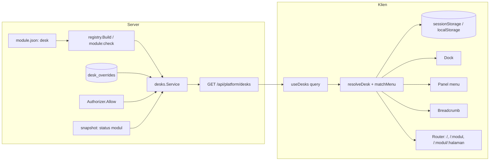

# Design Document: Revisi M3a (shadcn persis, shell Desk v16, Desk per modul)

## Overview

Revisi ini mengganti tiga hal pada M3a yang sudah ter-merge, dan menambah satu kerangka backend yang dibutuhkan ketiganya:

1. **Komponen** `@erpora/ui` menjadi salinan **persis** registry shadcn. Selisih yang diizinkan: jalur impor `cn`, patch label, patch token, dan patch perilaku terdaftar (K12; lihat D-1a). Disertai pemeriksaan otomatis dan lapisan pembungkus untuk kebutuhan DS yang tidak punya padanan.
2. **Shell** berubah dari sidebar tunggal menjadi **Dock + panel menu** (Pinned/Floating), grup tetap, breadcrumb bertahap, panel Notifikasi, Settings, dan palet perintah.
3. **Desk per modul** menjadi konsep inti navigasi: dideklarasikan di manifest modul, disaring server, dan dipilih klien lewat penentuan berurutan. URL menjadi bersih (`/<modul>`, `/<modul>/<halaman>`), dan `/` menjadi pintu masuk.
4. **Backend Desk**: properti manifest `desk`, endpoint baca `GET /api/platform/desks`, dan tabel timpaan (jalur baca saja).

**Sumber:** `requirements.md` spec ini, PRD-000 Q40 butir 1–16, catatan studi `docs/superpowers/research/2026-10-31-erpnext-desk-v16-ux-study.md`, dan spec M3a (`docs/specs/m3a-frontend-foundation-shell/design.md`) yang sebagian digantikan (shell, komponen, routing; lihat bagian Migrasi).

**Prinsip:** (a) backend adalah otoritas untuk daftar Desk dan menu; klien hanya menyaring tampilan; (b) komponen shadcn tidak pernah diubah, perluasan hanya dengan membungkus; (c) tidak ada data sensitif di penyimpanan klien; (d) tidak ada breaking change API (endpoint baru additive; perubahan `defineModule` hanya memengaruhi paket frontend internal yang belum dirilis).

## Keputusan desain

| # | Keputusan | Alasan | Alternatif yang ditolak |
| - | --------- | ------ | ----------------------- |
| D-1 | Kesamaan komponen dengan shadcn diperiksa terhadap **berkas kunci snapshot** (`packages/ui/shadcn.lock.json`, hash isi per berkas setelah normalisasi impor `cn`), bukan langsung terhadap registry hidup. Pembaruan sengaja lewat `task shadcn:sync`; `task shadcn:verify` (daring) melaporkan selisih snapshot vs registry. **Mengubah mekanisme R1.3; perlu konfirmasi.** | Registry shadcn tidak berversi: CLI terpin tidak menjamin isi komponen tetap. `web:check` yang membandingkan ke registry hidup akan gagal sendiri saat upstream berubah (CI tidak deterministik) | `shadcn add --dry-run --diff` di `web:check` apa adanya (R1.3 literal): rapuh dan butuh jaringan di setiap pemeriksaan |
| D-1a | **Patch label dan token terdaftar** (31 Okt 2026, disetujui pemilik produk): `shadcn:sync` menerapkan patch dari `packages/ui/shadcn.patches.json` yang mengganti teks Inggris tertanam registry dengan `useUiLabel(...)` dan warna palet langsung dengan token semantik (`bg-black/50` menjadi `bg-overlay` dengan opasitas 0,8 mengikuti DS; `text-white` menjadi `text-destructive-foreground`); hash di `shadcn.lock.json` dihitung setelah patch. Kunci juga mencakup `src/hooks/*.ts` hasil CLI. Mengubah R1.1 menjadi "persis kecuali jalur `cn`, patch label, patch token, dan patch perilaku". **Patch perilaku (K12, 31 Okt 2026, disetujui pemilik produk pada putaran perbaikan 2):** `Sidebar` shadcn menulis cookie `sidebar_state` setiap kali keadaannya berubah. Patch (`kind: behavior` di `shadcn.patches.json`, dengan `reason`) hanya menghapus penulisan cookie itu beserta konstanta dan komentarnya; `shadcn-check` memastikan patch terpasang. Penyimpanan keadaan ke `localStorage["erpora.sidebar"]` (hanya nilai `open` boolean) ditulis shell lewat `onOpenChange` (`web/src/app/shell/sidebar-state.ts`), bukan oleh patch. Alasan: R9.1, R20.2, dan D-10 menetapkan penyimpanan klien tanpa cookie. | Registry menulis "Close", "More", "Loading", `aria-label="breadcrumb"` yang melanggar aturan i18n proyek (R1.7, R19.1) | Menerima teks Inggris tertanam: melanggar i18n |
| D-1b | **`drawer` (vaul) tidak dipasang**; lembar bawah memakai `Sheet side="bottom"` (31 Okt 2026). `command` (cmdk 1.1.1) **disetujui** pemilik produk pada 31 Okt 2026 (dipasang dengan `shadcn:sync`, hanya di chunk malas palet). | `vaul` ±22 bulan tanpa rilis | Memasang vaul |
| D-2 | Menu dan Dashboard Desk dideklarasikan di **manifest** (`desk`), bukan di `defineModule` frontend. `FrontendModule.navigation` **dihapus**; frontend hanya mendaftarkan rute. **Perlu konfirmasi (perubahan kontrak SDK frontend).** | Server harus memetakan menu ke permission untuk menyaring (R11.2). Dua sumber menu (manifest dan `defineModule`) akan menyimpang | Mempertahankan `navigation` di frontend dan menyalin ke server: duplikasi |
| D-3 | Id Desk bawaan = **slug modul** (`example`, `core`); id Desk platform = `platform`. Desk kustom (M3b) memakai id `custom:<slug>`. | Sama dengan segmen URL Dashboard (`/<slug>`), unik karena slug modul unik di registry | Memakai `key` modul (`acme.example`): tidak dapat dipakai sebagai segmen URL |
| D-4 | Permission edit Desk dinamai **`platform.desks.update`** (baca: `platform.desks.read`), mengikuti pola kapabilitas `<slug>.<resource>.<aksi>` yang ditegakkan registry; scope per Desk lewat `scope_dimensions` PRD-001. Q40 menulis contoh `desk.update`; ini bentuk final yang sah menurut registry. | Registry menolak kapabilitas yang tidak berawalan slug (`capability_prefix`) | `desk.update` tanpa awalan: ditolak registry |
| D-5 | Penyaringan Desk memakai `runtime.Authorizer.Allow(ctx, permission)` yang ada. Dashboard **tidak dihitung** pada aturan "minimal satu menu diizinkan". | `sdk/authz` belum punya `Check/Filter/Principal` (menunggu PRD-001); Dashboard tanpa permission akan membuat semua Desk selalu tampil | Menunggu PRD-001 untuk memulai Desk |
| D-6 | ETag respons Desk = **hash isi respons akhir**, bukan revisi modul. Header `Cache-Control: private, no-cache` dan `Vary: Cookie, Authorization`. | Hasil bergantung pada principal; ETag berbasis revisi bisa menyajikan 304 untuk pengguna dengan izin berbeda | ETag dari revisi snapshot: berisiko kebocoran lewat cache perantara |
| D-7 | Penentuan Desk dan pencocokan halaman-ke-menu dilakukan di klien dengan fungsi murni (`resolveDesk`, `matchMenu`), memakai daftar Desk server. | Mudah diuji (property test) dan tidak butuh perjalanan jaringan per navigasi | Validasi di server per navigasi: latensi dan beban |
| D-8 | Rute indeks `/<slug>` adalah **Dashboard bawaan shell** (slot widget); halaman modul lama di rute indeks bergeser ke anak (`/example/notes`). | URL Dashboard wajib `/<slug>` (Q40 butir 10 dan 13) | Dashboard di `/<slug>/dashboard`: bertentangan dengan keputusan URL |
| D-9 | Platform memiliki Desk bawaan "Platform" (didefinisikan di Go, tanpa `module.json`) berisi Dashboard `/platform` dan Modul `/platform/modules`; halaman placeholder ToDo di `/platform/todo`. | Pseudo-modul `platform` tidak punya manifest berkas; halaman platform harus berawalan slug `platform` | Menaruh `/settings/modules` sebagai pengecualian: ditolak pemilik produk |
| D-10 | Status tab (Desk saat ini) disimpan di **`sessionStorage`** (bertahan saat muat ulang, terpisah per tab); ingatan lintas tab di **`localStorage`** (kunci `erpora.desk`). Cookie tidak dipakai, termasuk `sidebar_state` yang ditulis shadcn (dihapus lewat patch perilaku D-1a; K12, 31 Okt 2026): keadaan sidebar hanya di `localStorage["erpora.sidebar"]`. | Memenuhi "memori per tab" dan "cookie/localStorage" tanpa mengirim nilai ke server di setiap permintaan | Cookie: ikut terkirim ke server dan tidak perlu di sini |
| D-11 | **CLI shadcn tetap lewat `bunx shadcn@4.21.5`** (versi terpin, dari skrip `shadcn:sync` dan `shadcn:verify`; `shadcn:check` offline dan tidak menjalankan CLI), sesuai PRD-000 Q39 butir 5 (K13, keputusan pemilik produk 31 Okt 2026). Tidak ada devDependency `shadcn`. Temuan review keamanan MINOR-1 (CLI via `bunx` tanpa lockfile; dependensi transitif di-resolve segar) **ditutup sebagai risiko yang diterima**: CI hijau; skrip hanya jalan di mesin pengembang; nama komponen divalidasi `parseComponentNames`. | Alternatif devDependency terpin menambah ±270 entri `bun.lock` dan memperburuk `bun audit` (1 moderate menjadi 1 high, 1 moderate, dan 1 low). | devDependency terpin: ditolak pemilik produk (K13) |
| D-12 | **Aturan pindah Desk** (K10, 31 Okt 2026): fungsi murni `resolveDeskSwitchTarget(currentPath: string, targetDesk: Desk): string` di `packages/platform-web/src/desk/switch-target.ts`. Bila `deskContains(targetDesk, currentPath)` maka hasilnya `currentPath` (hanya Desk saat ini yang berganti); selain itu `deskDashboardPath(targetDesk)`; bila Desk tujuan tidak punya Dashboard, hasilnya `currentPath`. Dipakai oleh "Pindah Desk" di popover logo dan entri lintas Desk di palet. Sejak K20 (1 Nov 2026), klik ikon Dock, baik Pinned maupun Floating, membuka popover K8 dan tidak memakai D-12. Klik nama Desk di breadcrumb dan kartu di halaman Desks tetap ke Dashboard (`deskDashboardPath`). | Tautan dan kerja pengguna tidak terputus saat berpindah Desk; sesuai PRD-000 Q40 butir 24 (K10) | Selalu ke Dashboard (perilaku sebelumnya): membuang konteks halaman yang sedang dikerjakan |
| D-13 | **Chrome halaman Desks tanpa sidebar** (K1, 31 Okt 2026). Halaman Desks tidak punya URL, jadi chrome dipilih oleh halaman yang aktif: `DesksPage` menyatakan varian chrome `desks` lewat konteks shell (bukan lewat rute). Varian ini hanya merender navbar khusus (logo kiri → `LogoPopover`; Search tengah → `openCommandPalette`; lonceng → `openNotifications`; avatar → `UserMenu`; avatar dan lonceng berukuran `size-9` seragam, disetujui pemilik produk 1 Nov 2026) tanpa breadcrumb Home, dan **tidak** memuat Dock, panel, atau `SidebarProvider`. Isi kisi kartu gaya `DeskList` ERP DS memakai komponen dasar yang ada (`Card` shadcn bila visualnya sesuai DS). Penanda state navigasi `showDesks` tetap berlaku (R10.5). | Halaman Desks tanpa URL tidak bisa dibedakan dari rute lewat path; konteks shell memberi jalan keluar tanpa mengubah rute atau menambah URL (R10.4) | Halaman Desks sebagai bagian AppShell biasa: ditolak K1 |
| D-14 | **Judul halaman dan breadcrumb sebagai h1** (K9, 31 Okt 2026). Langkah terakhir breadcrumb dibungkus `<h1>` di luar `BreadcrumbPage` (yang tidak diubah): `<h1 className="text-base font-semibold …"><BreadcrumbPage>…</BreadcrumbPage></h1>` dengan reset margin heading. Judul visual di konten utama dihapus; deskripsi halaman (paragraf muted) tetap boleh. Satu h1 per halaman: judul galat `ErrorNotice` menjadi `<h2>` (P-3, diputuskan 1 Nov 2026). Halaman Desks tanpa breadcrumb memuat satu `<h1>` `sr-only` bertuliskan "Desks" (P-1, diputuskan 1 Nov 2026; sudah ada di `desks-page.tsx`). | Satu judul visual dan satu h1 untuk aksesibilitas; breadcrumb menjadi petunjuk posisi (K9) | Judul h1 di konten dan breadcrumb sekaligus: pengulangan yang ditolak K9 |
| D-15 | **Dua ambang lebar** (keputusan desain eksplisit, 1 Nov 2026): panel shell menjadi `Sheet` di bawah **1024 px** (`useIsCompact`, `COMPACT_BREAKPOINT`); orientasi tab Settings (K19, R17.1) memakai **768 px** (`useIsNarrow`, `matchMedia("(max-width: 767px)")`, dengan nilai awal sinkron lewat `useSyncExternalStore`). `useIsMobile` shadcn (768 px) tetap tidak diubah. Ambang 768 px untuk Settings **disetujui pemilik produk** pada 1 Nov 2026 (keputusan final). | Settings pada lebar 768 sampai 1023 px masih cukup lebar untuk navigasi kiri; panel shell yang sempit butuh ruang lebih. Nilai awal sinkron menghindari frame pertama yang salah (m-3) | Satu ambang 1024 px untuk keduanya: tidak dipilih; pemilik produk menyetujui ambang terpisah 768 px untuk Settings (1 Nov 2026) |

## Arsitektur



**Alur `/`:** `/` memuat `DeskEntry`: jika penanda state navigasi `showDesks` ada, tampilkan halaman Desks; jika tidak, jalankan `resolveDesk` tahap 1–3; hasil valid → `navigate('/<slug>', {replace:true})`; tidak ada → halaman Desks.

**Alur halaman menu (`/<modul>/<halaman>`):** `useDeskValidation` memakai `matchMenu(path, desks)` untuk mendapat Desk yang memuat halaman; Desk saat ini dipertahankan bila ada dalam hasil, selain itu penentuan tahap 4–5.

### Susunan berkas

| Area | Berkas baru atau berubah |
| ---- | ----------------------- |
| `packages/ui` | `src/components/ui/*` (salinan shadcn), `src/components/extended/{loading-button,status-badge}.tsx`, `shadcn.lock.json`, `scripts/shadcn-sync.ts`, `scripts/shadcn-check.ts`, `src/lib/breadcrumb-fit.ts`, `src/styles/theme.css` |
| `packages/module-sdk` | `src/types.ts` (hapus `navigation`), `src/define-module.ts`, `src/manifest.gen.ts` (dibangkitkan, memuat `desk`) |
| `packages/platform-web` | `src/desk/{types,api,storage,resolver,match-menu,provider,validation}.ts(x)`, `src/registry/*` (tanpa `selectNavigation`), `src/prefs/index.ts` (kunci baru), `src/sources/current-user.tsx` (`defaultDesk`) |
| `web/src/app` | `shell/{app-shell,dock,dock-floating,desk-panel,fixed-group,logo-popover,collapse-edge,breadcrumb-nav,navbar,notification-panel,user-menu}.tsx`, `shell/settings/*`, `shell/command-palette.tsx`, `router/*`, `pages/{desk-entry,desks-page,dashboard-page,todo-placeholder}.tsx`, `platform/modules/page.tsx` (pindah dari `settings/modules`) |
| Backend | `sdk/module/manifest.go` (`Desk`), `contracts/module.schema.json`, `internal/platform/modules/registry/{desk.go,errors.go,reserved.go}`, `internal/devtools/modcheck/check.go` (aturan `DESK`), `internal/platform/desks/{desk.go,merge.go,platform.go,service.go,api.go}`, `internal/platform/desks/store/store.go`, `migrations/control/0004_desk_overrides.sql`, `contracts/openapi/platform.yaml`, `internal/app/{registry.go,assemble.go}`, `internal/archcheck/rules.go` |
| Modul referensi dan templat | `modules/example/{module.json,web/src/*}`, `modules/exampleaddon/*`, `internal/devtools/templates/module/*`, golden generator |

## Komponen dan antarmuka

### 1. `@erpora/ui` persis shadcn

**Alur pemasangan dan pemeriksaan (D-1)**
- `scripts/shadcn-sync.ts` (`task shadcn:sync -- <komponen...>`): menjalankan `bunx shadcn@<terpin> add <komponen> -o -y`, mengganti `from "cn"` menjadi `from "@erpora/ui/lib/utils"`, menghapus dependensi `cn` yang ditulis CLI, dan memperbarui `shadcn.lock.json` (`{ cli, components: { "<nama>": { file, sha256 } } }`; hash dihitung atas isi **setelah** normalisasi impor `cn`).
- `scripts/shadcn-check.ts` (di `task web:check`, tanpa jaringan): menghitung hash setiap berkas di `src/components/ui` dan membandingkan ke kunci; gagal bila ada selisih, berkas tidak terkunci, atau kunci tanpa berkas. Pesan galat menyebut komponen dan petunjuk `shadcn:sync`.
- `task shadcn:verify` (daring, tidak di `web:check`): `shadcn add <k> --dry-run --diff` per komponen terhadap berkas lokal; melaporkan komponen yang berbeda dari registry hidup sebagai kabar drift (bukan kegagalan build). Dapat dijadwalkan di CI mingguan.
- Tes alat (`web/tools/shadcn-check.test.ts`): berkas diubah, berkas ditambah, normalisasi `cn`, kunci usang.

**Pemetaan komponen** (24 komponen M3a; hasil audit `--dry-run --diff` 31 Okt 2026). Tindakan: *resync* = timpa dengan registry terbaru.

| Komponen | Selisih sekarang | Tindakan |
| -------- | ---------------- | -------- |
| `sidebar` | +246/−90 | resync; pemakaian shell ditulis ulang |
| `avatar` (+`AvatarGroup`/badge baru), `alert-dialog`, `dropdown-menu`, `popover` (+`PopoverHeader/Title/Description`) | besar | resync |
| `button`, `dialog`, `table`, `breadcrumb`, `collapsible`, `alert`, `sheet` | sedang | resync; migrasi varian `primary→default`, ukuran `md→default`, `icon→icon` |
| `badge`, `checkbox`, `label`, `tooltip`, `separator`, `skeleton`, `sonner` | kecil | resync |
| Baru dari registry (dikonfirmasi satu per satu sebelum dipasang) | n/a | `command` (palet), `spinner`, `empty`, `kbd`, `scroll-area`, `toggle-group`/`radio-group` (kartu tema/dock di Settings), `input`, `tabs` (panel notifikasi), `switch` |

**Pengganti komposit buatan sendiri:** `Kbd`→`kbd`, `EmptyState` dan `ErrorPage`→`empty`, `LoadingIcon`→`spinner`, `BadgeStatus`→`Badge` bervarian bila `badge` terbaru menyediakan varian yang setara; bila tidak, pindah ke `extended/status-badge.tsx` (membungkus `Badge`, memetakan `tone` ke kelas token status). Keberadaan padanan **diverifikasi saat pemasangan** (`shadcn add <k> --dry-run`) dan hasilnya dicatat di `tasks.md`.

**Lapisan pembungkus** (`src/components/extended/`, bukan hasil `shadcn add`, bebas diubah):
- `loading-button.tsx`: membungkus `Button` + `Spinner` (`loading`, `aria-busy`), menggantikan prop `loading` yang dulu ada di Button.
- `status-badge.tsx`: lihat di atas.

**Token** (`theme.css`): variabel semantik shadcn (`--background`, `--primary`, `--sidebar-*`, `--radius`, ...) bernilai DS terang/gelap; skala tinggi kontrol tidak dikustomisasi (keputusan Q40 butir 16, selisih 36 vs 34 px dicatat). Uji `theme.test.ts` yang ada (tanpa nilai palet langsung di luar `theme.css`) tetap berlaku.

### 2. Penentuan Desk (`packages/platform-web/src/desk`)

```ts
type MessageRef = { ns: string; key: string };
type DeskMenuItem = { type: "item"; id: string; label: MessageRef; to: string; icon?: string; locked?: boolean; ownerDesk: string };
type DeskMenuGroup = { type: "group"; id: string; label: MessageRef; icon?: string; children: DeskMenuItem[] };
type Desk = { id: string; source: "module" | "platform" | "custom"; moduleKey?: string; label: MessageRef; icon?: string; menus: (DeskMenuItem | DeskMenuGroup)[] };
type DeskList = { desks: Desk[]; revision: string };
```

`resolveDesk(input): { deskId: string | null; step: 1 | 2 | 3 | 4 | 5 | null }` (fungsi murni):
- `input`: `desks`, `tabDesk` (sessionStorage), `rememberedDesk` (localStorage), `defaultDesk` (pengguna), `page?` (path yang dibuka).
- Kandidat berurutan `tabDesk → rememberedDesk → defaultDesk → ownerDesk(page) → desks pertama yang memuat page`. Kandidat diterima bila: ada di `desks` (diizinkan server) **dan** (bila `page` ada) `deskContains(desk, page)`. Tahap 4–5 hanya bila `page` ada.
- Nilai dari storage tidak dipercaya: hanya diterima bila berupa string yang cocok `^[a-z0-9:-]{1,64}$` dan ada di `desks`.

`matchMenu(path, desks): { owner: string | null; containing: string[] }`: pencocokan segmen-aman: Dashboard (`/<slug>`) cocok hanya persis; item lain cocok bila `path === to` atau `path` diawali `to + "/"`; terpanjang menang. `owner` = `ownerDesk` item yang cocok.

`DeskProvider` menyimpan `currentDeskId`, `setCurrentDesk(id)` (menulis sessionStorage + localStorage, mencatat), dan `showDesks` (penanda state navigasi dari riwayat browser). `useDeskValidation()` (efek pada perubahan lokasi): bila `currentDeskId` tidak memuat halaman, menjalankan `resolveDesk` dengan `page` dan memanggil `setCurrentDesk` tanpa navigasi.

**Penyimpanan:** `sessionStorage["erpora.desk.tab"]`, `localStorage["erpora.desk"]` (hanya id), `localStorage` lain yang sudah ada (tema, sidebar, locale) tetap; semua pembacaan dalam try/catch (aturan M3a). `default_desk` dibaca dari `CurrentUserSource.defaultDesk` (nilai `null` pada sumber sementara).

### 3. Shell

**Tata letak.** `AppShell` merakit: `Dock` (Pinned) | `DeskPanel` | area utama (`Navbar` + `<main>`), atau (Floating) `DeskPanel` + `DockFloating` (pil) di atas. Mode dibaca dari preferensi (`erpora.dock`, bawaan `floating`), dan di bawah 1024 px (`useIsCompact`, `web/src/app/shell/use-compact.ts`) panel menjadi `Sheet` yang dibuka tombol `☰` tanpa memandang mode. Ambang 1024 px ini berbeda dari `useIsMobile` shadcn (768 px, tidak boleh diubah). Orientasi tab Settings memakai ambang 768 px (`useIsNarrow`, D-15).

**Dock** (`dock.tsx`, `dock-floating.tsx`): daftar Desk dari `useDesks()`; ikon dari `resolveIcon`; yang aktif diberi latar tanpa outline atau cincin (`accent`/`sidebar-accent`, K2); `+N` (`OverflowDeskSub`, submenu, tambahan K8) bila tinggi tidak cukup (pengukuran `ResizeObserver`). Floating: pil `position: fixed; left: 8px; top: 50%; transform: translate(-150%, -50%)`, kelas terbuka menghapus translasi dengan transisi 280 ms (`cubic-bezier(.4,0,.2,1)`, dimatikan oleh `prefers-reduced-motion`); pemicu: zona hot-edge (lebar 12 px di tepi kiri) dan pintasan `Ctrl+Shift+/`; menutup setelah memilih, `Escape`, atau fokus keluar. ARIA: `role="navigation"` berlabel, ikon `button` dengan `aria-current`, panah atas/bawah berpindah.

**Dock Pinned (K6, K8):** grup tetap (Cari, Notifikasi dengan lencana, ToDo) berada di Dock tepat di bawah logo, lalu divider, ikon Desk, dan avatar di dasar. Klik ikon Desk (termasuk yang aktif) membuka popover menu Desk di sisi kanan ikon, berisi item bergaya sidebar (Dashboard, menu, grup yang dapat dibuka). Memilih item menavigasi ke item itu dan menetapkan Desk saat ini; Desk tidak berpindah sebelum item dipilih. Dock Floating juga memakai popover ini sejak 1 Nov 2026 (K20): klik ikon membuka menu Desk dan tidak memindah Desk langsung. Submenu `+N` (`OverflowDeskSub`) memuat Desk yang ikonnya tersisih, pada Pinned dan Floating (tambahan K8, disetujui pemilik produk 1 Nov 2026). Ukuran tombol, ikon, dan jarak ikon Dock Pinned disamakan dengan strip ikon Floating (lebih rapat) lewat satu sumber ukuran bersama (K15, R4.10). Avatar diperbesar, berkontras jelas, dan terpusat (K16, R16.1). Ikon Dock Pinned memiliki sorotan latar saat hover seperti item sidebar (K17, R4.11). Strip ikon Floating (mode diciutkan) memusatkan tombol secara horizontal (logo, Cari, Notifikasi, ToDo, item menu Desk) dan memakai avatar 32 px yang berkontras dan terpusat; saat panel terbuka avatar tetap `sm` (K21, 1 Nov 2026, R4.10 dan R16.1).

**Panel** (`desk-panel.tsx`, `fixed-group.tsx`): tanpa header Desk. Pada Floating urutannya: `FixedGroup` (registri `fixedItems`: Cari → membuka palet, Notifikasi → membuka panel dengan lencana, ToDo → `/platform/todo` dengan lencana sumber sementara), `Separator`, label nama Desk + menu Desk (`SidebarMenu` shadcn; grup membuka inline via `Collapsible`; Dashboard selalu pertama), pada Floating `Separator` + pengguna di dasar. Registri `fixedItems` di `platform-web` (`registerFixedItem`) memungkinkan penambahan kelak tanpa mengubah komponen.

**Pembatas** (`collapse-edge.tsx`): elemen `role="separator"` fokusable setinggi panel, area klik 16 px, kursor resize, `aria-controls`. Klik/Enter/Spasi mengalihkan `collapsed`. Pinned: panel disembunyikan, Dock tetap; Floating: `SidebarProvider collapsible="icon"` menjadi strip ≈48 px. Status disimpan hanya di `localStorage["erpora.sidebar"]` (kunci yang ada; cookie `sidebar_state` dihapus lewat patch perilaku D-1a, K12). Transisi menciut dan membuka mulus (K3): tanpa lompatan layout dan tanpa meluncur melintasi Dock; dimatikan oleh `prefers-reduced-motion`. Pintasan `Ctrl+B` (bawaan `SidebarProvider`) tetap.

**Logo dan popover** (`logo-popover.tsx`): `DropdownMenu` shadcn dengan item Pindah Desk (submenu `DropdownMenuSub`), Semua Desk (`showDesks`), Edit sidebar (`disabled`, tooltip "M3b"), Bantuan dan pintasan (membuka Settings → Pintasan), Tentang (versi `AppVersion` dari bootstrap). Pemicu: logo di kepala panel (Floating) atau di atas Dock (Pinned). Item Pindah Desk memakai `resolveDeskSwitchTarget` (D-12, K10). Pada halaman Desks, dropdown logo tidak memuat "Pindah Desk" dan "Semua Desk" (K18, R6.6).

**Breadcrumb bertahap** (`breadcrumb-nav.tsx` + `packages/ui/src/lib/breadcrumb-fit.ts`):
- `fitBreadcrumb({ segments, widths, available, mobile }): Plan` fungsi murni. `segments = [home, desk?, ...crumbs]` (halaman terakhir = `current`); `widths` hasil ukuran awal (elemen tersembunyi untuk mengukur, di-cache per label). `available` = lebar navbar dikurangi lebar tombol aksi (`ResizeObserver` pada navbar dan blok aksi).
- Tahap berurutan, tiap tahap dipilih bila total lebar ≤ `available`: 1 utuh; 2 Opsi A (Home, Desk, "…", dua langkah terakhir); 3 Opsi B (Home, "…", dua langkah terakhir), lalu 3b (Home, "…", langkah terakhir); 4 `mobile` (lebar < 480 px): `… › langkah terakhir` dengan Home di dalam "…"; 5 langkah terakhir dipotong elipsis (`truncate`, `title`/tooltip).
- Render: dropdown (`DropdownMenu` + `BreadcrumbEllipsis`) pada ≥ 480 px, `Sheet` shadcn sisi bawah pada < 480 px (daftar jalur lengkap, tiap langkah tautan; langkah terakhir `aria-current="page"`).
- Home memanggil `goToDesks()` (state navigasi `showDesks`), Desk memanggil `setCurrentDesk(id)` lalu `navigate('/<slug>')`.
- Langkah terakhir dibungkus `<h1>` dan tampil lebih besar (D-14, K9); konten utama tidak lagi memuat judul halaman.
- Divider vertikal (`Separator orientation="vertical"` shadcn) memisahkan tombol toggle sidebar dari breadcrumb di navbar (K5).
- Aksi: `Navbar` mengukur lebar blok aksi; aksi sekunder masuk `DropdownMenu` "⋯" lebih dulu (sebelum tahap breadcrumb berikutnya diambil), aksi utama tetap (ikon di < 480 px).

**Panel Notifikasi** (`notification-panel.tsx`): `Sheet side="left"` yang dimulai di tepi kanan panel menu (offset = max(tepi kanan Dock, tepi kanan kontainer terlihat), Minor 1) tanpa overlay penuh; jebakan fokus dengan klik di luar dan Escape tetap menutup (K11); `Tabs` (Semua, Peristiwa), tombol tandai semua, `Empty` bila kosong; fokus dikembalikan ke item Notifikasi saat tutup. Sumber: `NotificationSource` M3a (tidak berubah).

**Settings** (`shell/settings/*`, dimuat malas): `Dialog` dua kolom, dengan garis pembatas vertikal setinggi penuh dialog (K7); di desktop dialog diperbesar secara nyata, dan pada mode mobile navigasi kiri menjadi tab horizontal di atas konten (K19, R17.1, R17.7); bagian Appearance (`RadioGroup` kartu pratinjau untuk Tema dan Dock) dan Preferences (Bahasa memakai `useLocale` i18n, Zona waktu `Select`); setiap perubahan langsung tersimpan lewat `writePref`. Daftar pintasan sebagai bagian ketiga yang dibuka dari popover logo.

**Palet** (`command-palette.tsx`, malas): `Command` di `Dialog`; sumber lokal: menu Desk saat ini dan semua Desk yang diizinkan; pemilihan memanggil `setCurrentDesk` (bila lintas Desk) lalu navigasi; `Ctrl+K` membuka.

**Menu pengguna** (`user-menu.tsx`): `DropdownMenu` di dasar Dock/panel; item Settings, Reload, Logout (nonaktif sementara). Teks nama/email dari `CurrentUserSource`.

**Dashboard** (`pages/dashboard-page.tsx`): halaman bersama di indeks setiap `/<slug>`; menerima `deskId` dari rute; menampilkan kerangka slot (`DashboardSlots`) dan `Empty` bila tidak ada widget; memakai `Skeleton` selama `useDesks()` belum siap.

**Halaman Desks** (`pages/desks-page.tsx`, chrome khusus tanpa sidebar, Dock, dan panel sesuai D-13 dan K1): kisi kartu gaya `DeskList` untuk Desk yang diizinkan (`Card`-setara dari `components/ui`; pasang `card` bila belum ada) dan `Empty` bila kosong; klik menetapkan Desk dan menuju Dashboard-nya.

### 4. Routing dan `@erpora/module-sdk`

**Tabel rute** (TanStack Router):

| Path | Komponen | Keterangan |
| ---- | -------- | ---------- |
| `/` | `DeskEntry` | resolver tahap 1–3; atau `DesksPage` bila `showDesks` / tidak ada hasil |
| `/platform` | `DashboardPage` (deskId `platform`) | Dashboard Desk Platform |
| `/platform/modules` | `ModulesPage` | pindah dari `/settings/modules`, tanpa pengalihan |
| `/platform/todo` | `TodoPlaceholderPage` | placeholder ToDo |
| `/<slug>` | `DashboardPage` | indeks base route modul (guard modul aktif tetap) |
| `/<slug>/<halaman>` | halaman modul | anak base route |

`/desks` **tidak terdaftar**; namespace `desks` tercadang untuk `/desks/<slug-desk>` (Desk kustom, M3b).

**`FrontendModule`** (`packages/module-sdk/src/types.ts`): `navigation` dihapus; tersisa `key, slug, version, title?, registerRoutes, offline`. `defineModule` tidak lagi memvalidasi `navigation`. `registerRoutes(base)` tidak boleh mendaftarkan rute indeks (`path: "/"`); `attachModuleRoutes` menolak rute indeks dengan galat dev (`ModuleDefinitionError`). Menu berasal dari server. Tes SDK modul wajib memeriksa bahwa setiap `to` di manifest Desk modul ada di rute yang didaftarkan (`assertDeskRoutes(module, manifestDesk)` helper pengujian di `@erpora/module-sdk/testing`).

**Registry frontend** (`platform-web/src/registry`): `resolveModules` tetap (mencocokkan modul dengan bootstrap untuk guard dan peringatan); `selectNavigation` dihapus.

### 5. Manifest: properti `desk`

Skema (`contracts/module.schema.json`, `additionalProperties:false` pada objeknya):

```json
"desk": {
  "type": "object",
  "required": ["label", "icon", "menus"],
  "properties": {
    "label": { "type": "string", "pattern": "^[a-z][a-zA-Z0-9_]*(\\.[a-zA-Z0-9_-]+)+$" },
    "icon": { "type": "string", "pattern": "^[a-z0-9-]{1,40}$" },
    "dashboard": { "type": "object", "properties": { "label": {"type":"string"}, "icon": {"type":"string"} } },
    "menus": { "type": "array", "maxItems": 100, "items": { "$ref": "#/$defs/deskMenu" } },
    "settings": { "type": "object" }
  }
}
```

`deskMenu` = `{ "id", "label", "icon?", "to", "permission" }` atau `{ "id", "label", "icon?", "children": [deskMenu item] }` (grup satu tingkat). `label` berupa kunci i18n dalam namespace modul (`nav.notes`); `to` relatif base route (`/notes`, tanpa `/` ganda, tanpa skema/host); `permission` wajib salah satu `capabilities` modul.

Go (`sdk/module/manifest.go`): `Desk *Desk \`json:"desk,omitempty"\`` dengan tipe `Desk{Label, Icon string; Dashboard *DeskDashboard; Menus []DeskMenu; Settings map[string]any}`, `DeskMenu{ID, Label, Icon, To, Permission string; Children []DeskMenu}`. Pola `checkMatchesRaw` (struct = hasil parse `Raw`) tetap berlaku.

**Validasi registry** (`registry/desk.go`, kode baru di `errors.go`): `desk_duplicate_id`, `desk_unknown_permission` (menu merujuk permission di luar `capabilities`), `desk_invalid_to`, `desk_label_unknown` (kunci tidak ada di katalog namespace modul; memakai `CatalogSource`), `desk_dashboard_locked` (Dashboard tidak boleh dideklarasikan sebagai menu biasa; selalu dibangkitkan). **`module:check`** (`modcheck/check.go`, aturan `DESK`): modul dengan direktori `web/` wajib memiliki `desk` (R11.3), dan semua temuan registry di atas dilaporkan dengan berkas dan kunci.

**Pembangkit TS:** `manifest.gen.ts` memuat `desk` (otomatis dari skema lewat `contracts:generate`).

**Modul referensi:** `example` mendapat `desk` (label `desk.title`, ikon `file-text`, menu `notes` → `/notes`, permission `example.notes.read`); `exampleaddon` (menu `summary` → `/summary`, permission `example-addon.summary.read`). Rute web bergeser: `/example/notes` dan `/example-addon/summary` (indeks menjadi Dashboard bawaan). **Templat** `make:module --frontend` dan golden diperbarui; `task test:generator` wajib dijalankan.

**Desk Platform** (`internal/platform/desks/platform.go`): struct Go bertipe sama (`module.Desk`) dengan menu `Modul` → `/modules` (permission `platform.modules.read`); label di katalog `platform`.

### 6. Backend Desk

**Paket** `internal/platform/desks`:

```go
type Service struct { reg *registry.Registry; snap *runtime.Snapshot; authz runtime.Authorizer; store Store }
func (s *Service) List(ctx context.Context) (View, error) // tenancy.FromContext(ctx), tanpa tenantId/userId pada parameter
type View struct { Desks []Desk; ETag string }
```

Langkah `List`: ambil tenant dari context; untuk tiap entri registry (modul berfrontend dengan `Desk != nil`) tambah Desk Platform; **lewati** modul yang bukan `enabled` pada tenant (snapshot); baca timpaan tenant dari store (`store.ListSite(ctx, tenant)`) dan terapkan `merge` (sembunyikan/urutkan, tidak pernah menghapus Dashboard); saring tiap item dengan `authz.Allow(ctx, item.Permission)`; buang grup tanpa anak; **buang Desk bila tidak ada item non-Dashboard yang diizinkan** (D-5); sisipkan Dashboard sebagai item pertama (`locked`, `to="/<slug>"`); isi `ownerDesk`; urut mengikuti urutan registry (Platform pertama). ETag = SHA-256 isi JSON akhir (D-6).

**Endpoint** (`internal/platform/desks/api.go`, pola `i18n/admin`: `API` dengan `atomic.Pointer[Backend]`, `Bind`, 503 `not_ready` sebelum bind): `GET /api/platform/desks`, permission `platform.desks.read`, handler memakai `httpserver.CheckETag`, `Cache-Control: private, no-cache`, `Vary: Cookie, Authorization`. Amplop `{"data": {"desks": [...], "revision": "<etag>"}}`. Terdaftar di `buildRegistry` (`platformAPIs.Desks`) dengan `PlatformCapabilities` ditambah `platform.desks.read` dan `platform.desks.update`; di-`Bind` di `assemble.go`. Mutasi (M3b) memakai gate `runtime.SkipRoute` yang sama bila diperlukan.

**Kontrak** (`contracts/openapi/platform.yaml`): path `/desks` (`GET`, `operationId: listDesks`, `x-erp-permission: platform.desks.read`, respons 200 dengan `example`, 304, 403 `PermissionDenied`, 503 `NotReady`), skema `Desk`, `DeskMenuItem`, `DeskMenuGroup`, `DesksEnvelope`; properti `x-erp-classification: internal`. `contracts:generate` membangkitkan `packages/platform-contracts/src/platform.gen.ts`; `inspect_routes.golden` diperbarui (`-update`); tes kesesuaian (`CheckConformance`) dan `public_routes.txt` (route ini **tidak** publik) tetap lolos.

**Penyimpanan timpaan** (`migrations/control/0004_desk_overrides.sql`):

```sql
CREATE TABLE desk_overrides (
  tenant_id  uuid        NOT NULL,
  desk_id    text        NOT NULL CHECK (desk_id ~ '^[a-z0-9:-]{1,64}$'),
  scope      text        NOT NULL CHECK (scope IN ('site','user')),
  subject    text        NOT NULL DEFAULT '' CHECK (length(subject) <= 128),
  config     jsonb       NOT NULL DEFAULT '{}',
  revision   bigint      NOT NULL DEFAULT 0 CHECK (revision >= 0),
  updated_by text        NOT NULL DEFAULT '',
  updated_at timestamptz NOT NULL DEFAULT now(),
  PRIMARY KEY (tenant_id, desk_id, scope, subject)
);
```

`config` berbentuk `{ "hidden": [id...], "order": [id...] }` (skema divalidasi aplikasi; Dashboard di `hidden` diabaikan). `internal/platform/desks/store` (`Store{control database.ControlDB}`; semua kueri menyaring `tenant_id`; metode menerima `tenancy.TenantID` eksplisit) masuk allowlist D3b (`internal/archcheck/rules.go`) beserta tes; **hanya `ListSite` (baca) yang diimplementasikan di revisi ini** (R13.5). Scope `user` tidak dibaca (butuh identitas, PRD-001).

**Permission:** `platform.desks.read` (endpoint), `platform.desks.update` (didaftarkan sebagai kapabilitas platform, dipakai API tulis M3b; aturan: Desk bawaan dan Desk bersama hanya oleh pemegang `platform.desks.update` atas Desk itu, Desk pribadi oleh pemilik atau pemegang hak itu).

**Slug tercadang:** `desks` ditambahkan ke `reservedSlugs` (menjadi 26) dengan pembaruan `rules_test.go` (`len(slugs) != 26`, subtest `desks`), ADR-0006 dan PRD-000 (daftar 25→26).

## Keamanan

Kontrol yang dirujuk: `docs/security/security-guidelines.md` (ASVS 5.0.0 L2), PRD-000 Q33, PRD-001 FR-119.

| Ancaman (STRIDE) | Titik | Mitigasi |
| ---------------- | ----- | -------- |
| **S**poofing | `GET /api/platform/desks` | Endpoint non-publik; melewati rantai middleware yang ada (Authenticate, tenantContext, permission). Identitas nyata datang dengan PRD-001; sampai saat itu stub (`ERP_AUTHZ_STUB`, fail-closed bila bukan `allow`) |
| **T**ampering | Penyimpanan klien (`sessionStorage`/`localStorage`) | Nilai diperlakukan tidak tepercaya: dipakai hanya bila lolos `^[a-z0-9:-]{1,64}$` dan ada di daftar server; tidak dipakai sebagai kunci akses |
| **T**ampering | Timpaan Desk | Tulis hanya M3b dengan `platform.desks.update`; revisi ini hanya baca; `config` divalidasi skema; Dashboard tidak dapat disembunyikan |
| **R**epudiation | Edit Desk | Dicatat di audit saat API tulis ada (M3b); revisi ini tidak menulis |
| **I**nformation disclosure | Daftar Desk/menu | Menu dan Desk yang tidak diizinkan **tidak dikirim** (disaring server); ETag hash isi + `Cache-Control: private` + `Vary` mencegah 304/cache silang pengguna; `x-erp-classification: internal` |
| **I**nformation disclosure | Status modul nonaktif | Desk modul nonaktif tidak muncul; tidak ada pesan yang membedakan "nonaktif" dari "tidak ada" |
| **D**oS | `List` per permintaan | Jumlah Desk dan menu dibatasi (`maxItems` skema, ≤ 100 menu per Desk); komputasi murni dari memori registry dan satu kueri timpaan per tenant; `Cache-Control: no-cache` memakai `If-None-Match` agar respons 304 ringan |
| **I**nformation disclosure | Keadaan sidebar di penyimpanan klien | Cookie `sidebar_state` dihapus (D-1a, K12); hanya `localStorage["erpora.sidebar"]` berisi nilai `open` boolean; tidak ada data sensitif |
| **E**levation of privilege | Edit Desk bersama | Permission `platform.desks.update` terpisah dari hak lihat, ditegakkan di backend (bukan klien); tidak ada `AsSystem` otomatis |

**Titik masuk ID dan IDOR.** Endpoint `GET /desks` tidak menerima id. Parameter `deskId` tidak ada di jalur ini; bila endpoint per-Desk ditambah (M3b), wajib `authz` per record (Desk di luar scope → 404 seragam) dan **tes IDOR pengguna A vs B**. Tidak ada `tenantId`/`userId` pada parameter `Service.List`; tenant dari `tenancy.FromContext`.

**Koneksi keluar (SSRF).** Tidak ada koneksi keluar baru; `shadcn:sync`/`shadcn:verify` hanya jalan di mesin pengembang/CI (bukan runtime produk) ke registry shadcn dengan CLI `bunx` terpin (D-11). Nilai `to` di manifest dilarang memuat skema atau host (skema dan `desk_invalid_to`); klien memperlakukan `to` sebagai rute internal saja (`safeInternalHref`).

**File.** Tidak ada unggah. `shadcn.lock.json` hanya berisi hash.

**Data offline.** Daftar Desk tidak masuk penyimpanan offline (modul online-only pada M3a); `localStorage` hanya id Desk dan preferensi UI (tidak ada PII/token).

**Skrip dan XSS.** `dangerouslySetInnerHTML` tetap dilarang; label datang dari katalog i18n (ICU, tidak merender HTML); ikon memakai peta `resolveIcon` (nama tidak dikenal jatuh ke ikon bawaan).

**Checklist `transaction-data-standards.md` §15:** tidak berlaku (bukan resource transaksional).

## Pengujian

- **Frontend (bun test):** `resolveDesk` dan `matchMenu` dengan property test (`fast-check`: kandidat tidak diizinkan tidak pernah dipilih; urutan tahap; nilai storage berbahaya diabaikan; Dashboard hanya cocok persis); `fitBreadcrumb` (properti: Home dan halaman saat ini selalu tersedia, lebar tidak melampaui `available`, urutan tahap monoton menyempit); `shadcn-check`; komponen shell (Dock Pinned/Floating, pembatas klik, popover, panel notifikasi, Settings, palet) dengan Testing Library (peran ARIA, keyboard); tes router (`/`, `/platform/modules`, `/<slug>` menampilkan Dashboard, modul nonaktif tidak punya Desk, halaman Desks tanpa URL); tes anggaran bundle (`web/build.ts` ≤ 200 KB; Dock Floating, Settings, palet, dan lembar bawah dimuat malas lewat `module-lazy.test.ts` yang ada).
- **Go:** tes skema dan manifest `desk` (`validate_test.go`, pola `TestValidate_I18nSection`), tes registry (kode galat baru), `modcheck` aturan `DESK`, tes `desks.Service` (modul nonaktif, permission, Dashboard tidak dihitung, grup kosong dibuang, merge timpaan, ETag stabil dan berubah bila izin berubah), tes handler (200/304/403/503), konformansi kontrak, `inspect_routes.golden`, tes `archcheck` untuk allowlist store baru, tes slug tercadang (26).
- **Integrasi (PostgreSQL via tunnel, `-p 2`):** migrasi `0004`, `store.ListSite` per tenant (isolasi tenant), endpoint penuh terhadap modul `example`/`exampleaddon`.
- **Generator:** golden dan `task test:generator` (templat berubah).
- **Manual di browser** (backend nyata, `web/dev-api.ts`): enable/disable modul menghilangkan Desk di Dock tanpa muat ulang; tautan `/example/notes` di tab dengan Desk berbeda; `/` mengikuti resolver; Home membuka Desks; breadcrumb pada lebar berbeda; Dock Pinned/Floating; pembatas klik.

## Migrasi dari M3a dan dokumentasi

**Perubahan yang memecah kompatibilitas internal (belum dirilis):** `FrontendModule.navigation` dihapus; rute indeks modul bergeser; `/settings/modules` → `/platform/modules`; varian/ukuran Button dan nama komposit `@erpora/ui`; entry `@erpora/ui` tidak lagi mengekspor `BadgeStatus`/`EmptyState`/`ErrorPage`/`Kbd`/`LoadingIcon`.

**Dokumen yang diperbarui bersama kode:** PRD-000 (Q40 sudah; catatan hasil), ADR-0006 (26 slug), ADR-0015 (komponen persis shadcn, kunci snapshot, patch; memperbarui ADR-0011), `docs/module-sdk/{frontend,generators,creating-a-module}.md` (`desk`, rute, tanpa `navigation`), `packages/ui/README.md` (alur `shadcn:sync/check/verify`), `CLAUDE.md`/`AGENTS.md` (identik: aturan komponen persis shadcn, `task shadcn:*`), spec M3a (ditandai sebagian digantikan).

## Risiko dan mitigasi

| Risiko | Mitigasi |
| ------ | -------- |
| Registry shadcn berubah di antara sync | D-1: kunci snapshot; drift hanya dilaporkan |
| Bundle melampaui 200 KB (entry saat ini 197,7 KB gzip, catatan 8.3 sampai 8.5) | Dock Floating, Settings, palet, lembar bawah (`Sheet` sisi bawah), dan panel Notifikasi dimuat malas; uji anggaran di `web:check`; `Command` (cmdk) dimasukkan hanya di chunk malas palet; `drawer` tidak dipasang (D-1b). Kenaikan berikutnya butuh keputusan |
| Pengujian pengukuran lebar (breadcrumb) tidak stabil di happy-dom | `fitBreadcrumb` fungsi murni diuji berat; komponen diuji dengan lebar tiruan |
| Klik pembatas 8 px tidak terdaftar (temuan uji ERPNext) | Area klik 16 px dan akses keyboard |
| `authz` stub membuat daftar Desk sama untuk semua pengguna | Diterima sementara; endpoint sudah memakai `Allow` per item sehingga PRD-001 cukup mengganti `Authorizer` |
| Perubahan templat generator merusak modul hasil generate | `task test:generator` dan golden |
| Patch perilaku (K12) tidak lagi cocok setelah registry shadcn berubah | `shadcn:sync` gagal keras bila teks `find` tidak ditemukan (sesuai ADR-0015); tinjau patch pada setiap sinkronisasi |
| CLI lewat `bunx` tanpa lockfile: dependensi transitif di-resolve segar setiap jalan (MINOR-1 review keamanan) | **Diterima** (D-11, K13, 31 Okt 2026): CI hijau, skrip hanya di mesin pengembang, nama komponen divalidasi `parseComponentNames`; devDependency ditolak karena memperburuk `bun audit` |
| Judul halaman Desks dan halaman galat belum selaras dengan satu h1 per halaman (K9) | Diputuskan 1 Nov 2026 (P-1, P-3): h1 `sr-only` "Desks" dan judul galat `<h2>` |

## Pemetaan Requirement → desain

| Requirement | Bagian |
| ----------- | ------ |
| 1, 2, 3 | Komponen 1; Keputusan D-1 |
| 4, 5, 6, 7, 8 | Komponen 3 |
| 9 | Komponen 2; D-7, D-10 |
| 10 | Komponen 4; Komponen 3 (Desks) |
| 11 | Komponen 5; D-2, D-3, D-9 |
| 12, 13 | Komponen 6; D-4, D-5, D-6 |
| 14 | Komponen 3 (Dashboard); D-8 |
| 15, 16, 17, 18 | Komponen 3 |
| 19, 20 | Keamanan; Pengujian |
| 21 | Pengujian; Migrasi dan dokumentasi |

## Keputusan atas pertanyaan terbuka (31 Okt 2026, disetujui pemilik produk)

| # | Pertanyaan | Keputusan |
| - | ---------- | --------- |
| 1 | D-1: kesamaan komponen diperiksa terhadap kunci snapshot (mengubah R1.3) | Disetujui; `shadcn:verify` daring hanya melaporkan drift. R1.3 sudah diubah |
| 2 | D-2: menu di manifest, `navigation` dihapus dari `defineModule` | Disetujui |
| 3 | D-4: permission bernama `platform.desks.update` (bukan `desk.update`) | Disetujui. R13.1 sudah diubah |
| 4 | D-5: Dashboard tidak dihitung pada aturan "minimal satu menu diizinkan" | Disetujui |
| 5 | D-10: sessionStorage (per tab) + localStorage, tanpa cookie | Disetujui |
| 6 | Dock bawaan Floating, ambang sheet < 1024 px, ambang ponsel breadcrumb < 480 px | Disetujui |
| 7 | Putaran perbaikan 2 (K1–K14, I-1–I-4, Minor 1–8): D-11 (CLI tetap `bunx`), D-12 sampai D-14, dan patch perilaku D-1a | Disetujui pemilik produk 31 Okt 2026; lihat `requirements.md` bagian "Keputusan putaran perbaikan" dan PRD-000 Q40 butir 24. Pertanyaan P-1 dan P-3 diputuskan 1 Nov 2026; P-2 ditutup (K13) |
| 8 | Putaran 1 Nov 2026 (K15–K19, dari uji browser pemilik produk): ukuran Dock Pinned, avatar, sorotan hover, dropdown logo di Desks, dan Settings | Disetujui pemilik produk 1 Nov 2026; lihat `requirements.md` dan PRD-000 Q40 butir 25 |
| 9 | K20 (klik ikon Dock membuka popover di Floating), submenu `+N` sebagai tambahan K8, avatar Desks `size-9`, ambang Settings 768 px (D-15 ditutup), dan keputusan komponen di ADR-0015 | Disetujui pemilik produk 1 Nov 2026; PRD-000 Q40 butir 26; `requirements.md` tabel K20 dan konfirmasi |
| 10 | K21: strip ikon Floating terpusat horizontal dan avatar 32 px berkontras (dari tangkapan layar mode diciutkan) | Disetujui pemilik produk 1 Nov 2026; PRD-000 Q40 butir 27; `requirements.md` tabel K21 |
