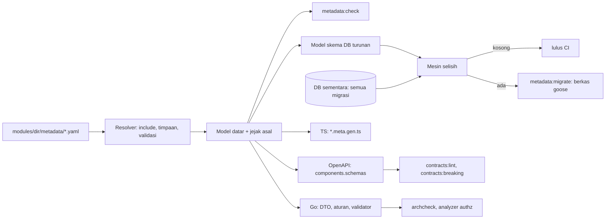

# Design Document: Metadata Resource (satu sumber kebenaran)

## Overview

Sistem ini menambah satu lapisan di atas kontrak OpenAPI yang sudah ada: **berkas metadata per resource** yang menjadi sumber bagi (1) skema OpenAPI, (2) DTO dan validasi Go, (3) metadata TypeScript untuk antarmuka generik, (4) pemeriksaan dan migrasi database, dan (5) pada tahap akhir, CRUD untuk resource sederhana. Tidak ada bahasa baru yang dijalankan saat runtime: metadata diselesaikan **saat pembangkitan**, hasilnya kode biasa yang ditinjau di PR.

**Sumber:** `requirements.md` spec ini; PRD-000 (FR-22, FR-23, §4.2, Q31, Q40); PRD-001 FR-110 sampai FR-119; `api-guidelines.md`; `security-guidelines.md`; `transaction-data-standards.md`; ADR-0003, ADR-0004, ADR-0010.

**Prinsip:**
(a) satu sumber, banyak turunan: turunan tidak diedit tangan dan drift menggagalkan build;
(b) server adalah otoritas: klien hanya mengevaluasi untuk kenyamanan;
(c) aman secara bawaan: kode bangkitan memuat otorisasi, tes IDOR, dan batas sumber daya, bukan menambahkannya belakangan;
(d) tidak ada breaking change API: perubahan struktur mengikuti expand, migrate, contract;
(e) tanpa kunci mati: setiap otomatisasi punya jalan keluar ke kode biasa;
(f) tidak ada eksekusi metadata saat runtime di binary rilis (generator hanya di flavor dev).

**Catatan penamaan (K15, 1 Nov 2026):** kunci dan identifier berkas metadata memakai camelCase (`lockWhen`, `fieldGroup`, `customerName`); generator mengonversinya ke konvensi tiap keluaran (Komponen 13). Nilai `enum` bukan kunci dan tetap snake_case. Kunci manifest (`module.json`, PRD-001) tetap snake_case karena milik manifest.

## Keputusan desain

| # | Keputusan | Alasan | Alternatif yang ditolak |
| - | --------- | ------ | ----------------------- |
| D-1 | **Format berkas: YAML + JSON Schema** (`contracts/resource.schema.json`), `modules/<dir>/metadata/*.resource.yaml`. *Keputusan pelaksana, dapat diubah pemilik produk.* | Sejalan dengan `openapi.yaml` dan `module.json`; netral bahasa sehingga pembangkit Go dan TS membacanya sama; JSON Schema memberi validasi dan dukungan editor tanpa kode baru; pustaka YAML sudah ada di repo | DSL bertipe di Go (gaya Ent): aman tipe tetapi pembangkit TS harus menjalankan Go; CUE: kuat tetapi bahasa baru bagi tim; DSL TypeScript: pembangkit Go bergantung Bun |
| D-2 | Go **tidak menafsirkan YAML saat runtime**: kode bangkitan menanam AST kondisi sebagai data bertipe dan memanggil evaluator kecil `sdk/metadata`. | Permukaan serangan kecil, perilaku deterministik, tidak ada parsing berkas di binary rilis | Memuat metadata saat boot: menambah parser dan jalur galat di produksi |
| D-3 | **Satu model kondisi tertutup** (`all`/`any`/`not` + operator api-guidelines §5.1) dengan dua evaluator kecil (Go dan TS) dan **korpus vektor bersama** `contracts/metadata-vectors/` ditambah property test dua sisi. | Satu model melayani tampil/wajib/hanya-baca, penguncian, validasi lintas field, dan filter relasi; paritas dibuktikan, bukan diasumsikan | Bahasa ekspresi umum (mis. CEL): lebih ekspresif dari kebutuhan; mesin kedua di JS menambah bundel dan risiko paritas (*belum diverifikasi, penilaian pelaksana*) |
| D-4 | Penyertaan dan timpaan **diselesaikan saat pembangkitan** menjadi metadata datar dengan jejak asal per atribut. | Hasil mudah ditinjau dan dibandingkan; tidak ada resolusi saat runtime | Resolusi dinamis: menyulitkan diff dan audit |
| D-5 | Timpaan **bergaya tambal** (`set`/`omit`/`add`), tanpa bahasa parameter. | Mencegah metadata menjadi bahasa pemrograman; kebutuhan "kirim props dari induk" terpenuhi sebagai timpaan | Parameter bertipe pada metadata yang disertakan: ditunda sampai ada kebutuhan nyata |
| D-6 | **Mesin selisih database**: jalankan semua migrasi pada database sementara (`pgtest`), baca katalog, bandingkan dengan model turunan metadata. Implementasi sendiri untuk subset yang dimodelkan; **alat siap pakai (mis. Atlas) dievaluasi dalam spike T2** (lisensi dan dukungan format goose belum diverifikasi). | Memakai infrastruktur yang ada; pemeriksa dan pembangkit memakai mesin yang sama | Membangkitkan skema langsung dari metadata tanpa mengulang migrasi: tidak membuktikan riwayat migrasi |
| D-7 | Perubahan merusak **hanya menghasilkan kerangka bertanda `TODO`** yang menggagalkan `metadata:check` sampai ditinjau manusia. | Selaras ADR-0010 dan api-guidelines §14.3; diff tidak dapat membedakan rename dari hapus lalu tambah | Migrasi destruktif otomatis: berisiko kehilangan data |
| D-8 | **Metadata frontend statis** (`*.meta.gen.ts`, dimuat malas per resource); tidak ada titik akhir metadata saat runtime. Aturan yang merujuk field `confidential` ke atas atau field di luar grup `default` bertanda `scope: server` dan **tidak disertakan**; chunk bersifat publik (SPA statis), lihat D-21. Akses grup field datang dari respons API (field hilang berarti tidak tersedia). | Sesuai K1 (developer yang mengubah metadata); nama dan ambang field sangat rahasia tidak ikut terkirim ke semua pengguna | Titik akhir metadata per pengguna: baru perlu bila ada field kustom runtime |
| D-9 | Relasi **lintas modul tidak pernah FK atau JOIN**; kontrak bangkitan menyediakan `ResolveLabels` dan `Search` dengan otorisasi di dalam implementasi. | D1 dan D8; PRD-001 FR-118/FR-119 | JOIN lewat tampilan database bersama: melewati otorisasi modul pemilik |
| D-10 | **Salinan field** diisi dengan principal pemanggil; segarkan saat relasi berubah selama belum terkunci dan sekali lagi dalam transaksi `submit`; beku sesudahnya. Bila principal tidak boleh membaca salah satu field sumber yang dideklarasikan, simpan gagal (`422 business_rule_violated`, `code: snapshot_forbidden`). Hak sistem hanya eksplisit (P-4). | transaction-data-standards §7; mencegah *confused deputy* | Selalu `AsSystem`: membuka field yang tak boleh dibaca pemanggil |
| D-11 | **Penguncian tiga lapis**: metadata (`lockWhen`; bawaan `status` bukan `draft` pada lifecycle baku D-38), server (`409 invalid_state`), database (pemicu bangkitan). `lockWhen` untuk pemicu dibatasi pada kondisi atas kolom milik sendiri (`eq`, `ne`, `in`, `isnull`) agar dapat diterjemahkan ke SQL. | security-guidelines §1 pertahanan berlapis; transaction-data-standards §15 butir 2 | Hanya lapis server: dapat dilewati jalur tulis lain |
| D-12 | **T4 menunggu PRD-001** (FR-110 sampai FR-115, FR-119). T1 sampai T3 tidak membangkitkan kode yang membaca atau menulis data. | Kode data tanpa `authz.Check/Filter` nyata akan menanam celah IDOR di banyak resource | CRUD bangkitan dengan stub: celah tertanam dan banyak |
| D-13 | **Enum disimpan `text` + CHECK**, bukan tipe enum PostgreSQL. | Menambah nilai tetap aditif (api-guidelines §14.1) tanpa `ALTER TYPE` | Tipe enum PostgreSQL: penambahan nilai bermasalah di transaksi |
| D-14 | **Berkas bangkitan** berkepala `Code generated by erpora metadata:generate. DO NOT EDIT.`, berakhiran `.gen.go`/`.gen.ts`; `metadata:eject` menyalin menjadi kode biasa. | Pola `*.gen.ts` kontrak; tidak ada kunci mati | Menyuntikkan ke berkas tulis tangan: tidak dapat dibangkitkan ulang aman |
| D-15 | **Pembanding penghapusan field** (`deprecate-before-remove`): metadata pada tag rilis terakhir modul, seperti `contracts:breaking`; modul tanpa tag dikecualikan. | Konsisten dengan penegakan yang sudah ada | Menyimpan riwayat di berkas kunci: menambah artefak untuk dipelihara |
| D-16 | **Label hasil `expand`** memakai `label` (tambahan aditif atas contoh `name` di api-guidelines §5.3). *Disetujui pemilik produk (P-5), 1 Nov 2026.* | Label bangkitan tidak bergantung nama field | Memaksa field `name`: tidak semua resource punya |
| D-17 | **Tidak ada `tenant_id`** pada tabel bangkitan (ADR-0004); pemeriksaan "referensi di tenant yang sama" tidak berlaku karena setiap tenant punya database sendiri. | Mengikuti arsitektur yang ada | Kolom `tenant_id`: bertentangan ADR-0004 |
| D-18 | **Objek uji exit gate**: modul **fixture** di `testdata` (tidak didaftarkan ke aplikasi) memuat dokumen, relasi satu modul dan lintas modul, `decimal`, `enum`, baris `embedded`, `morph`, tipe domain, dan blok; `example` dimigrasikan dengan menambahkan `createdBy` dan `updatedBy` secara aditif ke kontrak dan implementasinya (K19; tanpa `omit`, tanpa perubahan breaking); `exampleaddon` tidak punya tabel dan tidak dimigrasikan. *Keputusan perancang (1 Nov 2026) dari pemeriksaan pembaca independen; disetujui pemilik produk 1 Nov 2026 ("sisanya saya terima").* | `example` hanya punya satu tabel dan endpoint baca; tidak cukup untuk membuktikan T1 sampai T4 | Menambah resource ke `example`/`exampleaddon`: mengubah modul referensi dan UI; modul referensi baru: biaya dan permukaan baru |
| D-19 | **Pengecualian pemicu baris terkunci**: dievaluasi pada `OLD`; `DELETE` selalu ditolak; `UPDATE` hanya bila (a) hanya `status`/`version`/`updated_at`/`updated_by` berubah dengan pasangan status yang ada di tabel transisi lifecycle bangkitan (D-38), atau (a2) hanya kolom sumbu status (`statusAxes`, D-37) bersama `version`/`updated_at`/`updated_by` berubah dengan pasangan yang ada di transisi sumbu itu, atau (b) hanya kolom tujuan `migrateFrom` diisi dari `NULL` menjadi salinan persis kolom asal; tanpa penanda sesi atau pengecualian role (deployment memakai satu role `erp`); migrasi tulis tangan yang perlu melampaui itu menonaktifkan dan mengaktifkan pemicu secara eksplisit, dan `metadata:diff` memastikan pemicu aktif di akhir. | Memungkinkan cancel, amend, dan rename tanpa membuka celah yang juga tersedia bagi jalur aplikasi | Penanda `SET LOCAL`: dapat dipakai kode aplikasi; role migrasi terpisah: tidak ada di deployment |
| D-20 | **Operasi kontrak ketiga** `ReadSnapshotFields(ctx, id, fields)`: hanya field `snapshotSource` yang dideklarasikan modul pemilik dan boleh dibaca principal. | Salinan lintas modul (K7) butuh data lebih dari label; operasi khusus menjaga Requirement 17.5 | Memperluas `ResolveLabels` dengan field bebas: membuka field di luar kebutuhan |
| D-21 | **Metadata klien memuat struktur field** (nama, tipe, batasan, grup, kunci label); aturan dan ambang yang merujuk field `confidential` ke atas atau grup non-`default` bertanda `scope: server` dan tidak terkirim; `clientVisible: false` (dengan alasan) untuk keluar sepenuhnya. Chunk bersifat publik (SPA statis). *Disetujui pemilik produk (P-8), 1 Nov 2026; `highly_confidential` belum didukung (D-31).* | Form generik tetap dapat merender field bagi pengguna berhak; nilai tidak pernah terkirim tanpa hak | Membuang field dari bundel: form generik tidak bisa merendernya |
| D-22 | **Tes IDOR T4 dibangkitkan sebagai integration test** (tag `integration`, fixture A dan B lewat `testsupport`) dengan penanda `// erp:idor-test <resource>.<operasi>`; `metadata:check` memastikan penanda ada untuk setiap baris matriks. Integration test **repository** tetap manual (Q31 ★2). | Tes IDOR bermakna butuh database dan scope nyata; penanda dapat diperiksa tanpa menjalankan tes | Tes dengan stub: tetap hijau walau scope hilang (sudah terjadi pada kerangka generator sekarang) |
| D-23 | **Indeks dan unique dideklarasikan eksplisit** (`unique`, `index`, `indexes` komposit), tidak diturunkan otomatis; yang tidak dideklarasikan dianggap selisih; peringatan untuk FK tanpa indeks. | Migrasi bangkitan kecil dan dapat ditebak; `example` tetap cocok | Menurunkan indeks dari `sortable`/`filterable`/FK: migrasi besar dan menyimpang dari skema yang ada |
| D-24 | **Sebelum PRD-001**, T1 tidak mensyaratkan `resources`/`field_groups` di manifest: grup field divalidasi terhadap definisi di metadata (grup `default` implisit); kesamaan dengan manifest diperiksa begitu manifest memuat `resources` (P-1). | T1 dapat dirilis tanpa menunggu PRD-001 | Mewajibkan manifest sekarang: memaksa pekerjaan PRD-001 lebih awal |
| D-25 | **Tipe domain dan blok reusable** (1 Nov 2026; cakupan "keduanya" disetujui pemilik produk): tipe domain (`kind: fieldType`) = satu field bernama; blok = metadata abstrak beberapa field dengan tata letak dan `prefix`; keduanya diselesaikan saat pembangkitan; klasifikasi menular; perubahan bersama diperlakukan sebagai perubahan atas semua pemakai; ekspor lintas modul mengikuti SemVer modul. | Mengurangi penulisan berulang; klasifikasi benar sekali menular ke semua pemakai | Menyalin definisi per resource: drift dan boros; parameter bertipe: ditunda (D-5) |
| D-26 | **Penguncian tidak boleh turun lapis**: ada pemicu anak untuk `embedded`, pivot, dan `hasOne`; `lockWhen` hanya boleh diperketat (OR dengan bawaan) dan harus dapat diterjemahkan ke SQL (kalau tidak, `metadata:check` gagal); CRUD bangkitan memuat induk dengan `SELECT … FOR UPDATE` untuk `PATCH`, aksi, dan `submit`. | Review keamanan: pemicu hanya di induk, balapan `PATCH` dengan `submit`, dan pelemahan `lockWhen` lewat penyertaan | Penguncian di lapis server saja: dapat dilewati jalur tulis lain |
| D-27 | **Pemeriksaan keadaan sebelum dan sesudah** pada `PATCH` untuk `scope_fields` dan `owner_field`; field bawaan, `owner_field`, `scope_fields`, dan `amendedFromId` tidak dapat dilepas dari `readOnly`. | Mencegah memindahkan record keluar scope tulis dan mass assignment atas pemilik | Hanya memeriksa referensi dapat dibaca: record pindah ke scope yang tak boleh ditulis |
| D-28 | **Label dan accessor hanya dari field grup `default` berklasifikasi ≤ `internal`**; accessor mewarisi klasifikasi tertinggi dan grup paling ketat; teks bebas `q` hanya mencocokkan field yang boleh dibaca principal. | Label dikembalikan kepada siapa pun yang boleh membaca record; accessor dan `q` dapat menjadi oracle | Pengecualian dengan alasan: celah kebocoran lewat label |
| D-29 | **Relasi satu modul tetap lewat otorisasi resource seberang**; hanya `embedded` yang ditulis lewat induk, dengan otorisasi per baris; membaca anak morph lewat otorisasi target. | JOIN tidak boleh melewati scope dan grup field resource seberang | JOIN tanpa filter seberang: kebocoran label dan hitungan |
| D-30 | **Urutan penegakan handler**: `Check(read)` (404), `Check(aksi)` (403), `If-Match` (412 dengan `details` lewat `MaskFields`), lalu validasi dan tulis. | `412` memuat record terbaru (api-guidelines §7.1): tanpa urutan ini membocorkan record milik pihak lain | `If-Match` sebelum `Check`: kebocoran isi record |
| D-31 | **Field `highly_confidential` belum didukung pada rilis pertama** (K17, 1 Nov 2026): `metadata:check` menolaknya (termasuk dari tipe domain, blok, accessor, dan properti bernama sensitif); kolom seperti itu ditangani kode tulis tangan dan dideklarasikan di `unmanagedColumns` (dikecualikan dari DTO, kontrak, metadata klien, dan mesin selisih; resource itu tanpa `generate.crud`). Rancangan awal dukungan penuh dicatat pada bagian "Pengembangan berikutnya". | Belum ada sistem enkripsi; menahan cakupan; menolak dengan jelas lebih aman daripada menyimpan data sangat rahasia sebagai teks biasa | Menyimpan sebagai teks biasa: melanggar security-guidelines §2; membangun enkripsi sekarang: menunda blok metadata |
| D-32 | **Pembangkitan aman literal**: nilai `enum` snake_case, kanonisasi nilai, satu fungsi escape literal SQL yang diuji, `strconv.Quote` untuk Go, `JSON.stringify` untuk TS, golden berbahaya. | DDL tidak dapat diparameterisasi; literal yang ditanam ke kode dapat menyuntikkan perintah | Hanya meng-quote identifier: nilai literal tetap terbuka |
| D-33 | **Pasangan `migrateFrom`** memiliki `fieldGroup` dan `classification` identik; `CheckWrite` dan `MaskFields` atas field kanonik; kedua bentuk dengan nilai berbeda ditolak. | Mencegah melewati field group lewat bentuk lama | Memperlakukan kedua bentuk bebas: jalur memintas grup |
| D-34 | **Penamaan camelCase di berkas metadata, dikonversi per bahasa saat pembangkitan** (K15): camelCase ketat tanpa huruf kapital berurutan agar konversi tidak ambigu dan dapat dibalik; SQL snake_case, Go PascalCase dengan inisialisme baku, URL kebab-case jamak, JSON/OpenAPI/TS camelCase; nilai enum tetap snake_case. Tabel konversi di Komponen 13. | Satu kosakata bagi developer; tiap bahasa tetap idiomatik; konversi deterministik dapat diuji | snake_case di berkas (draf awal): sama dengan manifest tetapi berbeda dari JSON dan TS |
| D-35 | **Penghapusan kolom hanya pada rilis MAJOR; upgrade lompat versi tetap menjalankan semua migrasi berurutan** (K18, 1 Nov 2026): migrasi yang sudah dirilis tidak boleh diedit atau digabung; tidak ada titik henti wajib antar-versi; migrasi penghapusan bangkitan memuat penjaga (gagal bila ada baris dengan kolom lama terisi dan kolom pengganti kosong), `Down` penghapusan ditandai tidak dapat dibalik, dan dokumen upgrade mewajibkan backup sebelumnya. *Penjaga dan penanda tidak dapat dibalik: usulan perancang.* | Migrasi goose berurutan menjamin salinan data berjalan sebelum penghapusan walau versi dilompati; MAJOR memberi klien masa transisi (api-guidelines §14.3) | Titik henti wajib antar-MAJOR: butuh kolom manifest dan pemeriksaan lifecycle baru, tidak dipilih pemilik produk; gabung migrasi lama (squash): memutus lompat versi |
| D-36 | **`sdk:audit` selalu disertakan otomatis** (K22, 2 Nov 2026): resolver menambahkan `id`, `version`, `createdAt`, `updatedAt`, `createdBy`, `updatedBy` ke setiap resource (tabel biasa maupun dokumen; `sdk:document` sudah menyertakannya) tanpa `include` eksplisit; `include: sdk:audit` eksplisit tetap sah dan tidak menimbulkan nama ganda (field audit identik yang dicapai lewat beberapa jalur dimasukkan sekali; field pengguna bernama sama dengan field audit tetap `duplicate_field`); semuanya `readOnly` dan tanpa `omit`/`set` (Requirement 3.6). `createdAt` dan `updatedAt` memakai `DEFAULT now()` di database secara implisit dari metadata bawaan (bukan nilai bawaan dinamis di berkas metadata); `createdBy` dan `updatedBy` nullable (K19: data lama dan seed null). *Disetujui pemilik produk, 2 Nov 2026.* | Setiap resource butuh jejak audit dan konkurensi yang sama; menuliskannya per resource berulang dan mudah terlewat; menutup selisih `now()` pada `example` | `include` wajib eksplisit: terlewat di resource baru; nilai bawaan dinamis di metadata: membuka ekspresi bebas pada default |
| D-37 | **Sumbu status tambahan (`statusAxes`)** (K24, 2 Nov 2026): resource dokumen dapat mendeklarasikan peta sumbu camelCase (mis. `billingStatus`, `deliveryStatus`) berisi `values`, `initial`, dan `transitions` (pasangan `from` dan `to`) yang boleh mundur atau siklik. Tiap sumbu menjadi field enum `readOnly` bukan-nullable (kolom `text NOT NULL DEFAULT <initial>` + CHECK nilai); penguncian tetap hanya dari `status` lifecycle; pemicu dokumen mengizinkan perubahan kolom sumbu pada dokumen terkunci hanya dengan pasangan sah (D-19 butir a2) dan menolak kolom lain; sumbu berubah hanya lewat aksi atau kait server (bukan `PATCH`, tidak ada di DTO `Create`/`Update`). Metadata hanya menyatakan nilai dan pasangan sah; perhitungan transisi (mis. dari dokumen turunan) adalah logika per resource. *Disetujui pemilik produk, 2 Nov 2026.* | Dokumen nyata punya beberapa dimensi status independen (penagihan, pengiriman) yang berubah setelah dokumen terkunci dan dapat mundur (retur); satu `status` tidak cukup dan melonggarkan kunci akan membuka celah | Menambah nilai ke `status` lifecycle: ledakan kombinasi; membuka kolom sumbu bebas pada dokumen terkunci: dapat dipakai jalur aplikasi lain; mengizinkan sumbu lewat `PATCH`: mass assignment atas status turunan |
| D-38 | **Siklus hidup `status` dokumen baku** (K23, 2 Nov 2026): nilai persisten `draft`, `deleted`, `pending_approval`, `accepted`, `rejected`, `cancelled`, `done`; transisi sah dari `sdk:document`: `draft`>`deleted`, `draft`>`accepted` (submit tanpa skema persetujuan), `draft`>`pending_approval` (submit dengan skema persetujuan), `pending_approval`>`accepted`, `pending_approval`>`rejected`, `accepted`>`cancelled`, `accepted`>`done`. `submit` tidak menghasilkan status `submitted`; kait atau resource menentukan `accepted` atau `pending_approval` (skema persetujuan di luar spec ini). `amend` hanya dari `cancelled` atau `rejected` dan membuat dokumen baru `draft` dengan `amendedFromId`. `lockWhen` bawaan tetap `status` bukan `draft`; pada rilis pertama resource tidak menambah status lifecycle (perluasan aditif kelak). Penamaan baku ditetapkan pemilik produk pada D-39 (K30). Menggantikan `draft`/`submitted`/`cancelled`. | Satu siklus baku membuat tabel transisi pemicu, kontrak, dan klien seragam; menutup pertanyaan "asal tabel transisi" (tasks, pelaksana T2) | Status bebas per resource: pemicu dan kunci tidak seragam; `submitted` persisten: tidak membedakan persetujuan |
| D-39 | **Penamaan status baku** (K30, 2 Nov 2026): `draft`, `deleted`, `pending_approval`, `accepted`, `rejected`, `cancelled`, `done`; `cancelled` nama status (aksinya `cancel`); `need_approval` pada K23 diganti `pending_approval`. | Frasa nama konsisten dan selaras `transaction-data-standards.md` | `need_approval`, `canceled`, `voided` |
| D-40 | **Identifier ketat dan kata tercadang per target** (K25, K26, 2 Nov 2026): pola `^[a-z][a-z0-9]*([A-Z][a-z0-9]+)*[A-Z]?$` (akronim `taxId`); kata tercadang diperiksa pada bentuk hasil konversi tiap target, bukan daftar tetap, sehingga `type`, `order`, `user`, `group` sah (SQL di-quote). | Konversi deterministik dan bolak-balik; nama domain ERP yang lazim tidak dilarang tanpa alasan | Longgarkan pola (`taxID`) dengan tabel inisialisme; daftar tetap kata terlarang |
| D-41 | **Include `set` bertanda `reason`** (K27, 2 Nov 2026): setiap include `set` wajib memuat `reason` tidak kosong (memperketat maupun melonggarkan); ditegakkan `metadata:check`, dicetak di keluarannya. | Alasan dapat ditegakkan mesin dan terlihat di tinjauan | Komentar YAML (tak dapat ditegakkan, hilang saat bangkitan ulang) |
| D-42 | **`unmanagedColumns` berobjek** (K28, 2 Nov 2026): `{name, classification: highly_confidential, reason}` per entri. | Pemeriksa tidak dapat membuktikan klasifikasi kolom di luar metadata; dinyatakan eksplisit dan terlihat di tinjauan | Daftar nama saja |
| D-43 | **`lockWhen` hanya pada dokumen konkret** (K29, 2 Nov 2026): ditolak pada non-dokumen dan abstrak. | Penguncian hanya bermakna dengan siklus lifecycle `sdk:document` | Dibiarkan sah dan tak bekerja |
| D-44 | **Pemicu `BEFORE TRUNCATE`** (K31, 2 Nov 2026, diperluas atas temuan review): statement-level pada tabel dokumen dan tabel anak/pivot, menolak `TRUNCATE` bila ada baris terkunci (atau yang menunjuk induk terkunci; predikat kunci sama dengan pemicu baris), tabel dikualifikasi lewat `TG_TABLE_SCHEMA`/`TG_TABLE_NAME` (kebal `pg_temp`) dan semua fungsi pemicu bangkitan memakai `SET search_path = pg_catalog, pg_temp` (kebal fungsi/operator bayangan), menolak di luar isolation `read committed`, `ENABLE ALWAYS TRIGGER`, dikenali mesin selisih. | Pemicu baris tidak aktif untuk `TRUNCATE`, sehingga hapus massal melewati proteksi | Risiko diterima dan dicatat |
| D-45 | **`Down` expand bertanda dev-only** (K32, 2 Nov 2026): `Down` berisi `DROP` pembalik expand dibangkitkan dengan penanda "hanya development"; `Down` contract tetap tidak dapat dibalik. | Rollback dev tetap bisa; produksi maju-saja | Down tak dapat dibalik untuk semuanya |
| D-46 | **Modul tanpa tag rilis bebas dari gerbang `deprecated`/`removeAfter`/MAJOR** (K34, 2 Nov 2026); penjaga data migrasi tetap. | Belum ada konsumen yang dapat rusak; iterasi awal tidak terhambat | Wajib `removeAfter` selalu |

## Arsitektur



### Susunan berkas

| Lokasi | Isi |
| ------ | --- |
| `contracts/resource.schema.json` | Skema berkas metadata (dibenamkan seperti `module.schema.json`) |
| `contracts/metadata-vectors/*.json` | Korpus vektor paritas kondisi, ekspresi, dan templat label |
| `sdk/metadata/` | AST kondisi, evaluator, perbandingan desimal, galat bertipe; daun (tidak mengimpor platform) |
| `internal/devtools/metadatatools/` | Resolver, `check`, `generate`, `diff`, `migrate`, `eject` (hanya flavor dev, build tag `devtools`) |
| `internal/devtools/templates/resource/` | Templat Go, TS, dan SQL pembangkit |
| `packages/platform-web/src/metadata/` | Tipe, evaluator, validator, registri tipe field (T3) |
| `modules/<dir>/metadata/` | Berkas metadata modul |
| `modules/<dir>/internal/domain/<nama>_meta.gen.go` | Konstanta, aturan, validator (domain tanpa I/O) |
| `modules/<dir>/internal/presentation/http/<nama>_dto.gen.go` | DTO, decoder ketat, pemetaan |
| `modules/<dir>/web/src/metadata/<nama>.meta.gen.ts` | Metadata frontend (dimuat malas) |
| `modules/<dir>/contract/<nama>.gen.go`, `internal/infrastructure/<nama>_repo.gen.go`, `internal/application/<nama>_crud.gen.go`, `internal/presentation/http/<nama>_handler.gen.go` | **T4 saja** |
| `docs/module-sdk/metadata.md` | Panduan developer modul dan kontrak konsumsi M3c dan M3d |

## Komponen dan antarmuka

### 1. Berkas metadata (ilustrasi)

Contoh ilustratif (resource dan modul rekaan untuk menjelaskan bentuk, bukan modul yang akan dibuat):

```yaml
schemaVersion: "1"
kind: resource
key: sales.invoice                  # resource manifest sales; aksi: <key>.read dst.
include:
  - source: sdk:document            # status (lifecycle baku, D-38), amendedFromId, lockWhen; sdk:audit ikut otomatis (D-36)
labelTemplate: "{number} · {customerName}"   # hanya tanda baca/spasi sebagai teks tetap
fields:
  number:         {type: string, maxLength: 32, readOnly: true, sortable: true, filterable: true, label: sales.invoice.number}
  issuedOn:      {type: date, sortable: true, filterable: true, label: sales.invoice.issuedOn}
  dueOn:         {type: date, label: sales.invoice.dueOn}
  total:          {type: decimal, precision: 18, scale: 2, aggregatable: true, sortable: true, label: sales.invoice.total}
  customerName:  {type: string, maxLength: 200, readOnly: true, label: sales.invoice.customerName}   # target salinan
  approvalNote:  {type: text, nullable: true, requiredWhen: {field: total, op: gte, value: "50000000.00"}, label: sales.invoice.approvalNote}
relations:
  customer:
    type: belongsTo
    to: crm.customer                # slug berbeda: lintas modul, hanya ID (kolom customer_id)
    required: true
    filter: {field: status, op: eq, value: active}   # pembatas pilihan di form; divalidasi ulang server
    snapshot: [{from: name, to: customerName}]
  lines:
    type: hasMany
    of: sales.invoiceLine
    embedded: true                  # satu kesatuan dengan induk (api-guidelines §11)
rules:
  - id: dueAfterIssue
    assert: {field: dueOn, op: gte, ref: issuedOn}
    field: dueOn
    message: sales.invoice.error.dueBeforeIssued
```

**Tipe domain dan blok** (reusable; Requirement 3.8 sampai 3.14), contoh ilustratif:

```yaml
# modules/crm/metadata/types/email.type.yaml
schemaVersion: "1"
kind: fieldType
key: crm.email                       # diekspor: export: true
base: {type: string, maxLength: 254, format: email}
classification: confidential
widget: email                        # kunci widget di registri tipe field (T3)
operators: [eq, contains, isnull]

# modules/crm/metadata/blocks/address.abstract.yaml (blok)
kind: abstract
key: crm.address
export: true
layout: {section: address, columns: 2, order: [street, city, postalCode]}
fields:
  street:      {type: string, maxLength: 200, label: crm.address.street}
  city:        {type: string, maxLength: 100, label: crm.address.city}
  postalCode: {type: string, maxLength: 10, label: crm.address.postalCode}

# pemakaian di sebuah resource
include:
  - {source: crm.address, prefix: billing}     # billingStreet, billingCity, ...
  - {source: crm.address, prefix: shipping, set: {postalCode: {requiredWhen: {field: useShipping, op: eq, value: true}}}}
fields:
  contactEmail: {type: crm.email, label: crm.contact.email}
```

Timpaan penyertaan (contoh): `include: [{source: crm.address, set: {postalCode: {requiredWhen: …}}, omit: [line2], add: {…}}]`.

### 2. Resolver dan `metadata:check`

Urutan: parse YAML aman (batas ukuran, alias, kedalaman; Requirement 1.2), validasi JSON Schema, selesaikan `include` (modul sendiri, `sdk:` bawaan, atau modul dependensi dengan `export: true`; `sdk:audit` ditambahkan otomatis ke setiap resource, D-36), terapkan timpaan, deteksi siklus penyertaan dan siklus rujukan kondisi, validasi semantik (rujukan field, relasi, grup, manifest, klasifikasi, accessor, templat label), lalu keluarkan model datar dengan jejak asal. Nama field ganda tanpa timpaan eksplisit ditolak (`duplicate_field`), **kecuali** field `sdk:audit` identik yang dicapai lewat beberapa jalur (include eksplisit, lewat abstrak lain, lewat `sdk:document`, atau otomatis), yang hanya dimasukkan sekali (K22); field pengguna bernama sama dengan field audit tetap `duplicate_field`. Pelanggaran dilaporkan seluruhnya dengan berkas dan baris; tidak ada penulisan.

### 3. Model kondisi dan evaluator

```yaml
visibleWhen:
  all:
    - {field: status, op: eq, value: draft}
    - any:
        - {field: type, op: in, value: [a, b]}
        - not: {field: note, op: isnull, value: true}
```

Daun memakai `value` (literal) atau `ref` (field lain, resource sama). Perbandingan desimal memakai aritmetika desimal (Go: tipe desimal di `sdk/metadata`; TS: `BigInt` berskala atau pustaka desimal, tidak `Number`). Evaluator total fungsi: tipe tak cocok mengembalikan `false` dengan alasan; tidak ada panik; biaya linear. Aturan yang merujuk field `confidential` ke atas atau grup non-`default` otomatis `scope: server` (D-8).

### 4. Accessor dan templat label

| Jenis | Isi | Boleh sortable/filterable/groupable | Evaluasi |
| ----- | --- | ----------------------------------- | -------- |
| `expr` | Gabung, `coalesce`, aritmetika desimal dengan skala dan mode pembulatan eksplisit, `if` | Tidak | Go dan TS (evaluator bersama) |
| `stored` | Ekspresi yang sama, diterjemahkan ke kolom turunan database (fungsi immutable dari daftar putih) | Ya | Database |
| `func` | Nama fungsi Go yang didaftarkan modul (kait) | Tidak | Go saja |

Templat label: `{field}` hanya untuk field milik resource (termasuk accessor); kata berasal dari kunci i18n dengan argumen bernama field. Dirender sebagai teks. Setiap field pada templat label wajib berada di grup `default` dan berklasifikasi paling tinggi `internal` (label dikembalikan kepada siapa pun yang boleh membaca record); accessor mewarisi klasifikasi tertinggi dan grup paling ketat dari field masukannya, dan accessor `func` menyatakan keduanya secara eksplisit (D-28).

### 5. Relasi

| Relasi | Database | Form | Daftar |
| ------ | -------- | ---- | ------ |
| `belongsTo` | Kolom `<nama>_id`; FK bila satu modul | Pencarian record (dengan `filter` relasi) | Label via `expand`; urut/filter hanya satu modul |
| `hasOne` | FK unik di tabel seberang | Seksi inline atau tab | Opsional |
| `hasMany` | FK di tabel anak | `embedded`: grid anak bagian induk; selain itu daftar terkait | Hitungan atau agregat |
| `belongsToMany` | Tabel pivot bangkitan (atribut opsional) | Multi-pilih atau grid | Filter "memuat salah satu" |
| `morph*` | Kolom `<nama>_type` (kunci resource, daftar putih) dan `<nama>_id`; tanpa FK | Pemilih dua langkah | Label per tipe |

Lintas modul: hanya kolom ID; data lewat kontrak seberang (Komponen 12). Pada relasi satu modul, `expand`, urut atau filter lewat relasi, dan hitungan anak tetap menerapkan `authz.Filter` dan `authz.Fields` milik resource seberang (D-29); hanya `embedded` yang ditulis lewat induk, dengan `CheckWrite` dan `MaskFields` per baris menurut resource baris. Integritas `morph*` ditegakkan aplikasi pada setiap tulis, ditambah pemeriksa piatu yang dijalankan operator (`metadata:check` tidak memeriksa data).

### 6. Pembangkit kontrak dan kode (T1)

Pemetaan metadata ke OpenAPI/JSON Schema:

| Metadata | OpenAPI |
| -------- | ------- |
| `string` max/min length, `pattern`, `format` | `maxLength`, `minLength`, `pattern`, `format` |
| `decimal` | `type: string` + `pattern` desimal + `x-erp-decimal: {precision, scale}` |
| `integer` | `type: integer` + `minimum`/`maximum` |
| `enum` | `enum` (`x-erp-extensible-enum` bila `extensible`) |
| `nullable`/`readOnly` | `nullable`/`readOnly` |
| `fieldGroup`, `classification` | `x-erp-field-group`, `x-erp-classification` |
| `filterable`, `sortable` | `x-erp-filterable`, `x-erp-sortable` |
| `deprecated` | `deprecated: true` |

Skema bangkitan: `Invoice` (baca), `InvoiceCreate`, `InvoiceUpdate` (patch); ditandai `x-erp-generated: true` dan disuntikkan pada posisi node YAML (pola penanda generator yang ada). Decoder Go memakai `DisallowUnknownFields` dan menolak `readOnly`.

### 7. Mesin selisih dan pembangkit migrasi (T2)

Pemetaan tipe:

| Metadata | PostgreSQL |
| -------- | ---------- |
| `string(max)` | `varchar(max)` atau `text` + CHECK `length` |
| `text` | `text` |
| `integer` | `bigint` (atau `integer` bila rentang kecil) + CHECK rentang |
| `decimal(p,s)` | `numeric(p,s)` |
| `boolean` | `boolean` |
| `date` / `datetime` | `date` / `timestamptz` |
| `enum` | `text` + CHECK nilai |
| `createdAt`, `updatedAt` (sdk:audit) | `timestamptz NOT NULL DEFAULT now()` (implisit, D-36) |
| `createdBy`, `updatedBy` (sdk:audit) | `uuid NULL` (nullable, K19 dan K22) |
| sumbu status (`statusAxes`) | `text NOT NULL DEFAULT <initial>` + CHECK nilai (D-37) |
| `uuid` | `uuid` |
| `stored` accessor | kolom `GENERATED ALWAYS AS (...) STORED` |
| `belongsTo` satu modul | kolom + FK sesuai `onDelete` |

Klasifikasi selisih:

| Selisih | Perlakuan |
| ------- | --------- |
| Tabel baru, kolom nullable/berdefault, indeks baru, pelonggaran batasan, nilai enum baru | **Otomatis** (expand) |
| Rename, ubah tipe, perkecil panjang/rentang, `NOT NULL` pada kolom ada, unique pada data ada, hapus apa pun | **Kerangka `TODO`** (D-7) |
| Backfill pada tabel `large: true` | Per batch dengan `NO TRANSACTION` |

Identifier selalu di-quote dan hanya dari nilai yang lolos Requirement 1.4; ekspresi `stored`, CHECK, dan kondisi `lockWhen` untuk pemicu diterjemahkan oleh penerjemah beranotasi dari tata bahasa tertutup, tidak menyalin teks berkas.

### 8. Deprecated dan rename

```yaml
fields:
  phone:        {type: string, maxLength: 32, deprecated: {since: "1.4.0", replacedBy: phoneE164}}
  phoneE164:   {type: string, maxLength: 20, migrateFrom: phone}
```

`metadata:migrate` menghasilkan `ADD COLUMN phoneE164` dan salinan data dari `phone` (batch bila `large`). DTO menerima dan mengirim keduanya sampai tahap contract; kontrak menandai `phone` `deprecated: true`. Penghapusan hanya lewat kerangka, hanya pada rilis MAJOR modul (K18), dan hanya setelah `removeAfter` dinyatakan (untuk kolom yang tampil di API juga syarat api-guidelines §14.3 langkah 3). Migrasi penghapusan memuat penjaga terhadap baris yang belum disalin, dan `Down`-nya ditandai tidak dapat dibalik (D-35). `metadata:check` menolak field yang hilang tanpa tanda `deprecated` pada rilis sebelumnya (D-15).

### 9. Dokumen transaksional dan salinan field

`sdk:document` menyediakan `status` dengan **lifecycle baku** (D-38), `amendedFromId`, dan `lockWhen` (`status` bukan `draft`); `sdk:audit` ikut otomatis (D-36). Nilai `status`: `draft`, `deleted`, `pending_approval`, `accepted`, `rejected`, `cancelled`, `done`. Tabel transisi bangkitan dari `sdk:document`:

| Dari | Ke | Aksi |
| ---- | -- | ---- |
| `draft` | `deleted` | hapus (soft-delete) |
| `draft` | `accepted` | `submit` tanpa skema persetujuan |
| `draft` | `pending_approval` | `submit` dengan skema persetujuan |
| `pending_approval` | `accepted` | persetujuan |
| `pending_approval` | `rejected` | penolakan |
| `accepted` | `cancelled` | `cancel` |
| `accepted` | `done` | penyelesaian |

`submit` tidak menghasilkan status `submitted`; kait atau resource menentukan `accepted` atau `pending_approval` (skema persetujuan di luar spec ini). `amend` hanya dari `cancelled` atau `rejected` dan membuat dokumen **baru** berstatus `draft` dengan `amendedFromId` (dokumen lama tidak berubah). Resource tidak menambah status lifecycle pada rilis pertama.

**Sumbu status (`statusAxes`, D-37).** Status tambahan di luar lifecycle dinyatakan per resource dan boleh mundur:

```yaml
statusAxes:
  billingStatus:
    values: [to_bill, billed]
    initial: to_bill
    transitions:
      - {from: to_bill, to: billed}
  deliveryStatus:
    values: [to_deliver, partially_delivered, delivered]
    initial: to_deliver
    transitions:
      - {from: to_deliver, to: partially_delivered}
      - {from: to_deliver, to: delivered}
      - {from: partially_delivered, to: delivered}
      - {from: partially_delivered, to: to_deliver}   # retur: semua barang kembali
      - {from: delivered, to: partially_delivered}
      - {from: delivered, to: to_deliver}
```

Tiap sumbu menjadi field enum `readOnly` (kolom NOT NULL bernilai `initial`, CHECK nilai) yang berubah hanya lewat aksi atau kait server dan tidak pernah lewat `PATCH`; metadata hanya menyatakan nilai dan pasangan sah, sedangkan perhitungan transisi (mis. dari dokumen turunan) adalah logika per resource. `metadata:check` memvalidasi nama sumbu, nilai snake_case, `initial` termasuk `values`, pasangan merujuk `values`, dan sumbu bukan bagian lifecycle `status` (Requirement 13.18).

Pemicu bangkitan dievaluasi pada `OLD`: `DELETE` baris terkunci selalu ditolak; `UPDATE` hanya bila (a) hanya `status`/`version`/`updated_at`/`updated_by` berubah dengan pasangan status yang ada di tabel transisi lifecycle di atas, (a2) hanya kolom sumbu status bersama `version`/`updated_at`/`updated_by` berubah dengan pasangan yang ada di transisi sumbu itu (perubahan sumbu yang disertai kolom data lain ditolak), atau (b) hanya kolom tujuan `migrateFrom` diisi dari `NULL` menjadi salinan persis kolom asal (D-19). Pemicu anak untuk `embedded`, pivot, dan `hasOne` menolak tulis bila induk terkunci. `lockWhen` hanya boleh diperketat (OR dengan bawaan) dan harus dapat diterjemahkan ke SQL (D-26). CRUD bangkitan memuat induk dengan `SELECT … FOR UPDATE` untuk `PATCH`, aksi, dan `submit`. Salinan field: lihat D-10. Pemetaan checklist `transaction-data-standards.md` §15:

| Butir §15 | Dicakup sistem ini | Per resource (tidak dibangkitkan) |
| --------- | ------------------ | --------------------------------- |
| 1 Status dan transisi | Ya (`sdk:document`: lifecycle baku D-38 dan sumbu tambahan `statusAxes` D-37, transisi dinyatakan metadata) | Skema persetujuan (penentuan `accepted` atau `pending_approval`), perhitungan dan penerapan transisi sumbu |
| 2 Immutabilitas dan ledger append-only | Pemicu immutabilitas dokumen | Ledger append-only |
| 3 Satu transaksi data, ledger, nomor, idempotensi, outbox, audit | Data, idempotensi, audit pada CRUD bangkitan | Ledger, nomor, outbox |
| 4 Konkurensi (`version`, `If-Match`) | Ya | Kunci baris berurutan |
| 5 Referensi sumber unik, `Idempotency-Key` | Idempotensi pada `POST` | Referensi sumber ledger |
| 6 Seri penomoran | Tidak | Ya |
| 7 Uang dan kuantitas desimal | Ya (tipe `decimal`) | Titik dan metode pembulatan |
| 8 Snapshot data referensi | Ya (Requirement 14) | Pemilihan field yang disalin |
| 9 Periode akuntansi dan tanggal | Tidak | Ya |
| 10 Maker-checker | Tidak | Ya |
| 11 Rekonsiliasi saldo | Tidak | Ya |
| 12 Retensi dan penghapusan | Tidak | Ya |
| 13 Tes properti, konkurensi, idempotensi, immutabilitas | Tes immutabilitas dan idempotensi bangkitan | Properti dan konkurensi domain |

### 10. Paket metadata frontend (T3)

`packages/platform-web/src/metadata/` mengekspor: tipe (`ResourceMeta`, `FieldMeta`, `Condition`, `RelationMeta`), `evaluateCondition`, `validateRecord`, dan **registri tipe field**: setiap tipe memetakan ke operator yang sah (selaras api-guidelines §5.1), editor nilai form, dan editor nilai filter (komponen dibuat di M3c dan M3d; paket ini hanya mendefinisikan kontraknya). Modul mengimpor `*.meta.gen.ts` secara malas. `@erpora/ui` tidak mengimpor paket ini (F4).

### 11. CRUD bangkitan dan titik perluasan (T4)

Untuk `generate.crud: true`: entitas, repository, use case, handler, DTO, route, dan operasi OpenAPI. Kait (antarmuka Go bertipe) sebelum/sesudah validasi, simpan, hapus, transisi; accessor `func` didaftarkan lewat kait. Resource maju mengganti use case tertentu sambil memakai DTO dan validasi bangkitan. `metadata:eject` menyalin kode menjadi kode biasa. Semua kode data memanggil `authz.Filter`/`Check`/`MaskFields`/`CheckWrite` dan disertai tes IDOR; dibuka hanya setelah PRD-001 (D-12).

### 12. Kontrak relasi lintas modul

Dibangkitkan di `modules/<x>/contract` untuk resource yang menjadi target relasi (tiga operasi; yang ketiga untuk salinan field, D-20):

```go
// ResolveLabels menerima ID dan mengembalikan label hanya untuk record yang boleh dilihat principal di ctx.
ResolveLabels(ctx context.Context, ids []uuid.UUID) ([]LabelRef, error)
// Search mencari record yang boleh dilihat; kondisi dibatasi pada field filterable yang boleh dibaca.
Search(ctx context.Context, q SearchQuery) (Page[LabelRef], error)
// ReadSnapshotFields mengembalikan hanya field sumber salinan (snapshotSource) yang boleh dibaca principal di ctx.
ReadSnapshotFields(ctx context.Context, id uuid.UUID, fields []string) (map[string]any, error)
```

Tidak ada `tenantId`/`userId` pada parameter; otorisasi di implementasi; hasil tidak membedakan "tidak ada" dari "tidak boleh dilihat"; ukuran halaman dan jumlah kondisi dibatasi. Modul pemanggil hanya mengimpor kontrak dependensi manifest.

### 13. Konvensi penamaan dan konversi (K15)

Berkas metadata memakai camelCase ketat (`^[a-z][a-z0-9]*([A-Z][a-z0-9]*)*$`): tanpa huruf kapital berurutan, akronim ditulis `taxId`. Aturan pemisahan kata deterministik: batas huruf kecil ke huruf besar memulai kata baru, angka melekat pada kata sebelumnya. Dengan pola ketat ini konversi tidak ambigu dan dapat dibalik.

| Target | Aturan | Contoh (`customerName`, `customerId`; resource `sales.invoiceLine`) |
| ------ | ------ | ------------------------------------------------------------------- |
| SQL: kolom, indeks, constraint, pemicu | snake_case; selalu di-quote; dipotong atau ditolak bila > 63 byte | `customer_name`, `customer_id`, `sales_invoice_lines_customer_name_idx` |
| SQL: tabel | slug modul snake_case + nama resource snake_case jamak | `sales_invoice_lines` |
| Go: field struct | PascalCase dengan inisialisme baku (`Id` menjadi `ID`, `Url` menjadi `URL`, `Uuid` menjadi `UUID`) | `CustomerName`, `CustomerID` |
| Go: tag JSON; JSON, OpenAPI, TypeScript | camelCase tanpa perubahan (api-guidelines §4.1) | `customerName` |
| Segmen URL | kebab-case jamak (api-guidelines §2) | `/api/sales/invoice-lines` |
| Parameter query | camelCase (api-guidelines §5.1) | `customerId[in]=…` |
| Kunci i18n (label dan pesan) | string berpemisah titik; segmen camelCase | `sales.invoiceLine.customerName` |
| Kunci resource dan permission pada manifest | registry mensyaratkan `capabilities` berpola `^[a-z][a-z0-9-]*(\.[a-z][a-z0-9_]*)+$` berawalan `<slug>.` (tanpa huruf besar), sehingga bagian resource pada kunci metadata dikonversi ke snake_case dengan fungsi yang sama dengan kolom SQL; slug tidak diubah; pemetaan dicatat generator dan tabrakan setelah konversi ditolak (diverifikasi pelaksana, 1 Nov 2026) | metadata `sales.invoiceLine` menjadi kunci manifest `sales.invoice_line`, permission `sales.invoice_line.read` |
| Daftar `fields` pada field group di manifest (P-1) | kunci manifest tetap snake_case; `module:check` membandingkannya dengan `fieldGroup` metadata setelah konversi yang sama | `customer_name` pada manifest dan `customerName` pada metadata |
| Nilai `enum` | tetap snake_case (api-guidelines §4.1); bukan kunci | `pending_approval` |
| Kunci manifest (`module.json`) | tetap snake_case karena milik manifest | `field_groups`, `owner_field` |

Pemeriksaan `metadata:check`: tabrakan nama setelah konversi di tiap target, identifier tidak valid atau bentrok dengan anggota bangkitan per target (SQL, Go, TypeScript; kata tercadang diperiksa pada bentuk hasil konversi, bukan daftar tetap; D-40), batas 63 byte pada nama hasil gabungan (awalan blok dihitung: `billing` + `street` menjadi `billingStreet`, kolom `billing_street`), dan konversi bolak-balik identik (tes properti).

## Keamanan

Kontrol yang dirujuk: `security-guidelines.md` §2, §3.1 (IDOR, BFLA, mass assignment), §3.2 (injeksi), §3.4, §3.8 (parsing), §3.9, §3.10; ASVS 5.0.0 L2; PRD-001 FR-112, FR-115, FR-119; api-guidelines §4.4, §5, §7, §8.

| Ancaman (STRIDE) | Titik | Mitigasi |
| ---------------- | ----- | -------- |
| **S**poofing | Kontrak lintas modul | Principal dari context saja; parameter tanpa identitas; `AsSystem` hanya eksplisit, di `internal/application`, teraudit |
| **T**ampering | Body tulis | Decoder menolak field tak dikenal dan `readOnly` (termasuk `status` dan sumbu status, yang berubah hanya lewat aksi atau kait server, D-37); validasi server otoritatif; `If-Match` dan `version`; pemicu database untuk dokumen terkunci |
| **T**ampering | Berkas metadata (modul pihak ketiga) | Diperlakukan tak tepercaya (Requirement 19.4); tidak dibangkitkan otomatis di produksi; masuk tinjauan; tanpa fragmen SQL/kode di berkas |
| **R**epudiation | Perubahan data | `audit.data_changes` dari penanda resource; nilai `confidential` ke atas disamarkan di audit |
| **I**nformation disclosure | Filter, urut, grup, agregat | Daftar putih dari metadata; field `none` bagi principal ditolak `403 field_forbidden`; scope diterapkan sebelum filter klien (api-guidelines §5.1) |
| **I**nformation disclosure | Metadata di bundel klien | Aturan dan ambang yang merujuk field `confidential` ke atas tidak dikirim (`scope: server`); klien tidak menyimpulkan akses dari metadata |
| **I**nformation disclosure | Salinan field | Principal pemanggil; klasifikasi dan grup field diwarisi; field wajib tak terbaca menggagalkan simpan |
| **I**nformation disclosure | Galat validasi | Tanpa nilai field `confidential` ke atas |
| **D**oS | Kondisi, regex, YAML, halaman | Batas node, kedalaman, panjang, ukuran berkas, alias; RE2 di server; `pageSize ≤ 200`; kedalaman grup ≤ 4; `MaxBodyBytes` |
| **E**levation of privilege | Aksi bangkitan | Permission per aksi di `Registrar.Handle`; `authz.Check`/`Filter`/`CheckWrite` di handler; tes BFLA per aksi |
| **E**levation of privilege | Pembangkit | Tidak ada di binary rilis; tidak menulis di luar direktori modul; tidak mengikuti symlink; literal SQL, Go, dan TS di-escape lewat fungsi yang diuji (D-32); `include.source` diresolusi lewat registry, bukan jalur berkas; migrasi pada DB sementara dengan role non-superuser |

### Titik masuk ID dan IDOR (matriks penegakan)

| # | Titik masuk | ID yang diterima | Kontrol | Respons | Tes wajib |
| - | ----------- | ---------------- | ------- | ------- | --------- |
| 1 | `GET/PATCH/DELETE /…/{id}`, aksi `POST …/{id}/<aksi>` | ID path | `authz.Check`/query ber-`authz.Filter`; permission aksi | 404 di luar scope | B atas record A: 404 untuk setiap metode |
| 2 | Daftar: `filter`, `sort`, `group`, `in=` | ID di filter | Scope server dulu, daftar putih, `authz.Fields` | `403 field_forbidden` / `400 invalid_filter` | Filter dan urut pada field `none`; ID record A tidak mengungkap keberadaan |
| 3 | Body `belongsTo` | ID referensi | Ada, boleh `read`, dalam scope, memenuhi `filter` relasi (validasi ulang) | `422 validation_failed`, `code: not_found` | B memakai ID record A |
| 4 | Body `hasMany embedded` | ID baris | Baris harus milik induk dalam permintaan | `422`, `not_found`; baris tak berubah | B menyelipkan ID baris milik induk lain |
| 5 | Body `belongsToMany` | ID dua sisi | Kedua sisi diperiksa; baris pivot milik induk | `422`, `not_found` | B melampirkan record A ke induk B |
| 6 | Body `morph*` | Tipe dan ID | Daftar putih tipe; otorisasi lewat kontrak modul pemilik tipe; keberadaan diperiksa aplikasi | `422`, `not_found` | Tipe di luar daftar; ID record A |
| 7 | `expand` pada daftar/detail | ID relasi | Kontrak seberang menyaring; objek ekspansi dihilangkan bila tak boleh | Objek tidak disertakan | B tidak menerima label record A |
| 8 | Kontrak `ResolveLabels` | Daftar ID | Otorisasi di implementasi; ID tak boleh dilihat dibuang | Hasil tanpa entri itu | B memanggil dengan ID record A |
| 9 | Kontrak `Search` | Kondisi dan `q` | Daftar putih `filterable`; field boleh dibaca; halaman dibatasi | `field_forbidden` / invalid | Filter pada field `none`; ukuran halaman melebihi batas |
| 10 | Salinan field | ID relasi | Kontrak seberang `ReadSnapshotFields` dengan principal pemanggil; hanya field `snapshotSource`; salah satu field tak terbaca menggagalkan simpan | `422` `not_found` / `snapshot_forbidden` | B tanpa hak baca field salinan; tidak ada nilai basi dari principal sebelumnya |
| 11 | Transisi ke terkunci (`submit`) | ID dokumen | `authz.Check` aksi `submit`; transaksi tunggal; `version` | 404 / `409 invalid_state` | Dua `submit` bersamaan; B atas dokumen A |
| 12 | Agregat dan grup | Field | Daftar putih; `authz.Fields`; scope sebelum agregat | `403 field_forbidden` | Hitungan tidak membocorkan record di luar scope |
| 13 | Perkakas dev (`diff`, `migrate`) | Tidak ada | Tidak di binary rilis; hanya DB sementara; migrasi dijalankan dengan role non-superuser | — | Tes: binary rilis tidak punya perintah `metadata:*` |
| 14 | `PATCH` yang mengubah `scope_field` atau `owner_field` | Nilai baru | `authz.Check` pada keadaan sebelum **dan** sesudah | `422 validation_failed`, `not_found` | B (scope WH-01) memindahkan record ke WH-02 |
| 15 | Pencarian teks bebas `q` | Teks | Hanya field yang boleh dibaca principal; escape `ILIKE`; panjang dibatasi | Hasil tanpa record atau field terlarang | `q` memakai prefiks nilai field `none` berulang |
| 16 | Relasi satu modul: `expand`, urut/filter lewat relasi, hitungan/agregat anak | ID seberang | `authz.Filter` dan `authz.Fields` resource seberang | Objek dan hitungan hanya yang terlihat | B tidak menerima label atau hitungan record di luar scope |
| 17 | Tulis anak lewat induk | ID dan field baris | Hanya `embedded`; `CheckWrite` dan `MaskFields` per baris | `403 field_forbidden` | Field terlarang pada baris `embedded` |
| 18 | Baca anak morph | ID target | `Check(read)` atas induk target lewat kontrak pemilik tipe | 404 | B membaca komentar pada record A |
| 19 | `If-Match` salah pada record milik A | `If-Match: "0"` | `Check` sebelum `If-Match`; `details` lewat `MaskFields` | 404 (B) / 412 tanpa field terlarang (pengguna berhak) | B tidak menerima isi record A pada 412 |
| 20 | Ubah baris anak dokumen terkunci; `PATCH` bersamaan `submit` | ID baris, ID dokumen | Pemicu anak; `SELECT … FOR UPDATE` atas induk | `409 invalid_state` | Ubah baris setelah `submit`; dua permintaan bersamaan |
| 21 | Tulis lewat pasangan field deprecated | Dua bentuk field | Field kanonik; nilai berbeda ditolak | `422 validation_failed` | Tulis lewat bentuk lama pada field grup terbatas |

Setiap baris matriks 1 sampai 12 dan 14 sampai 21 yang dibangkitkan disertai tes IDOR (A vs B) dan **gagal** bila pembatasan scope dihapus; `metadata:check` menggagalkan T4 untuk resource tanpa tes itu (Requirement 15.9, 15.10).

**Koneksi keluar (SSRF).** Tidak ada koneksi keluar baru; metadata tidak memuat URL yang diambil server. Tipe `string` ber-`format: url` hanya memvalidasi skema `http`/`https` dan tidak pernah di-fetch server.

**File.** Tidak ada unggah. Pembangkit hanya menulis di direktori modul; keluaran melewati normalisasi jalur.

**Data offline.** Metadata frontend statis tanpa data pengguna; tidak masuk penyimpanan offline. Aturan dan ambang `scope: server` tidak terkirim (D-21); field `highly_confidential` belum didukung (D-31).

**Skrip dan XSS.** Label dan pesan dirender sebagai teks; `dangerouslySetInnerHTML` tetap dilarang.

**Checklist `transaction-data-standards.md` §15:** dipetakan pada Komponen 9; butir per resource tetap kewajiban spec resource itu.

## Pengujian

- **Skema dan resolver (Go):** tabel uji pelanggaran skema; property test resolver (siklus, timpaan, konflik, jejak asal); YAML berbahaya (alias bomb, ukuran, tag kustom).
- **Kondisi dan paritas:** korpus vektor dijalankan evaluator Go dan TS; property test dua sisi (`testing/quick` atau `rapid`, `fast-check`) untuk desimal, `null`, perbandingan teks, dan ekspresi.
- **Pembangkit:** tes golden per jenis keluaran; `--check` gagal bila dimodifikasi tangan; `contracts:lint`, `contracts:generate --check`, dan `contracts:breaking` bersih setelah modul `example` dimigrasikan.
- **Mesin selisih (integrasi, PostgreSQL via tunnel, `-p 2`):** selisih kosong untuk modul referensi; skenario aman (otomatis) dan perlu-keputusan (kerangka `TODO`); pemicu dikenali; deteksi penghapusan pemicu.
- **Keamanan:** mass assignment (field tak dikenal dan `readOnly`); injeksi identifier SQL pada pembangkit; IDOR A vs B per matriks; field terlarang (filter, urut, grup, tulis); batas sumber daya; ReDoS pada `pattern`; tes bahwa binary rilis tidak membawa perintah `metadata:*`.
- **Dokumen:** immutabilitas (`UPDATE`/`DELETE` langsung ditolak database), pengecualian pemicu (transisi sah lolos, perubahan kolom lain ditolak, backfill `migrateFrom` hanya salinan persis, `DELETE` selalu ditolak), pemicu anak, transisi sumbu status (sah termasuk mundur lolos pada dokumen terkunci; pasangan tak sah, perubahan bersama kolom data lain, dan sumbu lewat `PATCH`/body klien ditolak), tabel transisi lifecycle (D-38), dua `submit` bersamaan atau `PATCH` bersamaan `submit`, salinan beku setelah terkunci.
- **Frontend (bun test):** evaluator, validator, registri tipe field, paritas; anggaran bundle (`web:check`).
- **Penamaan:** konversi camelCase ke snake_case, PascalCase, dan kebab-case diuji dengan tes properti (bolak-balik identik, tanpa tabrakan, tanpa identifier tidak valid per target, batas 63 byte); tolak huruf kapital berurutan; `type`, `order`, `user`, `group`, `limit`, `default`, `left`, `class`, `let` harus lolos dan menghasilkan kode yang dapat dikompilasi (D-40).
- **Field `highly_confidential`:** ditolak `metadata:check` dengan pesan yang jelas, termasuk dari tipe domain, blok, accessor, dan nama sensitif; `unmanagedColumns` berobjek `{name, classification, reason}` (D-42) hanya diterima untuk kolom itu dan tidak muncul di DTO, kontrak, metadata klien, atau selisih; resource ber-`unmanagedColumns` tidak dapat memakai `generate.crud`.
- **Penghapusan kolom:** hanya pada MAJOR; penjaga menggagalkan migrasi bila ada baris belum disalin; lompatan beberapa versi menjalankan semua migrasi berurutan dengan hasil sama seperti upgrade bertahap (tes integrasi pada fixture); `Down` penghapusan ditandai tidak dapat dibalik.
- **Generator:** golden dan `task test:generator`.

## Migrasi dari kondisi sekarang dan dokumentasi

Modul `example` dipindahkan ke metadata dengan hasil identik secara perilaku (`contracts:breaking` bersih, tes modul tetap lulus; field bawaan yang belum ada di kontrak (`createdBy`, `updatedBy`) ditambahkan secara aditif (K19)); bukti ujung ke ujung untuk dokumen, relasi, `decimal`, `enum`, `embedded`, `morph`, tipe domain, dan blok dibuat pada modul fixture di `testdata` (D-18). `exampleaddon` tidak punya tabel dan tidak dimigrasikan. Modul `core` dan platform bermigrasi sendiri-sendiri pada spec masing-masing (di luar spec ini).

**Dokumen yang diperbarui bersama kode:** PRD-000 (Q41, tabel §11), ADR baru (metadata sebagai sumber kebenaran; memperbarui ADR-0003 dan ADR-0010 tanpa membatalkan larangan `AutoMigrate`), `docs/module-sdk/{metadata,generators,contracts,frontend}.md`, `CLAUDE.md` dan `AGENTS.md` (identik) bila ada aturan baru, dan `security-guidelines.md` §7 (status penegakan).

## Risiko dan mitigasi

| Risiko | Mitigasi |
| ------ | -------- |
| Generator menjadi titik tunggal: cacat templat menyebar ke semua resource | Golden test, `task test:generator`, tes IDOR bangkitan, review keamanan tiap putaran |
| Dua evaluator kondisi saling menyimpang | Tata bahasa tertutup, korpus vektor bersama, property test dua sisi |
| Metadata membengkak menjadi bahasa pemrograman | Tidak ada parameter atau logika bebas; kait Go untuk kasus rumit (D-5) |
| Mesin selisih tidak mencakup seluruh objek PostgreSQL | Subset objek yang dimodelkan didokumentasikan; objek tak dimodelkan diabaikan dengan peringatan terdokumentasi |
| Ketergantungan T4 pada PRD-001 | Tahap dipisah (D-12); T1 sampai T3 dapat dirilis lebih dulu |
| Bundel melampaui 200 KB | Metadata per resource dimuat malas; evaluator dan validator kecil; uji anggaran |
| Migrasi `example` mengubah kontrak tanpa sengaja | `contracts:breaking` dan tes kesesuaian sebagai gerbang |
| Pustaka YAML belum terbukti tahan bom alias | Batas ukuran dan kedalaman sendiri sebelum parse; tes YAML berbahaya |
| Keluhan ergonomi YAML (verbositas penyertaan) | Skema JSON untuk editor; contoh di panduan; evaluasi ulang D-1 setelah T1 |
| Kondisi `lockWhen` tak dapat diterjemahkan ke SQL | Dibatasi pada kolom milik sendiri dengan operator sederhana (D-11); bila tidak dapat diterjemahkan, `metadata:check` gagal (D-26), tidak turun diam-diam ke lapis server |
| Galat validasi, `q`, dan unique dapat menjadi oracle nilai atau keberadaan record | Aturan yang merujuk field di luar grup `default` diberi peringatan; `q` hanya field terbaca; pesan unique generik; rate limit pada tulis dan pencarian; sisa risiko diterima (Requirement 9.8, 16.9) |
| Field `highly_confidential` belum didukung | Ditolak dengan pesan jelas; kolom ditangani tulis tangan lewat `unmanagedColumns`; dukungan penuh (enkripsi, pencarian eksak) menjadi pengembangan berikutnya (D-31) |
| Pengguna melompati versi dan penghapusan kolom mengejutkan klien atau menghilangkan data | Penghapusan hanya MAJOR; semua migrasi tetap berurutan; penjaga data dan `Down` tidak dapat dibalik; backup wajib (D-35) |
| Chunk metadata klien bersifat publik | Hanya struktur dan batasan; aturan dan ambang server tidak terkirim; `clientVisible: false` untuk kasus sensitif (D-21, P-8) |
| Tipe domain atau blok bersama diubah: dampak berlipat | Pelaporan dampak per resource, `contracts:breaking`, mesin selisih, dan SemVer modul untuk ekspor (Requirement 3.12) |

## Pemetaan Requirement → desain

| Requirement | Bagian |
| ----------- | ------ |
| 1, 2 | Komponen 1, 2; D-1, D-17 |
| 3 | Komponen 2; D-4, D-5 |
| 4 | Komponen 3; D-2, D-3, D-8 |
| 5 | Komponen 4; D-3 |
| 6, 17 | Komponen 5, 12; D-9, D-16 |
| 7 | Komponen 2, 6 |
| 8, 9 | Komponen 6; D-2, D-14 |
| 10, 11 | Komponen 7; D-6, D-7, D-13 |
| 12 | Komponen 8; D-15 |
| 13, 14 | Komponen 9; D-10, D-11 |
| 15 | Keamanan (matriks IDOR) |
| 16 | Komponen 11; D-12, D-14 |
| 18 | Komponen 10; D-8 |
| 19 | Keamanan; Risiko |
| 20, 21, 22 | Pengujian; Migrasi dan dokumentasi |

## Diserahkan kepada pelaksana

Hal berikut sengaja tidak diputuskan di spec ini dan menjadi keputusan pelaksana (dicatat di catatan hasil `tasks.md`): bentuk tepat JSON Schema, nama paket dan antarmuka Go internal, kueri katalog PostgreSQL untuk introspeksi, kata kunci tepat templat SQL pemicu, bentuk keluaran peringatan, hasil spike alat selisih (Atlas atau implementasi sendiri; D-6), dan pustaka desimal Go dan TypeScript.

Keputusan pelaksana yang sudah dicatat (task 1.2, 1 Nov 2026; rincian dan alasan di "Catatan hasil" `tasks.md`):

- **YAML**: `go.yaml.in/yaml/v3 v3.0.5`; pemuat membatasi ukuran sebelum parse, parse ke `yaml.Node`, membatasi alias (paling banyak 16 alias per berkas dan perluasan alias paling banyak 10000 simpul tambahan; Requirement 1.2), tag kustom, kunci gabungan (`<<`), kunci non-string, dokumen ganda, serta kedalaman dan jumlah node di atas batas.
- **JSON Schema**: `santhosh-tekuri/jsonschema/v6 v6.0.3`; galat dipetakan ke baris lewat JSON pointer.
- **Desimal Go**: `math/big` standar dengan skala dan pembulatan eksplisit (K20, 1 Nov 2026, disetujui pemilik produk: `shopspring/decimal` tidak dipakai, SDK tanpa dependensi baru). **Desimal TypeScript**: buatan sendiri di atas `BigInt`.
- **Property test**: Go memakai PRNG berseed stdlib (tanpa dependensi baru; `rapid` ditolak karena MPL-2.0 dan belum ada di `go.mod`), TypeScript memakai `fast-check 4.10.2` (sudah ada). Paritas dua sisi lewat korpus acak berseed yang dikomit di `contracts/metadata-vectors/random/`.
- **Lokasi modul fixture (D-18)**: mini-repo `internal/devtools/metadatatools/testdata/repo/` (dua modul `fixturecore` dan `fixturesales`), disalin ke direktori sementara per tes; tidak mengubah `go.work` root dan tidak terpindai `archcheck`/`modcheck` pada root repo.
- **Format kunci resource bermulti-kata**: lihat Komponen 13 (dikonversi ke snake_case pada manifest dan permission).

## Pengembangan berikutnya (di luar cakupan, K17)

Field `highly_confidential` ditiadakan dulu (K17, 1 Nov 2026). Rancangan awal hasil brainstorming dicatat di sini agar tidak hilang; ini bukan keputusan mengikat:

- **Sistem enkripsi field end to end** sebagai spec terpisah: manajemen kunci `ERP_SECRET_KEY` (NFR-104 PRD-001), AES-256-GCM dengan nonce acak per nilai dan versi kunci di dalam ciphertext, rotasi kunci, dan API `sdk`. Belum ada kode enkripsi di repo; PRD-001 juga membutuhkannya (kunci tanda tangan JWT, rahasia MFA, pengaturan bertipe `secret`), sehingga satu implementasi bersama menghindari duplikasi.
- **Pencarian eksak** atas field `highly_confidential` hanya `eq` lewat **indeks buta** (kolom `<kolom>_idx` berisi HMAC-SHA-256 atas nilai terkanonisasi dengan kunci turunan HKDF berlabel resource dan field), lewat `POST …/search` dengan body JSON (bukan URL; security-guidelines §2 dan §3.4), permission aksi `search` dan hak baca grup field, audit tanpa nilai, dan rate limit ketat. Risiko yang diterima pada rancangan itu: kebocoran kesamaan nilai bagi pembaca database dan oracle keberadaan nilai bagi pemegang hak `search`.
- **Pemetaan database**: `bytea` untuk ciphertext dan `bytea` pendamping untuk indeks buta; skema baca bangkitan mengecualikan field itu; tanpa `stored`, CHECK nilai, indeks biasa, atau templat label; `unique` hanya lewat indeks buta.
- **Pencabutan penolakan** di `metadata:check` dan penghapusan `unmanagedColumns` untuk kolom yang sudah didukung.

Temuan review keamanan tentang enkripsi dan larangan filter lewat URL tetap berlaku sebagai syarat dukungan itu kelak.

## Pertanyaan terbuka

Semua pertanyaan P-1 sampai P-8 sudah diputuskan pemilik produk pada 1 Nov 2026 (tabel keputusan di akhir `requirements.md`). Format kunci resource bermulti-kata pada manifest dan permission sudah diputuskan pelaksana pada 1 Nov 2026 (Komponen 13: dikonversi ke snake_case, `sales.invoice_line`). Tidak ada pertanyaan terbuka yang tersisa untuk pelaksana selain hasil spike alat selisih (task 10.1).
